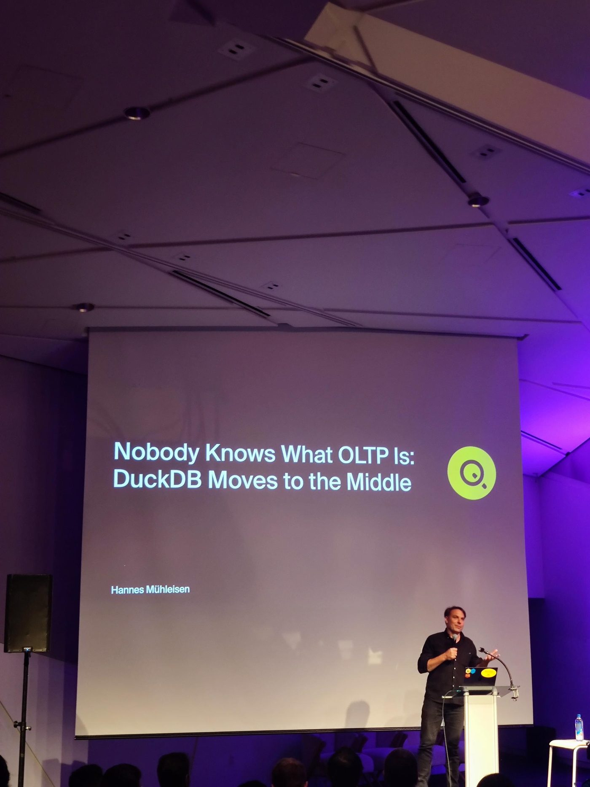
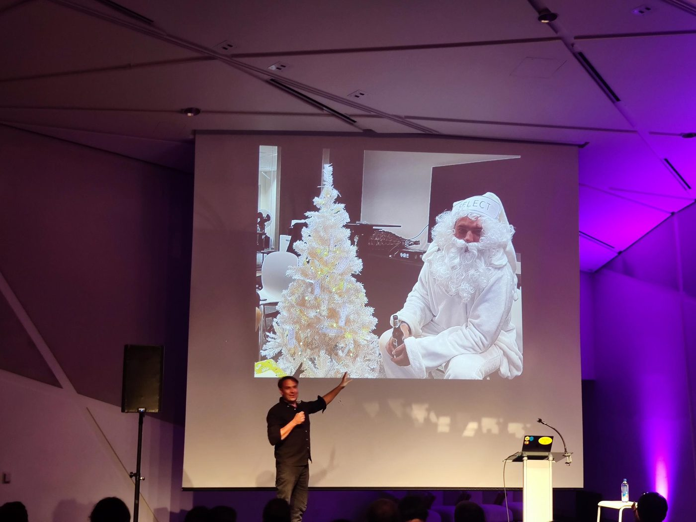
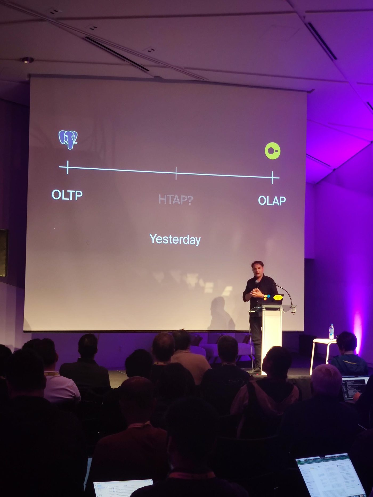
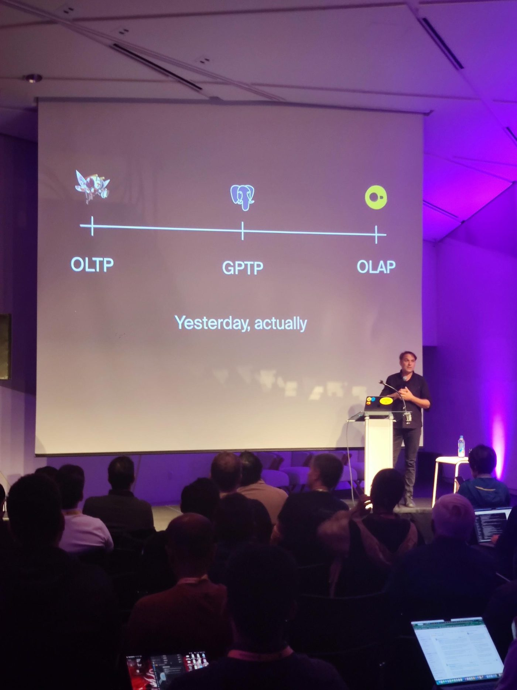
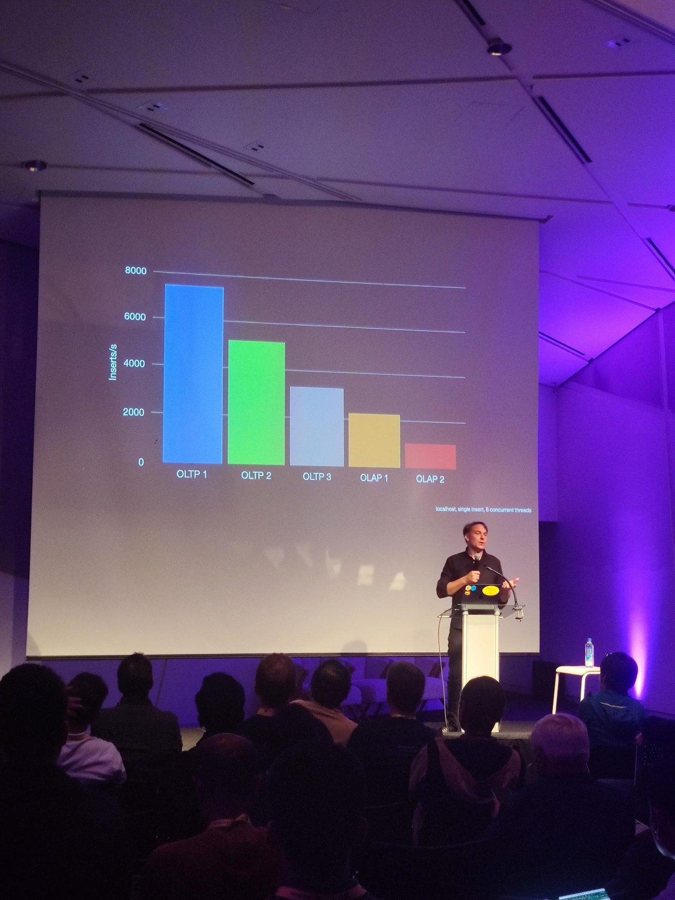
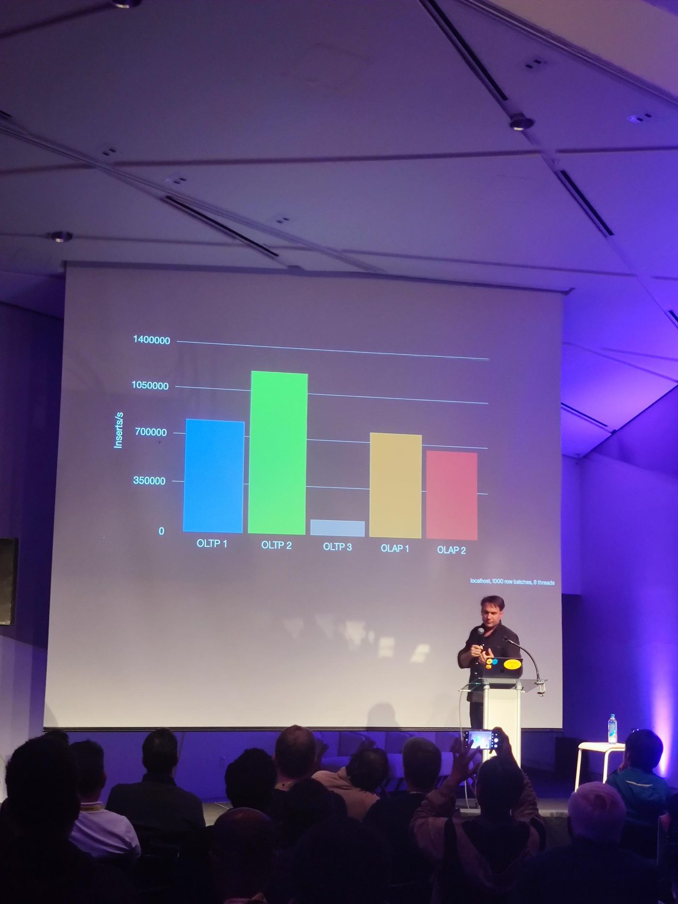
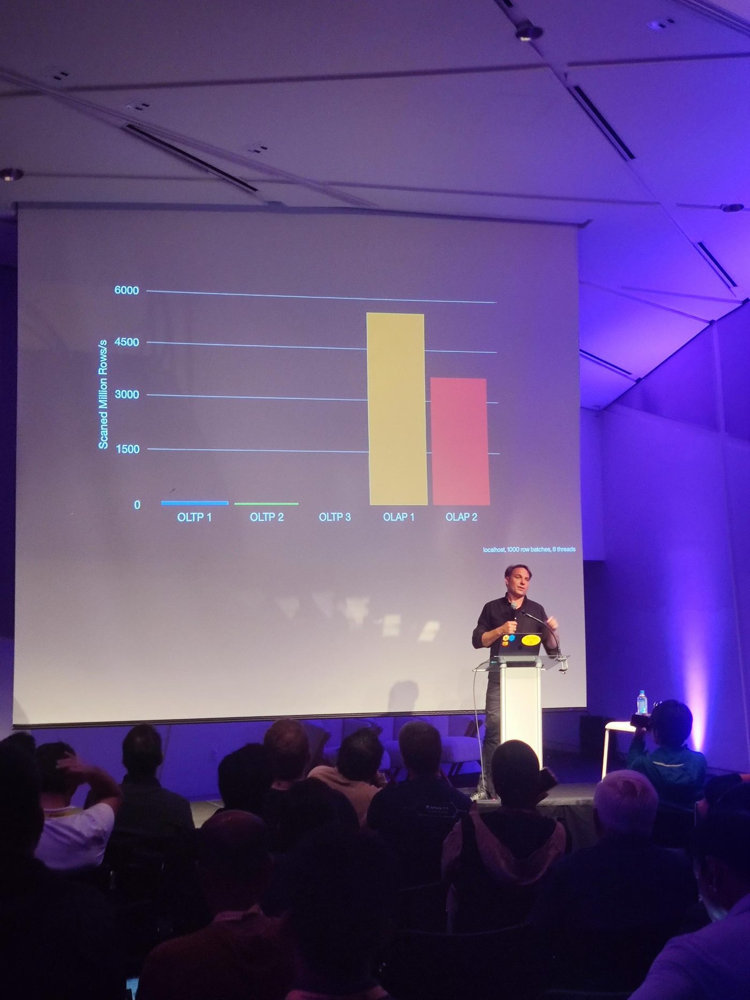
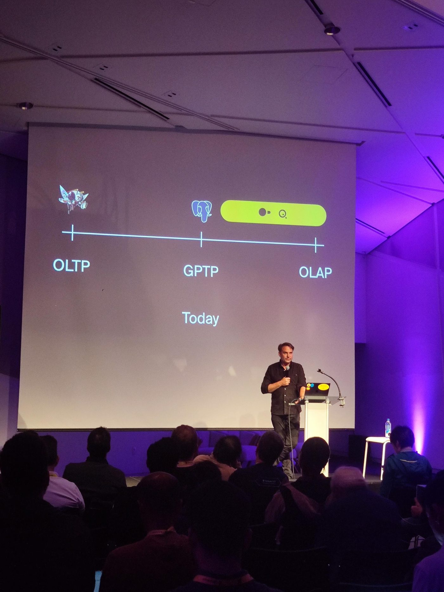
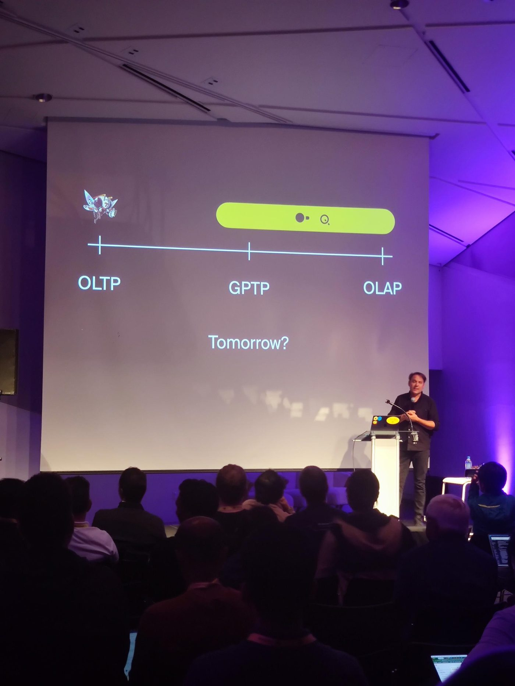
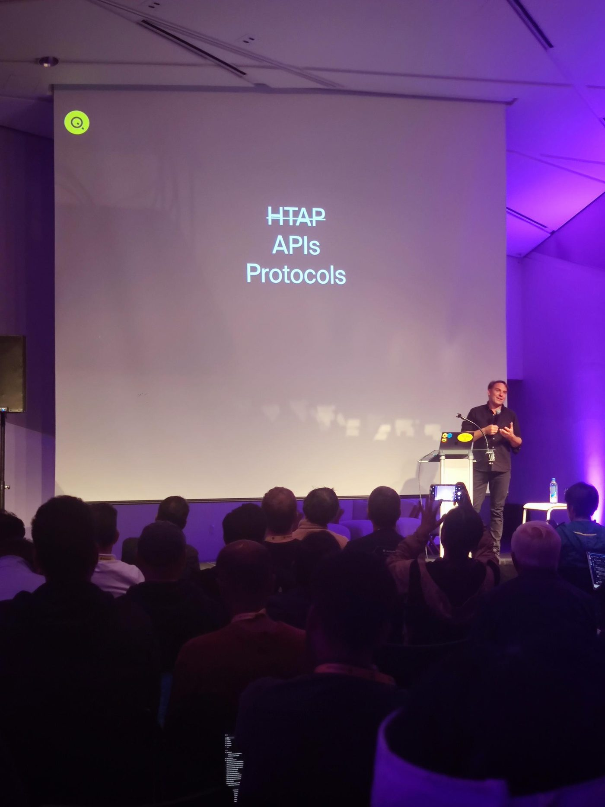

On the stage of the Rows & Columns Summit, the title of DuckDB founder Hannes Mühleisen's talk was deliberately provocative: **"Nobody Knows What OLTP Is: DuckDB Moves to the Middle."**

As one of the most successful database products of the past decade, DuckDB's greatest strength has never been any single peak performance metric, but ease of use and extensibility — for a long time, the biggest problem with databases was precisely that they were not user-friendly enough, whether for human users or for the growing number of agents to come.

Hannes Mühleisen opens with "Nobody Knows What OLTP Is"

## I. A Geek with a Passion for Databases

Hannes truly loves database technology. His earliest research was on CSV parsers — after all, that is the first step in getting data into a database.

The first car he owned had the license plate SQL 1337: SQL is the "mother tongue" of databases, and 1337 is "leet" in geek culture — the very "Leet" that LeetCode takes its name from.

Hannes's first car, with the license plate SQL 1337

One Christmas, his tree was hung with decorations of SQL syntax — SELECT, IN, VALUES, COLLATE, DISTINCT, PIVOT... A database built by someone who wove SQL into his daily life could hardly lack good taste, could it?

SQL keyword ornaments on the Christmas tree

## II. The Misunderstood "Yesterday": Postgres Is Not OLTP, and DuckDB Is More Than OLAP

In the past, the prevailing view in the industry when choosing a database was that Postgres represented OLTP and DuckDB represented OLAP — after all, DuckDB calls itself "SQLite for OLAP." The two ends of the database spectrum seemed sharply divided.

Yesterday: Postgres and DuckDB each at one end, with HTAP a question mark

But Hannes says that this view of the "past" does not hold up. The actual picture is that TigerBeetle sits at the OLTP end, while Postgres is really a **general-purpose transactional database (GPTP)**.

Yesterday, actually: extreme OLTP (TigerBeetle) — general-purpose Postgres — OLAP (DuckDB)

## III. DuckDB's Performance Data

As DuckDB established a firm foothold in OLAP, the need for transactional capability moved onto the agenda. Hannes presented three sets of experimental data:

Experiment one: single-row inserts with 8 threads of concurrency. **The three OLTP engines won decisively, while the OLAP engines' weakness in single-row write scenarios was fully exposed.**

Single-row inserts at 8-thread concurrency: the OLTP engines win decisively

Experiment two: the same scenario, but consolidating single-row inserts into batches of 1,000 writes. **A surprise** — the OLAP engines' write throughput was now more than a match for the OLTP engines, suggesting that DuckDB is well suited to this kind of ETL task.

Batches of 1,000 writes: OLAP engines' throughput pulls ahead

Experiment three: query performance in HTAP scenarios. **The tables turned** — the OLTP engines performed very poorly at queries during bulk writes, while the OLAP engines left everything else in the dust.

Analytical scans: a crushing defeat for the OLTP engines

To sum up these three experiments in one sentence: **DuckDB not only delivers excellent OLAP performance, it also has sufficiently good OLTP capability — and, more importantly, the ability to handle mixed HTAP workloads.**

In short, DuckDB now demonstrates considerable TP capability as well.

Today: DuckDB also has sufficiently good transactional capability

Tomorrow?: DuckDB's territory continues to expand

## IV. DuckDB's Ambition and the Industry's Next Question

DuckDB has big ambitions: it wants to one day take over the niche of the general-purpose transactional database that Postgres occupies. And Postgres's long-standing problem of more than twenty years — row-based storage only and limited multithreaded concurrency — imposes a clear performance ceiling in the agent era.

This is why plugins like Mooncake have emerged in the Postgres community to try to close these gaps (see the first article in this series: Andy Pavlo on the three "compromises" of 60 years of HTAP architectures).

And in the era of vibe coding, we have every reason to expect more and better database products — serving individuals, serving enterprises, and serving the broader agent landscape.

Hannes's closing pointed toward a still more distant future: **databases are not only about HTAP. For future agent applications, accessing data directly in the form of APIs or wire protocols is the broader frontier.**

Closing: HTAP, APIs, Protocols

## V. MatrixOrigin's Answer: One Engine + One Copy

This is the path MatrixOrigin has been on all along. From its initial design, the MatrixOne HTAP database likewise sought a balance between AP and TP performance, choosing a **one engine + one copy** architecture — on this point, we and DuckDB arrived at the same destination by different routes.

What is different is that MatrixOne is built for enterprise-grade scenarios, and lets real mixed-workload data do the talking:

**Measured: one cluster carrying TP and AP at the same time**

Test configuration: 100 warehouses, three CN nodes in a single cluster, with a topology of one TP node plus two AP nodes — the TP and AP pipelines running simultaneously, sharing the same copy of data.

On the TP side (TPC-C benchmark): **TPM ≈ 6,340**, with 190,206 NewOrder transactions completed, an abort rate of only about 1.0%, and zero anomalous SQL; Payment latency averaged 134 ms, with p95 at 218 ms. Notably, all of this was achieved while two AP nodes were running heavy queries in parallel — the TP pipeline was not overwhelmed.

| Metric | Measured Result |
| --- | --- |
| TPM (NewOrder) | ≈ 6,340 |
| NewOrder transactions completed | 190,206 |
| NewOrder abort rate | ≈ 1.0% |
| Anomalous SQL | 0 |
| Payment average / p95 latency | 134 ms / 218 ms |
| AP queries (22 concurrent) | All completed, average 14.1 s, p95 71.5 s |

Note: one TP node and two AP nodes running in parallel on the same cluster, sharing the same copy of data.

This is exactly the value of "one engine + one copy": remember that set of experiments in Hannes's talk? A dedicated OLTP engine scored close to zero on analytical queries (see experiment three in section three). On MatrixOne, **heavy analytical queries and transactional pipelines run side by side on the same cluster and the same data** — no need for two systems, two copies of the data, and a synchronization pipeline.

In addition, MatrixOne is friendlier to agents, natively supporting data-branching operations such as git4data, letting data be branched and version-managed just like code.

**One more thing**: built on the MatrixOne data foundation, MatrixOrigin's MatrixOne Intelligence platform fully supports agent workflows, helping enterprises with their AI transformation and productivity gains.

**It is time for HTAP systems to return to the One Engine era.**
