在 Rows & Columns Summit 的舞台上，DuckDB 创始人 Hannes Mühleisen 的演讲标题颇有些挑衅意味：**「Nobody Knows What OLTP Is: DuckDB Moves to the Middle（没人真的懂 OLTP：DuckDB 正在走向HTAP融合系统）」。**

作为近十年最成功的数据库产品之一，DuckDB 最大的优势从来不是某一项极限性能，而是易用性与扩展性——长期以来，数据库最大的问题恰恰是不够用户友好，无论对人类用户，还是对未来越来越多的 Agents。

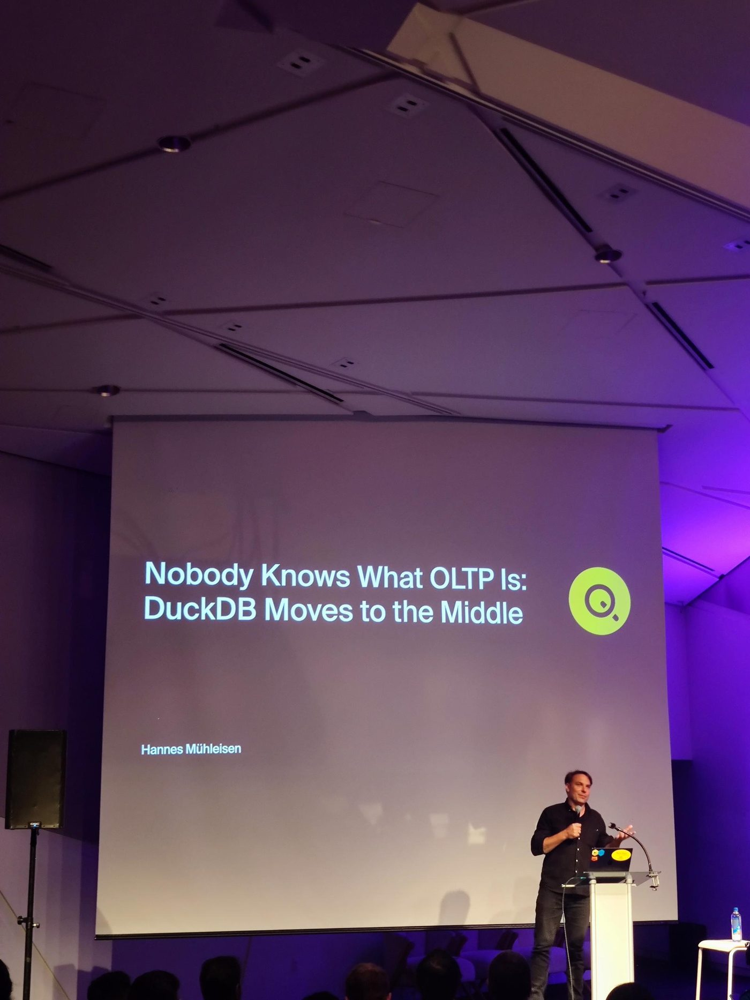

Hannes Mühleisen 开场：Nobody Knows What OLTP Is

## 一、具有数据库情怀的极客

Hannes 对数据库技术是真的热爱。他最初的研究方向是 CSV Parser——毕竟，这是数据导入数据库的第一步。

他拥有的第一辆车，车牌号是 SQL 1337：SQL 是数据库“母语”，1337 是极客圈的「leet」，LeetCode 的「Leet」正是由此而来。

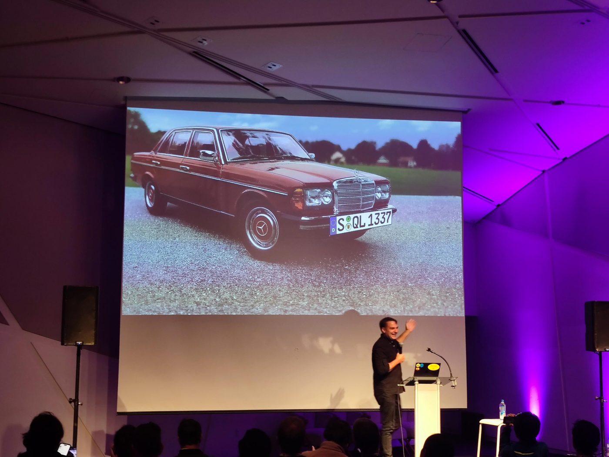

Hannes 的第一辆车：车牌号 SQL 1337

某年圣诞节，他的圣诞树上挂满了 SQL 语法的装饰——SELECT、IN、VALUES、COLLATE、DISTINCT、PIVOT……一个把 SQL 融入生活的人做出的数据库，能不有品味吗？

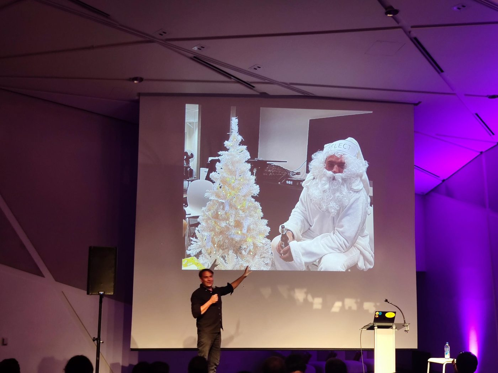

圣诞树上的 SQL 关键字装饰

## 二、被误解的「过去」：Postgres 不是 OLTP，DuckDB 也不只是 OLAP

过去选型时，行业普遍的认知是：Postgres 是 OLTP 的代表，而DuckDB 是 OLAP 的代表——毕竟 DuckDB 自称「SQLite for OLAP」。数据库光谱的两端，泾渭分明。

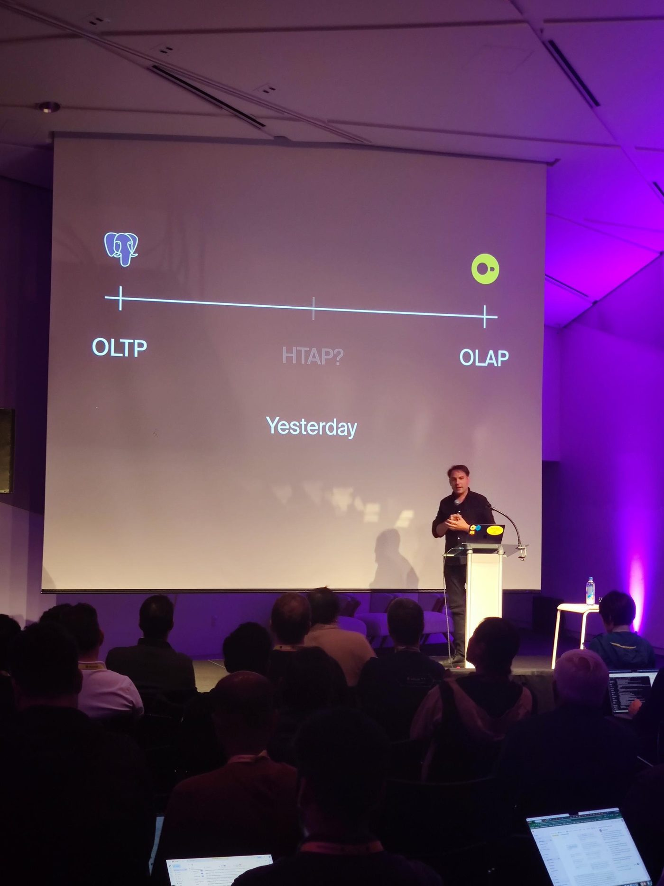

Yesterday：Postgres 与 DuckDB 各据一端，HTAP 是个问号

但 Hannes 说，这个「过去」的认知就不成立。实际的视角是，TigerBeetle 站在 OLTP 一端，而 Postgres 其实是一个**通用事务型数据库（GPTP）**。

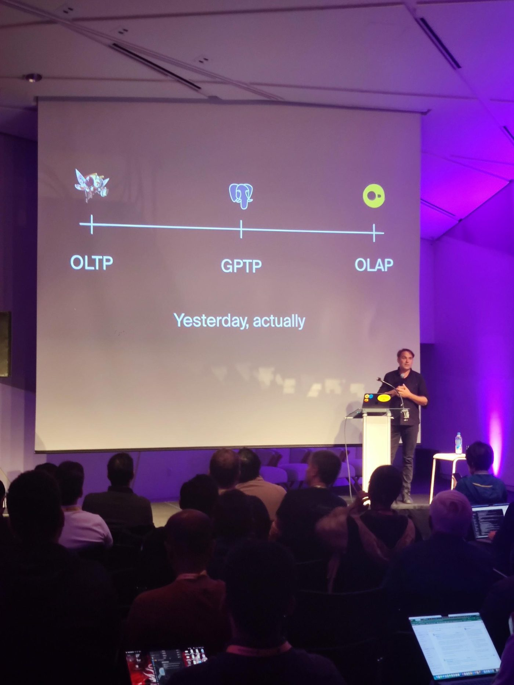

Yesterday, actually：极端 OLTP（TigerBeetle）— 通用型 Postgres — OLAP（DuckDB）

## 三、DuckDB的性能数据

随着 DuckDB 在 OLAP 领域站稳脚跟，事务能力的需求也提上了日程。Hannes 展示了三组实验数据：

实验一：单条插入、8 线程并发。**三个 OLTP 引擎完胜，而** OLAP 引擎在单条写入场景下的短板暴露无遗。

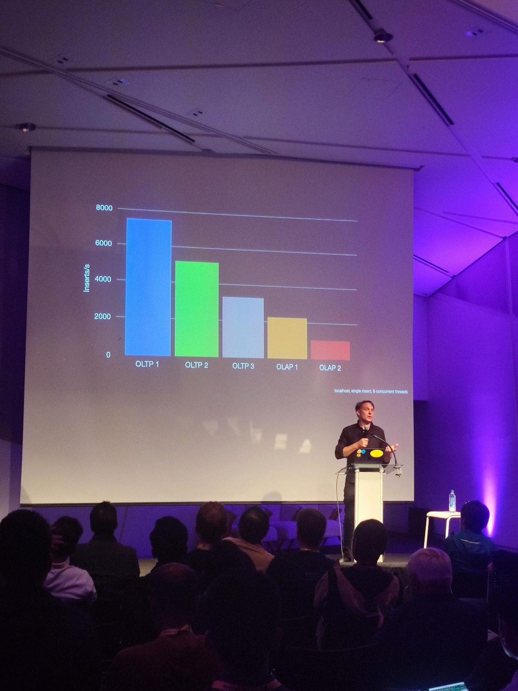

单条插入 8 线程并发：OLTP 引擎完胜

实验二：同样场景，把单条插入合并成 1,000 条批量写入。**意外来了**——OLAP 引擎的写入吞吐量反而足以媲美 OLTP 引擎。说明，DuckDB 适合这类ETL任务。

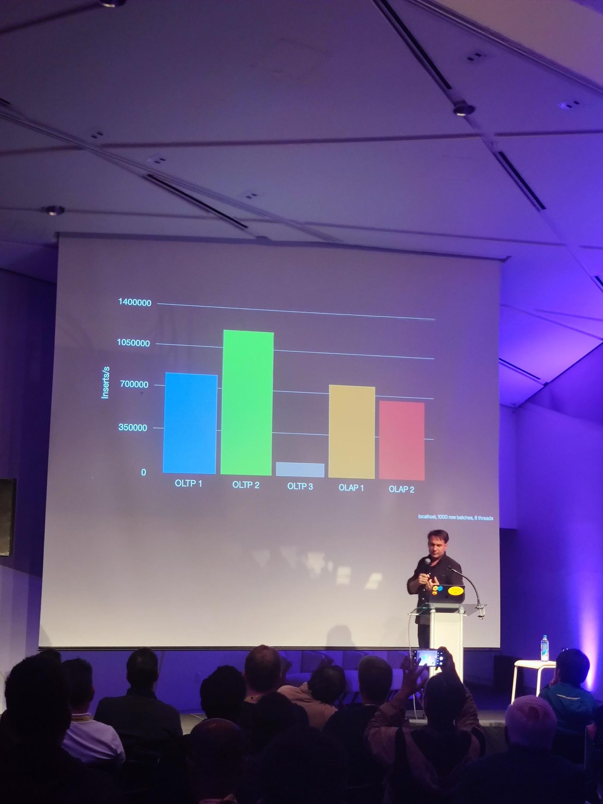

1,000 条批量写入：OLAP 引擎的吞吐量反超

实验三：HTAP场景下的查询性能。**风水轮流转**，OLTP 引擎在批量写入时的查询能力非常差，而 OLAP 引擎一骑绝尘。

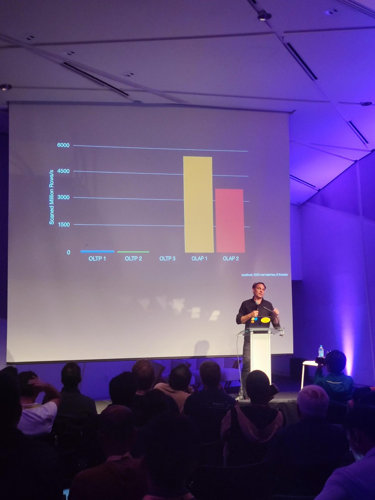

分析型扫描：OLTP 引擎完败

一句话总结这三组实验：**DuckDB 不仅拥有出色的 OLAP 性能，还具有足够好的 OLTP 能力。更重要的是，HTAP混合负载的能力。**

总之，DuckDB 如今也体现了相当的TP能力。

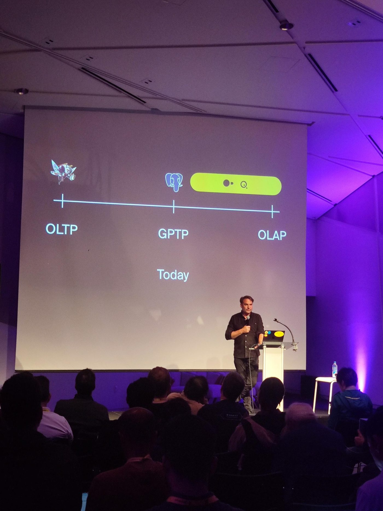

Today：DuckDB 也具有足够好的事务能力

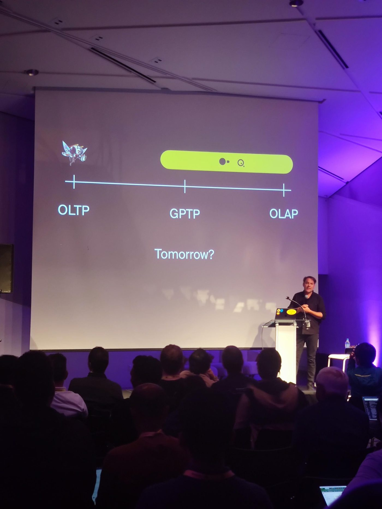

Tomorrow?：DuckDB 的版图还在继续扩张

## 四、DuckDB 之野望，与行业的下一个命题

DuckDB 的野心不小，未来想取代 Postgres 通用事务型数据库的生态位。而 Postgres 二十多年的老问题——只有行式存储、有限的多线程并发能力——在 Agent 时代，有明显的性能天花板。

这也是为什么Postgres 社区里会涌现出 Mooncake 这类插件试图弥补这些缺陷（参见本系列第一篇：Andy Pavlo 谈 60 年 HTAP 架构的三种「将就」方案）。

而在 vibe coding 时代，我们有理由期待更多更好的数据库产品诞生——服务个人、服务企业，也服务更广阔的 Agent 场景。

Hannes 的收尾指向了更远的未来：**数据库不只关于 HTAP。面向未来的 Agent 应用场景，以 API 或 wire protocol 的形式直接访问数据，才是更广阔的星辰大海。**

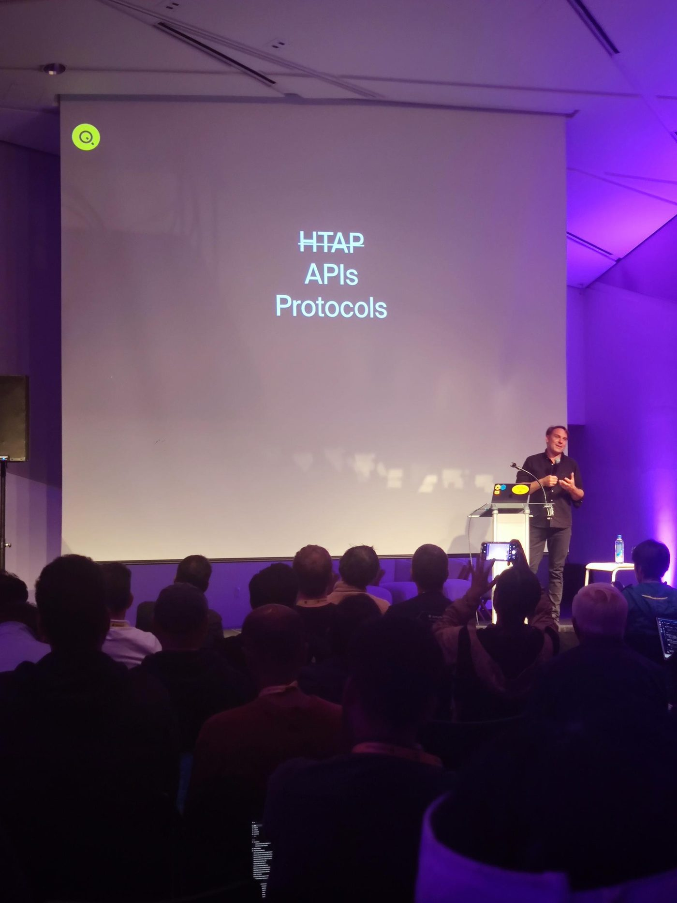

收尾：HTAP、APIs、Protocols

## 五、矩阵起源的答案：One Engine + One Copy

这也是矩阵起源一直在走的路。MatrixOne HTAP 数据库设计之初，同样在寻求 AP 与 TP 性能的平衡，选择了 **one engine + one copy** 架构——这一点上，我们与 DuckDB 殊途同归。

不同的是，MatrixOne 面向企业级场景，并且用真实混合负载数据说话：

**实测：一个集群，同时扛住 TP 与 AP**

测试配置：100 Warehouse，单集群 3 个 CN 节点，拓扑为 1 个 TP 节点 + 2 个 AP 节点——TP 与 AP 流水线同时在跑，共享同一份数据。

TP 侧（TPC-C 基准）：**TPM ≈ 6,340**，NewOrder 事务完成 190,206 笔、中断率仅约 1.0%、异常 SQL 为 0；Payment 平均延迟 134ms、p95 218ms。值得注意的是，这一切是在 2 个 AP 节点并行跑重查询的同时取得的——TP 流水线没有被打垮。

| 指标 | 实测结果 |
| --- | --- |
| TPM（NewOrder） | ≈ 6,340 |
| NewOrder 完成数 | 190,206 笔 |
| NewOrder 中断率 | ≈ 1.0% |
| 异常 SQL | 0 |
| Payment 平均 / p95 延迟 | 134 ms / 218 ms |
| AP 查询（22 条并发） | 全部完成，平均 14.1 s，p95 71.5 s |

注：同一集群上 1 个 TP 节点与 2 个 AP 节点并行运行，共享同一份数据。

这正是「one engine + one copy」的含金量：还记得 Hannes 演讲里那组实验吗？专用 OLTP 引擎跑分析查询近乎归零（见第三节的实验三）。而在 MatrixOne 上，**重型分析查询和事务流水线在同集群、同数据上并行不悖**——不需要两套系统、两份数据、一条同步链路。

此外，MatrixOne 对 Agents 更加友好，原生支持 git4data 等数据分支操作，让数据像代码一样可分支、可版本管理。

**One more thing**：依托 MatrixOne 数据底座，矩阵起源的 MatrixOne Intelligence 平台全面支持 Agent 工作流，为企业 AI 转型与生产力提升提供助力。

**HTAP系统，是时候回到 One Engine 时代了。**
