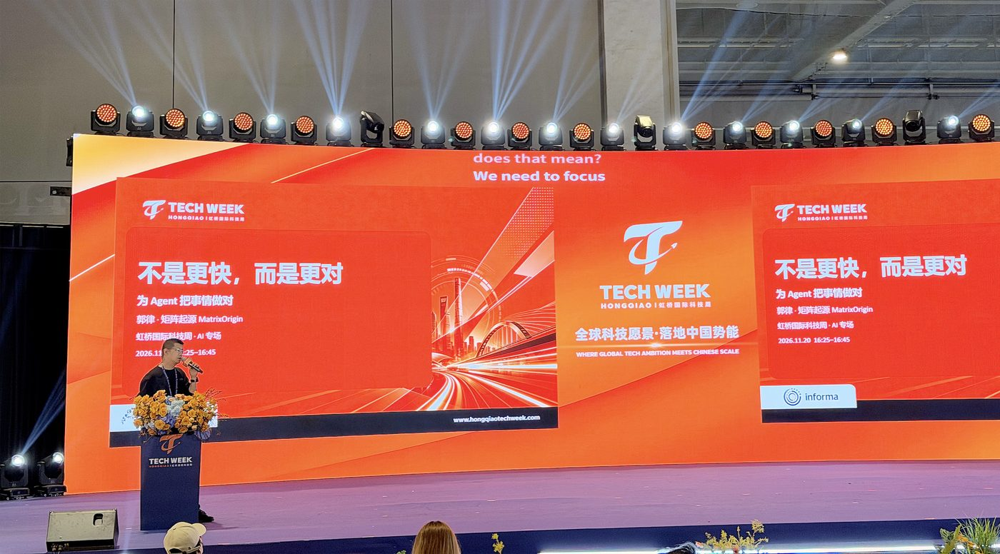
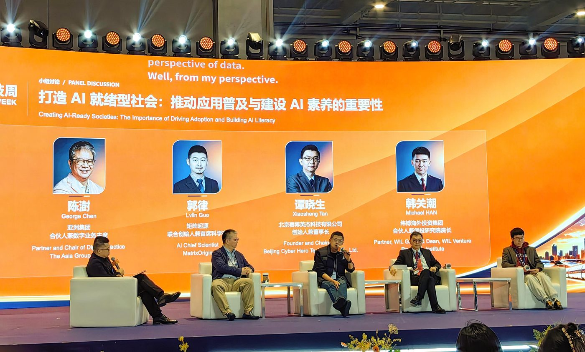

Shanghai, November 20, 2026 — At the opening day of the 2026 Hongqiao International Tech Week, Lvlin Guo, AI Chief Scientist at MatrixOrigin, delivered a keynote on the AI Stage at the National Exhibition and Convention Center (Shanghai) titled "Not Faster, But More Correct: A Paradigm Shift in Data Infrastructure for the AI Native Era." He argued that in the AI Native era, the problem data infrastructure must solve is not merely being faster, but being more correct — doing things right for agents. The same day, Guo also joined a panel discussion titled "Building an AI-Ready Society: Driving Application Adoption and AI Literacy."

Lvlin Guo delivering a keynote on the AI Stage at Hongqiao International Tech Week

Guo pointed out that databases and data platforms were built on the assumption that their users were human. Today, infrastructure faces software that makes decisions continuously. Agents read databases, call tools, and make decisions on a person's behalf — and the cost of an error is no longer a report that needs fixing, but a chain of wrong decisions that compounds. That is why we should ask "more correct" first, not just "faster."

He summarized the challenges standing in the way of agent adoption as five hurdles: hallucination and traceability, context governance, tool orchestration, compliance and auditing, and cost and stability. These hurdles stem from an old assumption — that infrastructure was designed for humans. When people use a system, they can ask again or rephrase; when agents run continuously, all the problems surface at once. "The five hurdles come before the product," Guo said. "You have to see the failure modes clearly before you can talk about doing things right."

In his view, "more correct" does not mean swapping in a bigger model or piling on more compute. It means making results traceable, memory governable, and multi-step chains stable. He proposed a layered approach — writable, queryable, memorable, stable, and collaborative — to turn "correctness" into an engineering default. "This isn't five band-aids applied separately."

Citing the complex specifications of semiconductors as an example, he noted that the reason people dare not use a system is often not the absence of question-and-answer, but that the answers cannot be tied to versions and sources — so engineers dare not treat them as evidence. The key is not "one question, one answer," but turning parsing, retrieval, and drafting into an auditable chain of work, signed off by a human at the end. In a benchmark on a difficult set of 50 documents, MatrixOrigin's parsing stack scored 84.5% with equal weight per dimension, versus roughly 57%–59% for the comparison, and led on 42 of the documents.

Speaking about how to measure "more correct," he used an internal comparison of an in-house pipeline (W1) to show that under workloads where agents write continuously and then look back, correctness and replayability do not have to be traded away for stability.

Guo closed with three judgments: the current bottleneck lies in "correctness," not in piling up compute; we should first identify the components that solve the problem before talking about stacking models; and correctness must become part of the infrastructure as a default capability — not a one-off impressive demo.

Panel discussion on "Building an AI-Ready Society: Driving Application Adoption and AI Literacy"

In the panel discussion the same day, Guo exchanged views with host and Omdia Chief Analyst Lian Jye Su, along with George Chen, Partner and Chair at The Asia Group, Xiaosheng Tan, Founder and CEO of Beijing Cyber Hero, and Michael HAN, Partner at Bessemer Venture Partners, on AI application adoption and literacy building. He noted that adoption is not just about providing a chat entry point — AI must be able to use business data, plug into workflows, and have its results verified. What enterprises need to build is the infrastructure between the model and the task. AI literacy, too, should no longer be equated with knowing how to write prompts; it means mastering three abilities: stating goals and constraints clearly, judging whether an answer has a basis, and knowing which operations must be confirmed by a person. "AI literacy shouldn't just teach people how to ask questions — it should teach them how to verify, authorize, and take responsibility." Trust, in turn, needs concrete mechanisms: scoped permissions, retained execution records, human confirmation at critical steps, and undo and recovery when things go wrong.
