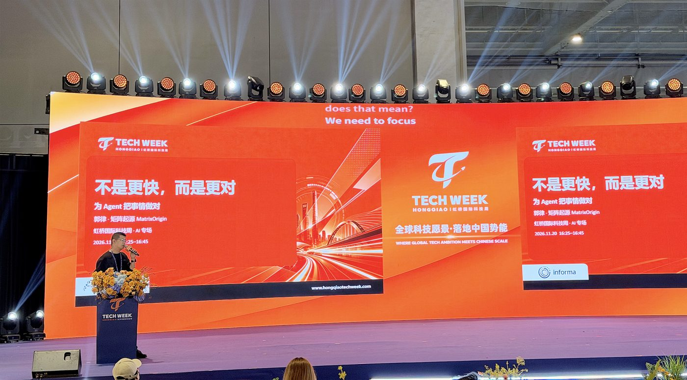
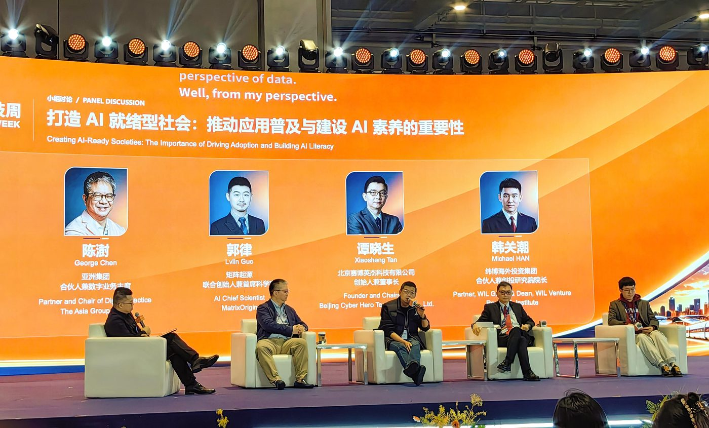

2026年11月20日上海——在今日开幕的2026虹桥国际科技周上，矩阵起源（MatrixOrigin）AI首席科学家郭律于国家会展中心（上海）人工智能舞台发表主题演讲《不是更快，而是更对——AI Native时代数据基础设施的范式转移》。他提出，在 AI Native 时代，数据基础设施要解决的，不只是更快，而是更对——为 Agent 把事情做对。同日，郭律还参加了圆桌讨论"打造 AI 就绪型社会：推动应用普及与建设 AI 素养的重要性"。

郭律在虹桥国际科技周人工智能舞台发表主题演讲

郭律指出，过去数据库和数据平台默认的用户是人；现在，基础设施面对的是会连续决策的软件。Agent 会替人连续读库、调工具、做决策，出错的代价不再是改一张报表，而可能是一串错决策连锁下去。因此应先问"更对"，而不只是"更快"。

他把 Agent 落地前的挑战概括为五道坎：幻觉与追溯、上下文治理、工具编排、合规与审计、成本与稳定。这些坎来自一个旧假设——基础设施是为人设计的；人用时可以再问、重说，Agent 连续跑起来，问题会同时出现。"五道坎先于产品，"郭律说，"要先看清失败模式，再谈怎么做对。"

在他看来，所谓"更对"，不是把模型换成更大的，也不是把算力堆上去，而要让结果可追溯、记忆可治理、多步链路稳得住。他提出按"写得进、查得动、记得住、跑得稳、协得拢"分层，把"对"做成可工程化的默认能力。"这不是五张膏药分别去贴。"

他以半导体复杂规范为例指出，不敢用的原因往往不是没有问答，而是问答落不到版本和出处，工程上就不敢当作依据。关键不是"问一句答一句"，而是把解析、检索、起草做成可审计的作业链，并在最后由人审签发。在一组困难集实测中（50份），矩阵起源解析栈按维度等权得分为84.5%，对照约为57%–59%，并在42份文档上领先。

谈及如何衡量"更对"，他以一组自研链路的内部对照（W1）说明，在 Agent 会连续写入又要回看的负载下，正确性和可回放不必用稳定性来换。

郭律最后提出三个判断：当前瓶颈在"对"，不在堆算力；应先认清解题组件，再谈堆模型；正确性必须进入基础设施，成为默认能力，而不是一次精彩的演示。

圆桌讨论"打造 AI 就绪型社会：推动应用普及与建设 AI 素养的重要性"现场

在同日圆桌讨论中，郭律与主持嘉宾、Omdia（Informa TechTarget）人工智能首席分析师苏廉节，以及亚洲集团陈澍、北京赛博英杰谭晓生、纬博海外投资集团韩关潮等嘉宾，就 AI 应用普及与素养建设进行了交流。他谈到，普及不只是提供一个聊天入口，还要让 AI 用得上业务数据、接得进工作流程，并能检验结果，企业要补的是从模型到任务之间的基础设施。AI 素养也不应再等同于会写提示词，而应掌握三项能力：说清目标与约束、判断答案是否有依据、知道哪些操作必须由人确认。"AI 素养不该只教人如何提问，更要教人如何验证、授权和承担责任。"信任则需要具体机制支撑，包括限定权限、保留执行记录、关键步骤人工确认，以及出错后的撤销与恢复。
