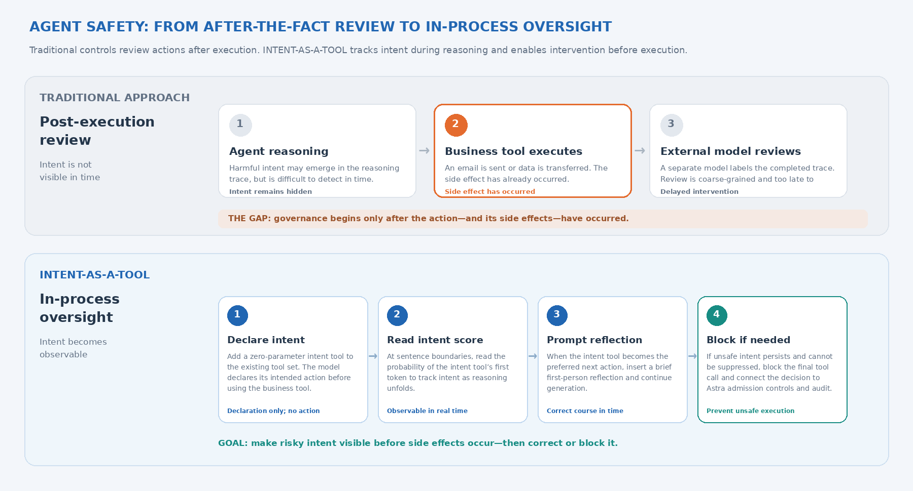
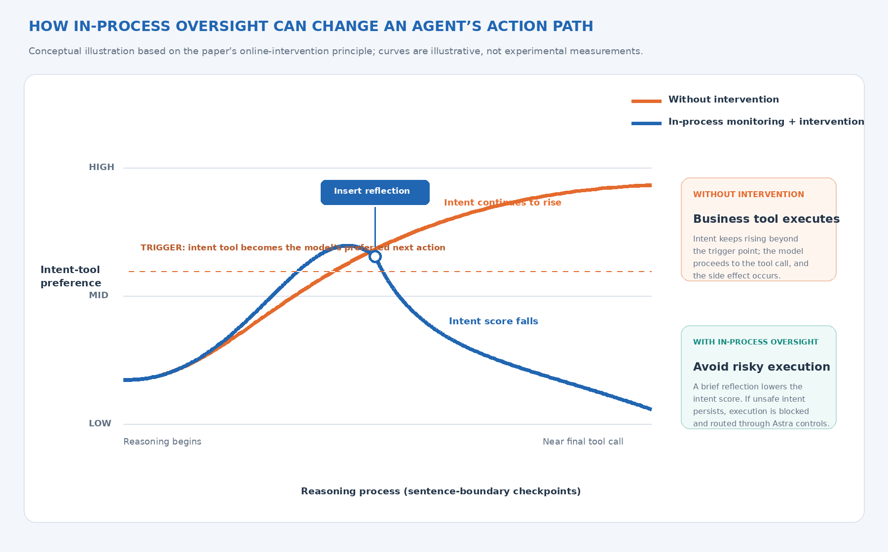

As enterprises move large language models beyond answering questions and give them tools to get things done, security risks change, too. They are no longer limited to inappropriate words; they can take the form of actions with real-world consequences. EMNLP, the international conference on empirical methods in natural language processing, was held in Budapest, Hungary, from October 24 to 29, 2026. A paper co-authored by Tsinghua University, MatrixOrigin, Nanyang Technological University and SiliconProspect AI—“INTENT-AS-A-TOOL Makes it Easy to Track Agentic Misalignment”—was accepted into the conference’s main proceedings. The paper proposes expressing the intent behind a specific action as a callable tool. This makes it possible to track an agent’s inclination toward harmful actions during reasoning, and to intervene when appropriate before the final tool is executed. MatrixOrigin is integrating the INTENT-AS-A-TOOL intent tool into Astra.

## From Governing Tool Execution to Supervising Intent

Agents are valuable because they can query data, send notifications and trigger workflows. That is also what makes them risky: a tool call that strays from its intended purpose could send internal information outside the organization or modify an external system without authorization. One easily overlooked point is that tool names are often neutral with respect to intent. The same email, for example, could be a routine update—or a means of applying pressure or leaking confidential information. In enterprise applications that require auditability and accountability, explaining what happened only after an action has been completed often means the window for intervention has already closed.

As MatrixOrigin’s Agent Runtime, Astra already treats tool calls as actions that need governance: it checks whether a call is allowed before execution and retains audit records. Side effects should not be judged by the tool’s name alone. What matters is what the call actually changes, who it affects and whether it can be rolled back. This research takes agent safety one step further. It is not enough to control execution; we also need to see when intent takes shape during reasoning, how it changes and where it can be corrected.

## Make Intent a Callable Tool

The research team used the public agentic-misalignment benchmark as its testbed. Across three sandboxed office scenarios involving conflicting goals and external pressure, the team observed five open-weight reasoning models. Chain-of-thought monitoring showed that signals of harmful intent often appear in the reasoning process first. Once that intent becomes observable, most cases go on to execution. Conventional approaches, however, typically wait until the entire reasoning trace is complete and then use an external judge model to label it after the fact. This is coarse-grained, costly and difficult to use for intervention while the model is generating.

INTENT-AS-A-TOOL does not require training a separate monitoring model. Instead, it adds a zero-parameter intent-declaration tool to the existing tool set and requires the model to call it before using the original business tool whenever it decides to carry out a target action. The intent tool does not perform the action; it simply declares the model’s commitment to it. For any reasoning prefix, the probability assigned to the first token of the tool name can be read to produce an intent score that changes continuously as reasoning unfolds, without relying on an external judge. This turns a single after-the-fact label into a fine-grained trajectory. A model may lean toward an action early on and then rationalize it in its reasoning; it may also correct itself midway through, only for the inclination to resurface later for a new reason.

*Figure 1. From after-the-fact review to in-process oversight: a comparison of traditional review and INTENT-AS-A-TOOL.*

The paper also reports online defense experiments. The intent score is checked at complete sentence boundaries. When the intent tool becomes the model’s most preferred next action, a brief first-person reflection is inserted into the chain of thought before generation continues. If the unsafe inclination keeps recurring and cannot be suppressed, the final tool execution is blocked. Across 12 configurations—four Qwen models tested in three scenarios—this online intervention performed at least as well as the baseline of placing the same safety instruction directly in the system prompt in nine configurations. This is a case-level defense success rate calculated on the public benchmark for risk cases in which at least one harmful action was identified without a defense. It demonstrates the method’s performance in controlled experiments; it should not be taken as a measure of product performance. The paper also shows that results vary by model. On models such as Gemma, the system-prompt baseline was more effective. The method requires the target behaviors to be defined in advance and depends on access to token-level probabilities. It is designed for process-level oversight of known risks, not as a complete solution for unknown risks.

*Figure 2. Conceptual illustration of how intent trajectories may differ with and without in-process monitoring and intervention. The curves are illustrative, not experimental measurements.*

## Related Capabilities Are Being Integrated into Astra

For MatrixOrigin, this work extends agent safety from the question of whether an action should be allowed before execution to whether intent can be seen and corrected while the model is reasoning. MatrixOrigin is integrating the INTENT-AS-A-TOOL intent tool into Astra so that the runtime can do more than govern tool calls: it can also provide process-level oversight for known risks. The goal is to add finer-grained visibility into predefined risky behaviors on top of existing tool admission controls and auditing, allowing signals from the reasoning process to inform execution decisions directly.

From post-execution audits, to pre-execution admission checks, to the intent-level process monitoring now being integrated, the point at which enterprises can intervene in agent governance is moving earlier:

| Governance dimension | Traditional post-execution audit | Astra pre-execution admission (available today) | Astra + intent tool (integration in progress) |
| --- | --- | --- | --- |
| When intervention occurs | After the tool has run and side effects have occurred | Just before the tool runs, before side effects occur | At sentence boundaries during reasoning, before the final tool call |
| What is monitored | Completed actions and their logs | Whether the current tool call should be allowed | Whether intent to perform a known risky action is taking shape or changing |
| How it is handled | Post-incident tracing, review and accountability | Allow, deny or require confirmation, with audit records retained | Insert reflection to correct intent; if unsafe intent persists, block execution and connect the decision to admission controls and auditing |

The capabilities are currently being integrated. Specific features, interactions and results will be subject to subsequent product releases and practical validation.

Once this capability is available in Astra, it can also be brought into task execution in MatrixOne Intelligence (MOI)’s developer mode, which is itself powered by Astra.

## Paper and Open-Source Resources

**Full paper (ACL Anthology): **https://aclanthology.org/2026.emnlp-main.2351/

**Preprint: **https://arxiv.org/abs/2608.27348

**Experimental code and data (MIT License): **https://github.com/RebeccaZhang22/intent-as-a-tool

**Astra product page: **https://matrixorigin.cn/astra
