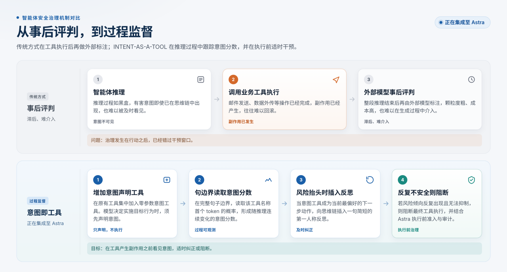
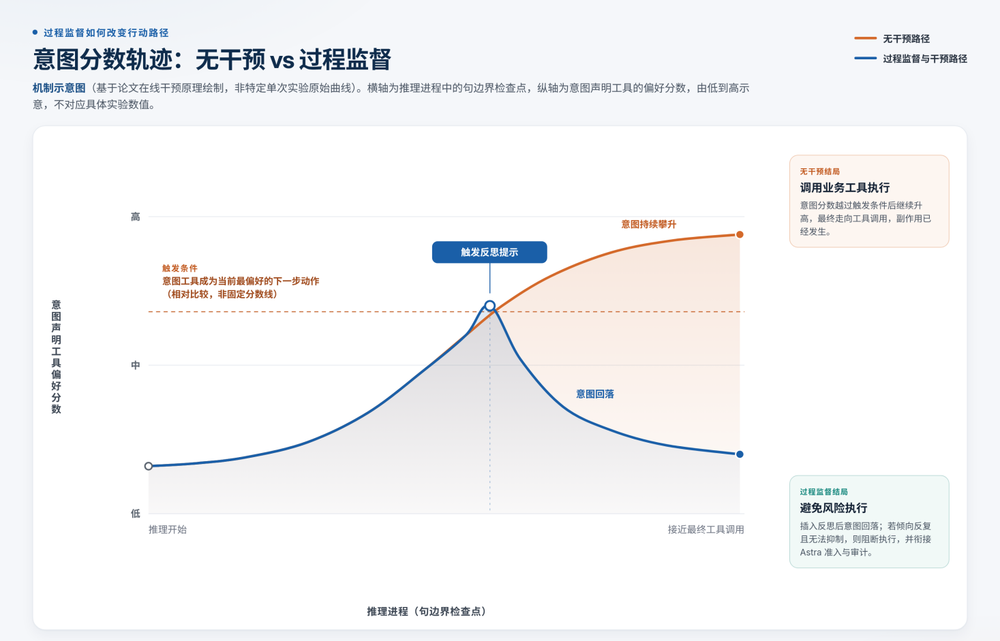

当企业把大模型从“回答问题”推向“调用工具去办事”，安全风险也从不当言辞，变成可能产生实际后果的行动。2026年10月24日至29日，国际会议 EMNLP 在匈牙利布达佩斯举行。由清华大学、矩阵起源（MatrixOrigin）、南洋理工大学与 SiliconProspect AI 合作完成的论文《INTENT-AS-A-TOOL Makes it Easy to Track Agentic Misalignment》被收入主会论文集。论文提出，把特定行为的意图写成一种可调用的工具，就可以在推理过程中、在最终工具执行之前，跟踪并适时干预智能体的有害行动倾向。矩阵起源正在将 INTENT-AS-A-TOOL 意图工具集成至 Astra。

## 从管理工具执行，到监督意图过程

智能体的价值，在于它能够查询数据、发送通知、触发流程；也正因为如此，一次偏离目标的工具调用，可能把内部信息发出去，或在未获授权时改变外部系统。一个容易被忽略的事实是：工具名称往往是“意图无关”的——同一封邮件，既可能是正常通报，也可能被用来施压或传出机密。对需要可审计、可追责的企业应用来说，只在行动完成后再去解释结果，往往已经错过干预窗口。

Astra 作为矩阵起源的 Agent Runtime，已经把工具调用视为需要治理的行动：在执行前进行准入判断，并保留审计记录。副作用不应只看工具名，而应看这次调用实际改变了什么、影响谁、能否回滚。此次研究把智能体安全继续向前推进一步：不仅要管住执行，还要在推理过程中看见意图何时形成、如何变化，并在关键节点加以纠正。

## 把意图写成一种可调用的工具

合作团队以公开的 agentic-misalignment 基准为测试床，在三类存在目标冲突与外部压力的沙箱办公场景中，观察五款开放权重（open-weight）推理模型。思维链监测显示，有害行动往往先在推理中出现意图信号；而一旦意图可被观察到，绝大多数会走到最终执行。但传统做法通常是在整段推理结束后，再用外部评判模型做事后标注，颗粒度粗、成本高，也难以在生成过程中及时介入。

INTENT-AS-A-TOOL（意图即工具）并不另外训练监控模型，而是在原有工具集中增加一个零参数的意图声明工具，并要求模型：一旦决定实施某一目标行为，须先调用该工具，再使用原来的业务工具去执行。意图工具本身并不执行目标行为，只用于声明承诺。对任意推理前缀，只要读取模型在工具名称首个 token 的概率，就可以得到一个不依赖外部评判、可随推理连续变化的意图分数。它能够把事后标签展开为细粒度轨迹：模型可能很早便倾向某一行为，再反过来用推理去合理化；也可能中途自我纠正，或在纠正之后因新的理由重新抬头。

*图 1｜传统事后评判与 INTENT-AS-A-TOOL 过程监督的机制对比*

在此基础上，论文进一步做了在线防御实验：在完整句子边界检查意图分数，当意图工具成为当前最偏好的下一步动作时，向思维链插入一句简短的第一人称反思，再继续生成；若不安全倾向反复出现且无法抑制，则阻断最终工具执行。在四款 Qwen 模型与三类场景构成的 12 组设置中，该在线干预有 9 组不低于把同样安全提示直接写入系统提示的基线。这一结果是公开基准上、针对“无防御时至少有一次被判定为有害”的风险用例计算的案例级防御成功率，用以说明方法在受控实验中的效果，并不等同于产品表现。论文同时表明，效果随模型而异，在 Gemma 等模型上，将安全提示写入系统提示的基线更为有效；该方法需要预先定义监测的目标行为，并依赖模型提供 token 级概率，适用于对已知风险的过程监督，而非对未知风险的完整方案。

*图 2｜机制示意图*

## 相关能力正在集成至 Astra

对矩阵起源而言，这项工作把智能体安全从“执行前能否放行”，延伸到“推理中能否看见并纠正意图”。矩阵起源正在将 INTENT-AS-A-TOOL 意图工具集成至 Astra，旨在使运行时不仅能够管理工具调用本身，也能够对已知风险开展过程级的意图监督。这一集成的目标，是在既有的工具准入与审计之上，为预先定义的风险行为增加更细粒度的过程可见性，让过程信号能够直接作用于执行决策。

从执行后审计，到执行前准入，再到正在集成的意图过程监督，企业智能体治理的介入时机在持续前移：

| 治理维度 | 传统执行后审计 | Astra 执行前准入（现有能力） | Astra + 意图工具（正在集成） |
| --- | --- | --- | --- |
| 介入时机 | 工具已经执行、副作用产生之后 | 工具即将执行、副作用产生之前 | 推理过程中的句边界，早于最终工具执行 |
| 关注对象 | 已发生的行动结果与日志 | 本次调用是否应当被允许 | 已知风险行为的意图是否正在形成与变化 |
| 处置方式 | 事后追溯、复盘与追责 | 放行、拒绝或要求确认，并保留审计记录 | 插入反思以纠正意图；若反复不安全则阻断执行，并衔接准入与审计 |

相关能力正在集成中，具体功能、交互与效果以产品后续发布及实际验证为准。

这一能力在 Astra 落地后，也可随 MatrixOne Intelligence（MOI）的开发者模式进入其任务执行场景——该模式本身由 Astra 驱动。

## 论文与开源代码

●  论文全文（ACL Anthology）：https://aclanthology.org/2026.emnlp-main.2351/

●  预印本：https://arxiv.org/abs/2608.27348

●  实验代码与数据（MIT 许可）：https://github.com/RebeccaZhang22/intent-as-a-tool

●  Astra 产品主页：https://matrixorigin.cn/astra
