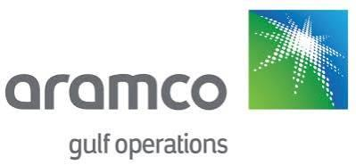
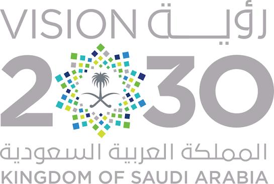

MatrixOrigin has officially signed Aramco Gulf Operations Company (AGOC), a subsidiary of Saudi Aramco. Built on MatrixOne Intelligence (MOI), its one-stop Data + AI platform, the partnership will focus on oil & gas data analytics, intelligent recruiting, and smart operations, accelerating the expansion of enterprise Data+AI solutions across the Middle East.

*Figure 1. Aramco Gulf Operations Company (AGOC)*

MatrixOrigin has officially signed Aramco Gulf Operations Company (“AGOC”), a subsidiary of Saudi Aramco. Leveraging MatrixOrigin’s one-stop Data + AI platform, MatrixOne Intelligence (“MOI”), the two parties will collaborate across oil & gas data analytics, intelligent recruiting, smart operations and other areas, jointly exploring the large-scale adoption of AI in core business scenarios of large energy enterprises.

This signing marks a significant step in MatrixOrigin’s expansion into the Middle East market. Through this partnership with an international energy major such as Saudi Aramco, MatrixOrigin will further bring MOI’s multimodal data processing, knowledge engineering, model serving, Agent runtime and intelligent workflow capabilities into real business processes, helping customers turn complex, fragmented enterprise data into secure, controllable and sustainable intelligent productivity.

## Signing with a Major Energy Enterprise, Entering the Middle East Enterprise AI Market

AGOC is a wholly owned subsidiary of Saudi Aramco, operating oil and gas assets in the Partitioned Neutral Zone between Saudi Arabia and Kuwait. Its business involves large cross-border energy assets, complex offshore oil and gas operations and multi-organization collaboration, placing stringent requirements on data security, operational continuity and business governance.

The energy industry holds large volumes of specialized data and complex business processes, making it one of the sectors where enterprise AI delivers the most concentrated value. From oil & gas data analytics and production operations to talent management and organizational collaboration, enterprises need models that do more than understand and generate content — they require a complete data foundation, clear business rules and secure, controllable operating mechanisms.

At the same time, the Middle East continues to scale investment in digital infrastructure and artificial intelligence, with accelerating demand for intelligent transformation across energy, government, finance and large enterprises. How to move AI from isolated technology validation to production-grade systems that can be deployed at scale and operated sustainably has become a key priority for local enterprises’ digital upgrading.

In Saudi Arabia in particular, Vision 2030 has made economic diversification, reduced dependence on oil, and accelerated digital and intelligent transformation a national strategy, with AI and data infrastructure as core pillars. The MatrixOrigin–AGOC partnership aligns with this broader regional trend of digital upgrading and intelligent transformation.

*Figure 2. Saudi Arabia Vision 2030*

For MatrixOrigin, signing AGOC is both a key practice of bringing MOI into real business scenarios at an international energy major, and a foundation for continued expansion in the Middle East enterprise AI market.

## Powered by MOI, Bringing AI into Diverse Business Scenarios

MOI is MatrixOrigin’s one-stop Data + AI platform built for enterprise-grade AI-Native applications and production-ready Agents. With the MatrixOne AI-Native Database as its data foundation, the platform unifies multimodal data management, knowledge construction, model serving, Agent runtime, long-term memory and continuous optimization, providing end-to-end technical support from data governance to intelligent application deployment.

This partnership is not limited to a single use case. Centered on MOI, it explores enterprise AI value across multiple directions aligned with AGOC’s real business needs.

### Oil & Gas Data Analytics

Given the energy industry’s diverse data sources, high domain specificity and large data volumes, MOI can manage both structured and unstructured data in one place, helping enterprises integrate, analyze and intelligently retrieve business data, technical documents and historical knowledge.

Combining large models, knowledge engineering and Agent capabilities, the platform supports professional data queries, information correlation, trend analysis and decision assistance, improving the utilization of enterprise data resources.

### Smart Operations

Around the complex operations management systems of large energy enterprises, MOI can organize enterprise knowledge, business rules and data processing flows into executable, traceable intelligent workflows.

By connecting different data sources and business systems, AI can participate in information processing, task collaboration, anomaly detection, knowledge retrieval and operational analysis, helping enterprises improve process efficiency and cross-department collaboration, and providing a platform foundation for building intelligent operations systems.

### Intelligent Recruiting and Talent Management

Facing large-scale, multilingual recruiting needs, MOI can ingest and intelligently process job descriptions, candidate materials and related data in a unified way, supporting formats such as PDF, Word, scanned documents and images, and languages including English and Arabic.

The platform can handle information parsing, key field extraction, job matching, unified scoring and result presentation, helping recruiting teams improve efficiency and evaluation consistency. On this basis, related capabilities can be further accumulated into reusable talent data and intelligent workflows, providing data support for enterprise talent management.

## From Data to Agents: Building a Closed Loop for Enterprise AI Deployment

For large enterprises, the real challenge of deploying AI often lies not in the model itself, but in how to form a complete closed loop among data, models, business rules and application processes.

Much of the valuable information inside an enterprise is scattered across databases, business systems, documents, images, reports and professional materials. Data formats, management methods and access permissions vary widely, making it difficult for AI to understand and consume them directly.

MOI unifies multimodal data management, model serving, knowledge engineering and Agent workflows on a single platform, helping enterprises complete the full journey from data ingestion and parsing/governance to intelligent application building:

- Ingest databases, business systems, documents, images and other multimodal data in a unified way;

- Turn scattered information into governable, traceable data assets accessible to AI;

- Build domain-specific knowledge capabilities through knowledge engineering and semantic understanding;

- Orchestrate enterprise rules, model capabilities and business processes into executable intelligent workflows;

- Enable Agents to participate in real tasks within defined permissions and business boundaries;

- Continuously manage and trace data sources, model calls, processing pipelines and output results.

With this capability framework, enterprises can start from a single AI application and gradually expand to more departments and business processes, forming a unified, reusable enterprise AI infrastructure that reduces the cost of repeated builds across scenarios.

## Secure, Controllable and Deployable: Meeting Energy Enterprise Governance Requirements

For large energy enterprises, AI systems must deliver processing effectiveness and operational performance, while also meeting stringent requirements for data security, data sovereignty, permission management and compliance.

The solution design for this partnership fully considers boundary control across data ingestion, storage, processing, model invocation, compute resources and result export. Combined with local infrastructure and ecosystem partner capabilities, it builds a deployment and service model that meets customer requirements.

MOI provides unified management of data resources, model services and intelligent workflows, so that every stage has clear inputs, processing logic and outputs, supporting permission control, process auditing and result traceability.

To accommodate differences in data volume, real-time requirements and resource usage across business scenarios, the platform can also flexibly configure resources according to actual business needs, balancing processing effectiveness, system performance, security governance and overall cost.

## Using a Flagship Project as a Lever to Unlock Middle East Growth

The Middle East is one of the fastest-growing markets globally for digital and AI investment. Local large enterprises, especially in the energy sector, hold rich data assets, complex business systems and clear demand for intelligent upgrading, creating broad application space for enterprise AI platforms.

At the same time, Middle East enterprises are raising the bar for AI vendors. Beyond model capabilities, they increasingly focus on data governance, private deployment, system integration, local service and scaled operations. Platforms with integrated Data + AI capabilities that can embed into real business processes will capture more opportunities.

Signing AGOC is an important step in MatrixOrigin’s internationalization strategy and its deep entry into the Middle East enterprise AI market. By serving a large energy enterprise with complex business systems and stringent governance requirements, MatrixOrigin will further accumulate experience in energy industry solutions, local delivery and ecosystem collaboration.

Going forward, MatrixOrigin will continue to strengthen collaboration with local customers and ecosystem partners in the Middle East, using MOI as the enterprise AI technology foundation to extend multimodal data processing, oil & gas data analytics, knowledge engineering, smart operations and Agent workflows to more business scenarios.

MatrixOrigin will take this signing as a new starting point, accelerating service to energy and other industry customers across the Middle East, and driving AI from isolated applications toward enterprise-grade, platform-based and scaled deployment.

## About AGOC

Founded in 2000, Aramco Gulf Operations Company (AGOC) is a wholly owned subsidiary of Saudi Aramco and a key Saudi entity involved in the management and operation of oil and gas resources in the Saudi–Kuwait Partitioned Neutral Zone.

AGOC undertakes joint development, production operations and long-term management of oil and gas resources in the relevant region. Its business covers cross-border energy assets and a complex offshore oil and gas operations system, with stringent requirements for safety compliance, operational continuity and cross-organization collaboration. With expertise in operating large energy assets and managing complex projects, AGOC is a major operating force in Saudi Arabia’s energy industry.
