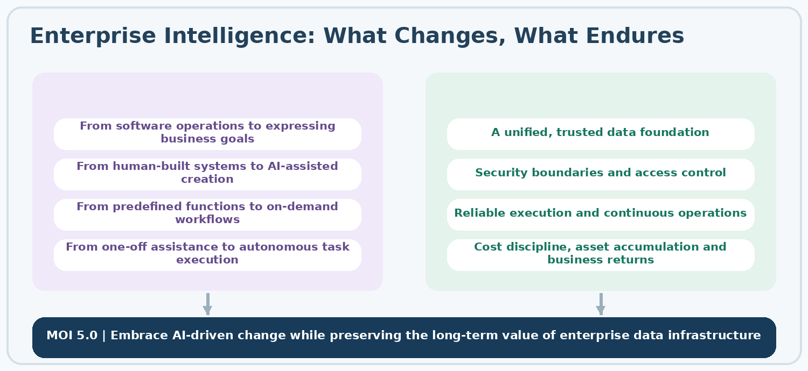
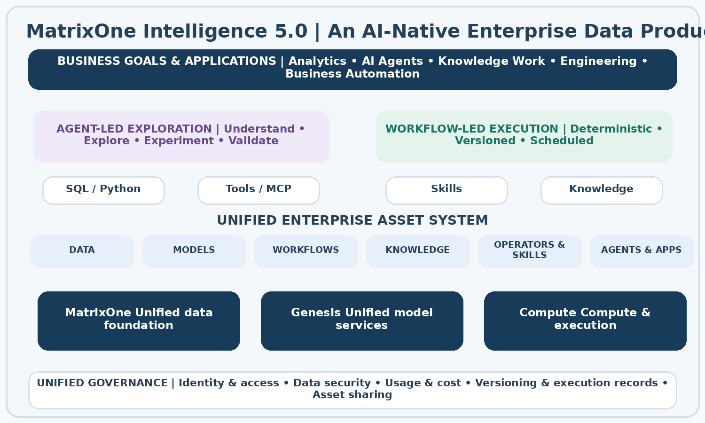
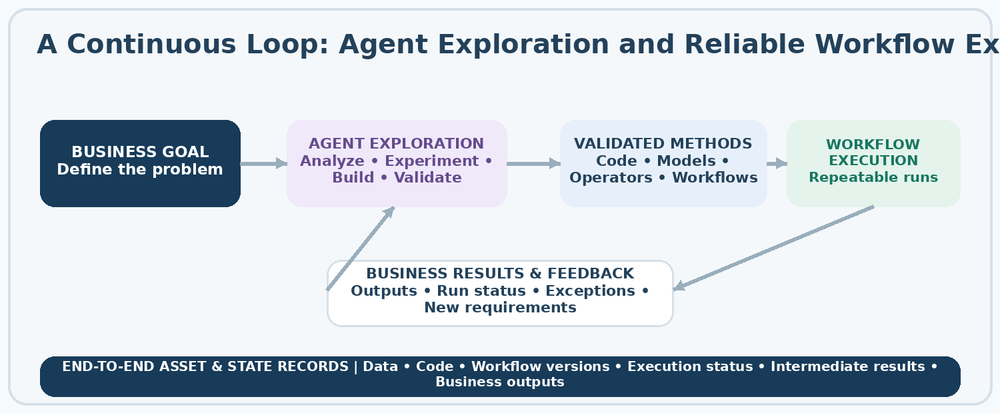
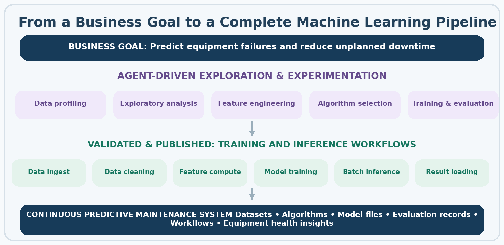
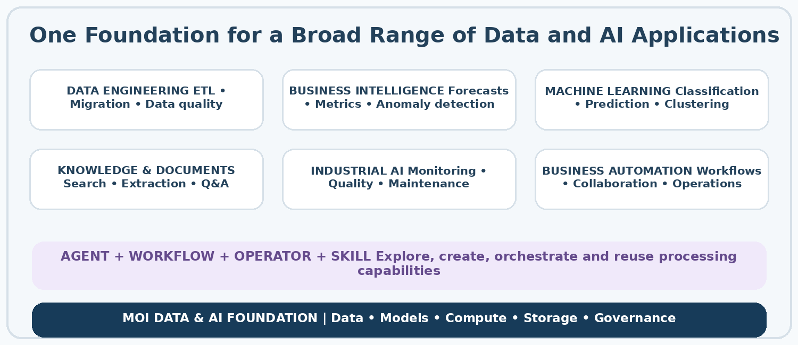
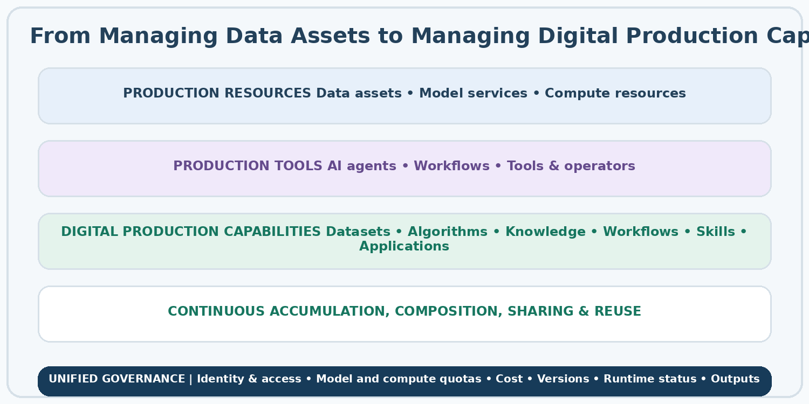
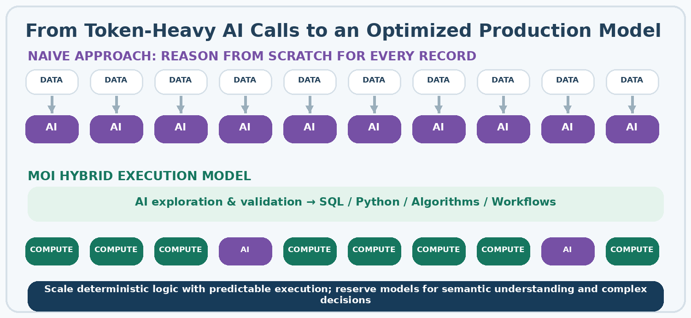
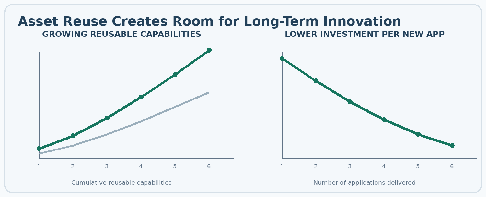

MatrixOne Intelligence 5.0: Building an AI-Native Enterprise Data Production System

Since generative AI entered the mainstream in 2022, enterprise expectations for artificial intelligence have changed substantially. At first, the focus was on using AI to write documents, answer questions, and improve individual productivity. A few years later, more and more enterprises began asking whether AI could participate directly in data processing, software development, and even business execution—and whether this could change how they build digital capabilities. The rapid development of AI agents has opened up new ways to perform work that once required substantial effort from specialist teams.

At the same time, our experience with enterprise customers shows that technological change has not altered the fundamentals of running a business. Data still needs to be managed consistently, business systems must remain reliable, and security, permissions, cost, and return on investment remain central criteria in technology decisions. The deeper AI moves into business operations, the more important these requirements become. For Matrix Origin, the real opportunity is not to redefine the product with every technology wave. It is to understand which needs are changing, which principles must endure, and how new technologies can solve longstanding enterprise problems. This is the thinking behind MatrixOne Intelligence (MOI) 5.0 reaching General Availability (GA).

## 01  What Changes Is the Way Work Gets Done; What Endures Is the Essence of Business

The bottleneck in traditional digital transformation is the speed at which enterprises can turn business needs into software and data-processing capabilities. Business users raise a problem; technical teams interpret the requirement, design data models, write code, and deploy the processing logic into production systems. Having more data does not make this process any simpler. Many valuable requests never make it into the development plan—not because they lack merit, but because the expected benefits do not justify the cost of development and maintenance.

*Figure 1 | What Is Changing in Enterprise Intelligence—and What Needs to Endure*

The key change brought by generative AI is that a business objective itself can become the starting point for data processing and application development. In the past, users had to learn a software product’s features and how to use them. Today, agents can understand objectives, explore data proactively, generate code, try algorithms, and validate results. Enterprise needs are therefore expanding beyond purchasing a predefined set of software features to gaining the foundational ability to build new workflows and applications on demand.

Yet whether code is written by people or generated by AI, enterprises must know where data comes from, who is authorized to access it, whether results can be trusted, how much computing resource is consumed, and whether the resulting business capabilities can operate over the long term and remain under the enterprise’s ownership. These requirements are not obsolete; they are prerequisites for bringing AI from personal productivity tools into mission-critical business operations. Matrix Origin has long been committed to unified data infrastructure and enterprise-grade governance. Today, we are bringing AI into the entire data-production process while upholding those principles and meeting enterprises’ new expectations for intelligent ways of working.

## 02  Providing AI with a Complete Set of Enterprise-Grade Production Tools

To get data work done, an engineer needs a database, model services, a computing environment, specialized tools, and a production runtime. An AI agent needs the same. MOI 5.0 brings together the MatrixOne data foundation, Genesis model services, computing resources, and the agent and workflow capabilities of AI Studio to create a shared data and AI infrastructure. Within a controlled environment, agents can access data, execute SQL and Python, invoke models, combine existing operators, and write new processing logic as needed. The data, code, workflows, and other outputs created along the way can also become part of the platform’s asset system.

*Figure 2 | MOI 5.0’s Unified Architecture for Data, Models, Execution, Assets, and Governance*

## 03  Let Agents Explore the Unknown and Workflows Execute the Known

The value of an agent lies in its ability to tackle uncertain problems and adapt its approach based on execution results. But much of the work inside an enterprise does not need to be reasoned through from scratch every time. Once the logic is clear, tasks such as data synchronization, financial calculations, feature processing, and batch prediction are better handled by databases, algorithmic programs, and workflows. Traditional workflows have the opposite weakness: their design and maintenance depend on people, and they lack the ability to explore new problems autonomously.

MOI brings the two together. Agents can analyze data, experiment with methods, generate operators, and build and test workflows. Once validated, the logic can run continuously through workflow versioning and scheduling. Steps that require semantic understanding, complex judgment, or dynamic decisions can call models or agents when needed. When business conditions change, AI can explore again and help improve existing workflows. Throughout the process, execution status, tool calls, workflow definitions, and outputs can be recorded and managed, while people can validate critical results and release steps.

*Figure 3 | Agent Exploration, Workflow Execution, and Continuous Feedback*

This mechanism changes how AI is used. AI does not need to reason from scratch for every task. It can discover an effective method during an initial exploration and then turn that method into a repeatable enterprise capability. A workflow is no longer merely a static program that people must fully orchestrate in advance; it can become the vehicle through which the results of intelligent exploration enter production. This helps enterprises strike a better balance among flexibility, reliability, and operating cost.

## 04  From a Single Business Request to a Complete Machine Learning System

<iframe width="100%" height="480" src="https://player.bilibili.com/player.html?bvid=BV1EfyUzAEdi&page=1" frameborder="0" scrolling="no" allowfullscreen="true" title="Build an Enterprise ML Model and Native BI Dashboard in One Sentence"></iframe>

Consider predictive maintenance in manufacturing. Suppose an enterprise has three years of equipment operating data, sensor data, and maintenance records, and wants to identify potential failures in advance. Traditionally, this would be a cross-functional project involving data engineering, machine learning, application development, and operations. With the MOI architecture, the enterprise can start from the business objective and use AI throughout the process—from exploration to workflow construction.

The agent first examines the data structure and quality, analyzes the relationship between equipment conditions and failures, writes Python code for feature engineering, tries different algorithms, and evaluates predictive performance. Once business and technical teams have validated the approach, it can be packaged as data-processing operators and workflows, forming a pipeline that covers data ingestion, cleaning, feature computation, model training, and batch prediction. The training data, model files, code, evaluation results, and workflow definitions then become a foundation for future iterations.

*Figure 4 | Building a Traditional Machine Learning System with Generative AI (Illustrative Scenario)*

After deployment, the workflow can process new data periodically as needed, and prediction results can be consumed by other applications. On top of this, the enterprise can build an agent for equipment engineers, combining predictions with maintenance knowledge and real-time operating data to explain anomalies, analyze possible causes, and generate maintenance recommendations. The truly valuable deliverable is not just a report or an algorithmic model, but a business system that can run, be maintained, and evolve over time.

This example is especially noteworthy because it is not a typical generative AI application. The final predictions may be produced by a traditional machine learning model, and data processing may still be performed with SQL or Python. Generative AI participates in exploring and building the system as a whole. It does not replace traditional data technologies; it organizes them so enterprises can create new data-processing capabilities with a lower barrier to entry.

## 05  One Infrastructure Foundation for Many Data and AI Applications

Machine learning is just one example. Data engineering, business intelligence, knowledge engineering, document understanding, industrial data analytics, and business automation may appear to belong to different product categories, but they share many underlying capabilities for data access, algorithmic computation, model inference, and workflow execution. When these capabilities are unified and can be combined and extended by AI according to business objectives, the platform’s application scope is no longer limited by the number of features built into the product in advance.

*Figure 5 | Typical Applications Built on a Shared Foundation of Data and AI Capabilities*

For example, an engineering company can explore methods for parsing and classifying drawings, preserve them as workflows, and then use the processed data to build drawing search, procurement comparison, and bid-generation applications. A retailer can connect sales forecasting, inventory analysis, and operational anomaly monitoring. A financial institution can use deterministic rules and models for risk screening, while assigning complex cases to agents for further assessment. Data engineering teams can use the same toolset to build workflows for data migration, field mapping, quality checks, and knowledge-base updates.

In the past, these needs often called for different specialist tools and separate implementation projects. MOI does not attempt to prebuild every industry application. Instead, it provides a unified baseline of general-purpose capabilities, enabling enterprises to create processing methods for their own data and business objectives and reuse established capabilities in the next scenario. As long as the data is available, the algorithms and execution environment are supported, and business rules can be validated, the same system can support the journey from exploration to application development.

## 06  From Managing Data Assets to Managing Enterprise Digital Productivity

Data assets have long been a focus for enterprises. But true competitiveness lies not only in the data itself; it also lies in how data is understood and processed, and how it is used to make decisions and take action. In the past, these capabilities were often scattered across employee experience, code repositories, application systems, and business processes. If AI-generated results remain confined to personal conversations, temporary files, and isolated sandboxes, enterprises still cannot build sustainable organizational capabilities.

With MOI, enterprises can manage databases, files, datasets, and model services. They can also package validated algorithms as operators, preserve processing logic as workflows with versions and execution records, turn specialized knowledge into knowledge bases or Skills, and build agents and applications for specific business needs. Different resources can reference and reuse one another, turning the outputs of one-off tasks into manageable enterprise assets.

*Figure 6 | Unified Management of Production Resources, Production Tools, and Digital Production Capabilities*

Workflow assets deserve particular attention. How a bank segments customers, assesses risk, and forecasts marketing outcomes—or how a manufacturer detects quality anomalies and analyzes production efficiency—represents business knowledge accumulated over many years. By combining workflows, operators, models, and agents, this knowledge can evolve from scattered experience or temporary code into digital capabilities that can be maintained, managed, and reused continuously. When employees change roles or leave, the accumulated processing capabilities can remain within the organization. When new needs arise, AI can continue exploring on the basis of existing assets.

## 07  Unified Governance: Making AI a True Part of Enterprise Infrastructure

As enterprises begin using AI at scale, the number of data assets, models, computing resources, and applications will all grow. If every application independently connects to models, copies data, configures credentials, and maintains its own runtime environment, the resulting management complexity may offset AI’s efficiency gains. That is why unified governance in MOI is not an additional security layer bolted on after applications are built. It is a shared foundation for data, models, computing, and workflow assets.

Enterprises need to manage more than data-access permissions. They must also manage model connectivity and usage, consumption of model and computing resources, workflow versions and releases, agent tools and runtime environments, as well as the execution records and outputs generated by tasks. In a unified platform, these resources can be managed through workspaces, roles, and permissions, while metering and billing mechanisms provide visibility into actual resource consumption. For enterprises, this means AI can gradually move from scattered individual activity to an organizational operation with clear resource boundaries, management responsibilities, and operating mechanisms.

Cost management should not be limited to counting how many tokens have been consumed. Suppose an enterprise processes one million business records every day. AI can help discover rules, write processing programs, and validate results, but there is no need to reason through already-established logic record by record. By using SQL, Python, and workflows for deterministic computation—and reserving models for tasks that genuinely require semantic understanding and complex judgment—enterprises can reduce costs through the way work is produced, rather than merely managing the bill after the fact. This is both an architectural advantage and a practical economic consideration for enterprises adopting AI at scale.

*Figure 7 | Cost Optimization by Combining Intelligent Exploration with Deterministic Computation*

## 08  Enabling Enterprise Digital Productivity to Grow Continuously

Traditional digital transformation projects often require new investment in data preparation, system integration, development, and operations whenever new business needs arise. MOI pursues a different model. The data connections established for the first application, the document-parsing operators created for the second, and the data-quality workflows developed for the third can all become foundations for future applications. Under unified governance, existing data, knowledge, algorithms, and workflows are continuously reused, while AI further accelerates the creation and combination of these capabilities.

*Figure 8 | The Long-Term Effects of Asset Accumulation and Reuse*

The significance of this mechanism goes beyond saving a few people some work. As an enterprise’s reusable capabilities grow, the barriers to validating a new algorithm, building a new application, or testing a new business model can fall. Data needs that were previously abandoned because development costs were too high may become economically viable. AI not only improves the efficiency of existing work; it also expands the range of work an enterprise can undertake.

## 09  Embrace Change, Stay True to What Matters

From databases to data platforms and now to AI infrastructure, Matrix Origin has consistently built its products around one question: how can enterprise data create greater value? In the past, we sought to reduce the complexity of data management and processing through a unified data architecture. Today, we are taking the next step by involving AI in the creation and validation of data-processing methods and in application development, while bringing the resulting assets into a unified system of management and governance.

We believe that the measure of enterprise intelligence in the future will not simply be how many agents have been deployed, how many AI applications have gone live, or how many tokens have been consumed. It will be whether an enterprise can continuously, efficiently, securely, and economically turn new business objectives into new production capabilities. Data and models are the means of production; agents and workflows are the tools of production; and the accumulated algorithms, knowledge, workflows, and applications are the digital capabilities an enterprise truly owns. Unified governance enables all of this to operate continuously within the enterprise and generate long-term value.

AI has changed how enterprises create digital productivity, but it has not changed their need for reliable data, stable business operations, reasonable costs, and secure governance. MOI 5.0 is both our response to technological change and our commitment to the enduring value of enterprise data infrastructure.

**Let AI do more than get work done. Let it create the capability to get work done.**

Explore the product: https://moi.matrixorigin.cn/Product documentation: https://docs.matrixorigin.cn/moi/zh/5.0/
