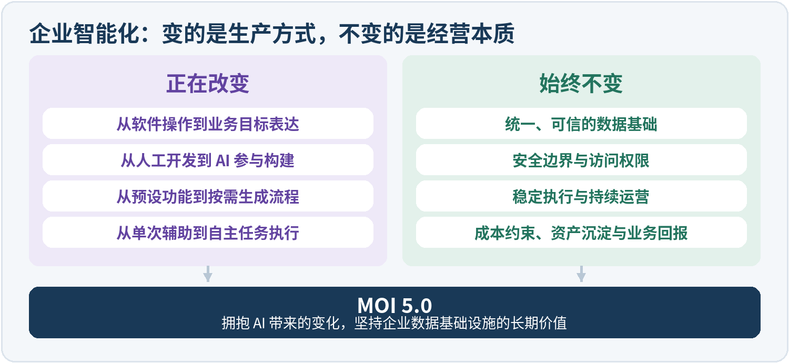
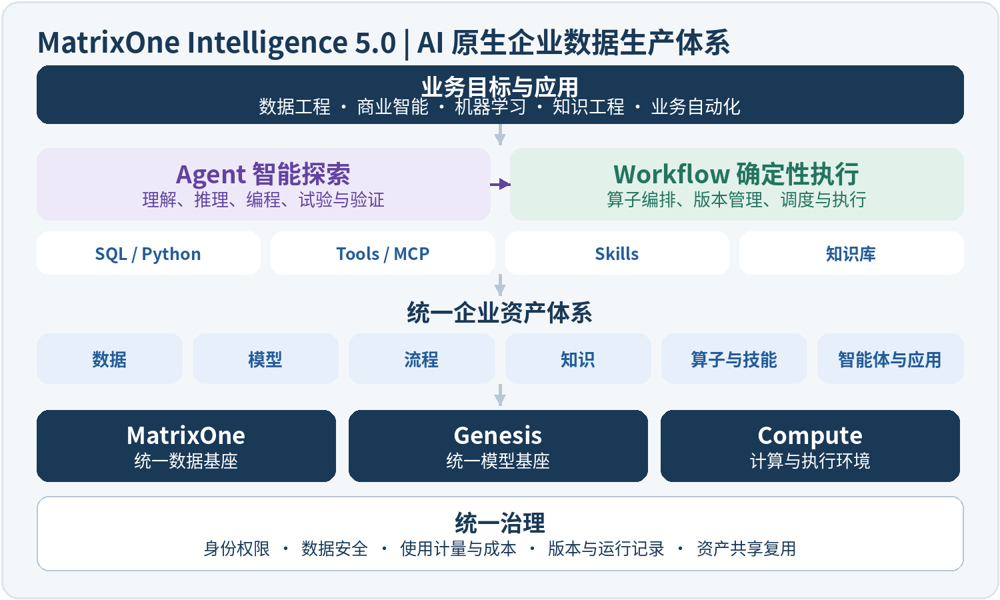
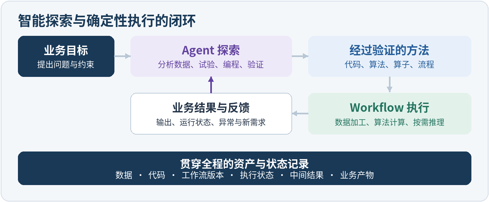
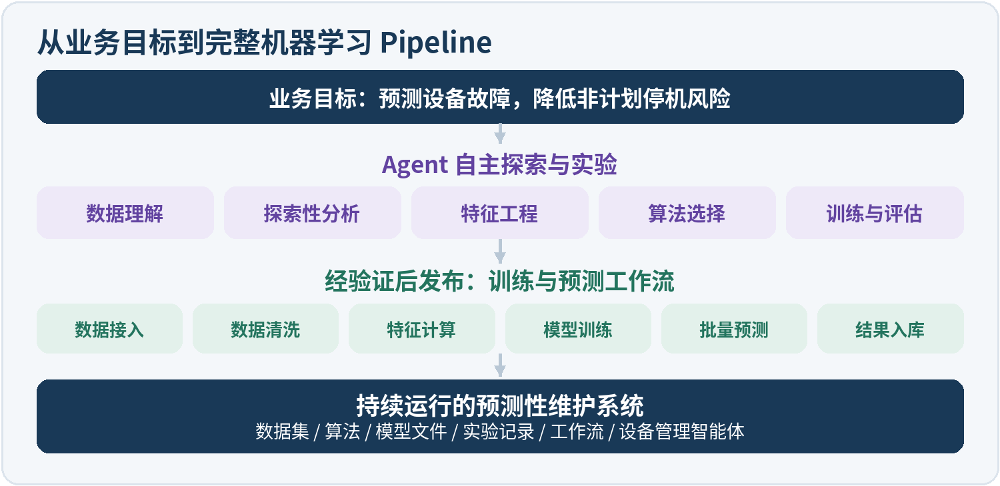
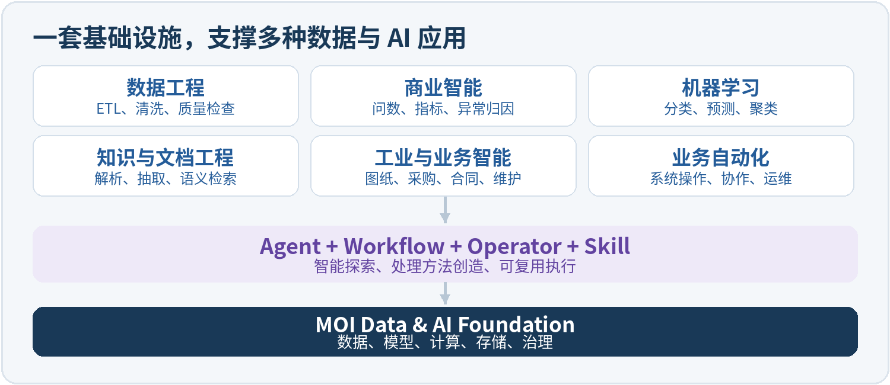
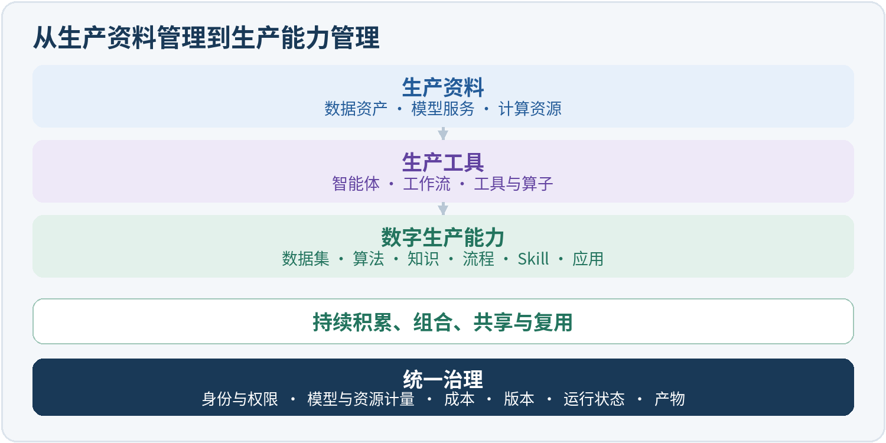
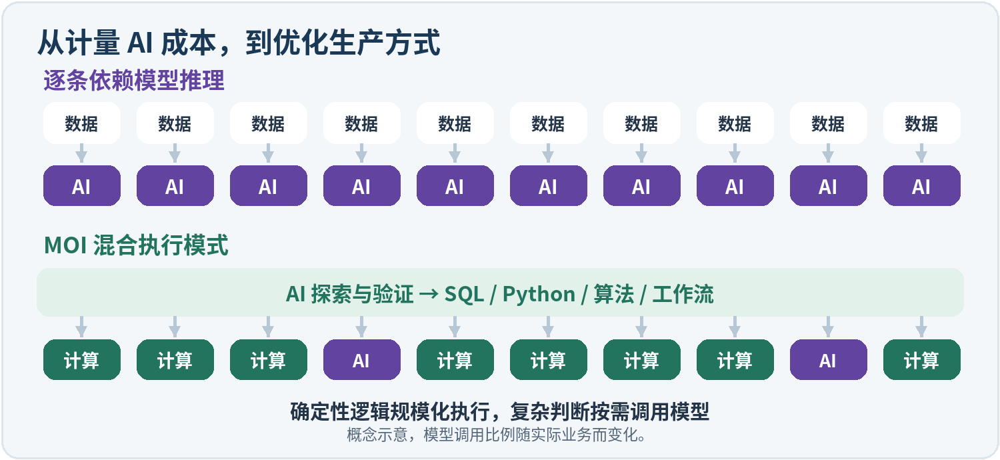
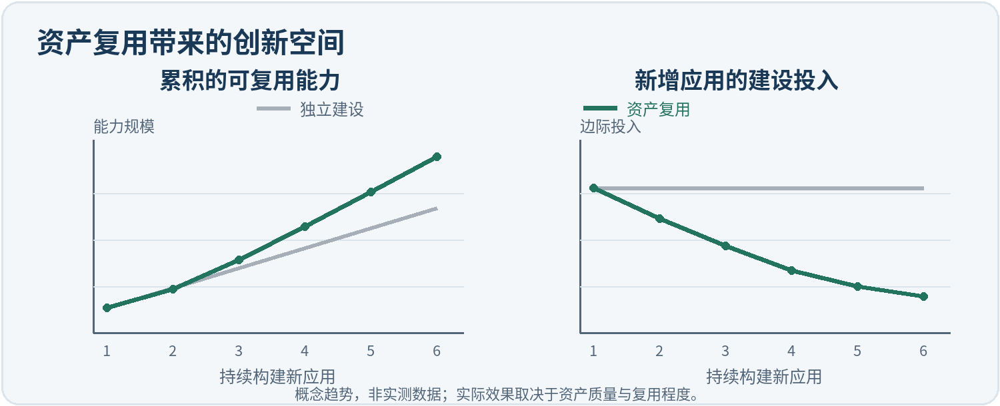

MatrixOne Intelligence 5.0：构建 AI 原生的企业数据生产体系

自 2022 年生成式 AI 走入大众视野以来，企业对人工智能的期待已经发生了实质性的变化。最初，大家关心的是如何用 AI 写文档、回答问题和提高个人效率；几年之后，越来越多的企业开始思考，能否让 AI 直接参与数据处理、软件开发乃至业务执行，并在此基础上改变企业建设数字化能力的方式。智能体的快速发展，让这些曾经需要大量专业人员投入的工作，有了新的实现路径。

与此同时，我们在企业实践中也看到，技术的变化并没有改变企业经营的基本规律。数据依然需要统一管理，业务系统依然需要稳定运行，安全、权限、成本和投资回报依然是企业选择技术的核心标准。AI 越深入业务，这些问题反而越重要。对于矩阵起源而言，真正值得做的不是在每一轮技术浪潮中重新定义产品，而是理解哪些需求发生了变化、哪些原则需要长期坚持，并以新的技术手段解决企业一直存在的问题。这也是 MatrixOne Intelligence（MOI）5.0 正式进入 GA 阶段背后的思考。

## 01  变的是生产方式，不变的是企业经营的本质

传统数字化的瓶颈，在于企业把业务需求转化为软件和数据处理能力的速度。业务人员提出问题，技术团队理解需求、设计数据模型、编写代码，再将处理逻辑部署到生产系统中。这个过程并不会因为企业有了更多数据而变得简单。许多有价值的需求最终没有进入开发计划，不是因为它们没有意义，而是因为其预期收益难以覆盖开发和维护成本。

*图 1｜企业智能化的变化与长期需求*

生成式 AI 带来的关键变化，是业务目标本身可以成为数据处理和应用构建的起点。过去，用户需要学习软件的功能和使用方式；现在，智能体能够理解目标、主动探索数据、生成代码、尝试算法并验证结果。企业的需求也从购买一组预先定义好的软件功能，逐渐延伸到获得能够按需构建新流程、新应用的基础能力。

然而，无论是人编写代码还是 AI 生成代码，企业都必须知道数据从何而来、谁有权访问、处理结果是否可信、计算资源消耗了多少，以及形成的业务能力能否长期运行并归企业所有。这些要求不仅没有过时，而且构成了 AI 从个人工具进入核心业务的前提。矩阵起源长期坚持统一的数据基础设施与企业级治理；今天，我们进一步把 AI 引入数据生产全过程，在坚持基本原则的同时，适应企业对智能化生产方式的新要求。

## 02  为 AI 提供完整的企业级生产工具

一个工程师要完成数据工作，需要数据库、模型服务、计算环境、专业工具以及生产运行系统。智能体同样如此。MOI 5.0 将 MatrixOne 数据基座、Genesis 模型服务、计算资源和 AI Studio 的智能体、工作流能力整合起来，形成一套共同的数据与 AI 基础设施。智能体可以在受控环境中访问数据、执行 SQL 和 Python、调用模型、组合现有算子，并根据需求编写新的处理逻辑。工作中形成的数据、代码、流程和产物也可以进入平台的资产体系。

*图 2｜MOI 5.0 的统一数据、模型、执行、资产与治理架构*

## 03  让智能体探索未知，让工作流执行已知

智能体的价值在于能够面对不确定的问题，根据执行结果不断调整自己的方法。但企业中大量工作并不需要每次都重新推理。数据同步、财务计算、特征加工、批量预测等任务，一旦处理逻辑已经明确，更适合由数据库、算法程序和工作流执行。传统工作流的不足，则恰恰在于设计和维护依赖人工，面对新的问题时缺少自主探索能力。

MOI 将二者结合起来：智能体可以分析数据、试验方法、生成算子并构建、测试工作流；经过验证的逻辑可以通过工作流版本管理与调度机制持续运行，而需要语义理解、复杂判断或动态决策的环节则按需调用模型或智能体。业务发生变化时，AI 可以再次介入探索，协助改进已有流程。整个过程中，执行状态、工具调用、流程定义和产物可以得到记录和管理，人工也可以对关键结果和发布环节进行验证。

*图 3｜Agent 探索、Workflow 执行与持续反馈*

这套机制改变了 AI 的使用方式。AI 不必在每次任务中从头推理，而可以在第一次探索中创造有效方法，再把方法沉淀为可重复执行的企业能力。工作流也不再是一套只能由人预先编排的静态程序，而可以成为智能探索成果进入生产环境的载体。企业由此能够在灵活性、可靠性和运行成本之间建立更好的平衡。

## 04  从一句业务需求，到一整套机器学习系统

<iframe width="100%" height="480" src="https://player.bilibili.com/player.html?bvid=BV1hJy6zoEjD&page=1" frameborder="0" scrolling="no" allowfullscreen="true" title="一句话创建企业级机器学习模型"></iframe>

以制造企业的预测性维护为例。假设企业拥有三年的设备运行数据、传感器数据和维修记录，希望提前识别潜在故障。传统上，这是一个涉及数据工程、机器学习、应用开发和运维的综合项目；在 MOI 的架构下，企业可以从业务目标出发，让 AI 参与完成从探索到流程构建的一系列工作。

智能体首先了解数据结构和质量，分析设备状态与故障之间的关系，编写 Python 代码进行特征工程，尝试不同算法，并评估预测效果。经过业务人员和技术人员验证的方法，可以被封装为数据处理算子及工作流，形成从数据接入、清洗、特征计算、模型训练到批量预测的 Pipeline。训练数据、模型文件、代码、评估结果和工作流定义则可以作为后续迭代的基础。

*图 4｜由生成式 AI 驱动传统机器学习系统的构建（场景示例）*

发布后，工作流可以按需要周期性处理新数据，预测结果可以被其他应用使用。在此基础上，企业还可以构建面向设备工程师的智能体，将预测结果与维修知识、实时运行数据结合起来，辅助解释异常、分析故障原因并生成维护建议。真正有价值的交付物不只是一份报告或一个算法模型，而是一套可以持续运行、维护和演进的业务系统。

这个例子尤其值得关注，因为它并不是典型的生成式 AI 应用。最终执行预测的可能是传统机器学习模型，数据加工依然由 SQL 或 Python 完成，生成式 AI 则参与整个系统的探索和构建。它并没有替代传统数据技术，而是把这些技术组织起来，使企业能够以更低的门槛创造新的数据处理能力。

## 05  一套基础设施，支撑多种数据与 AI 应用

机器学习只是其中一个例子。数据工程、商业智能、知识工程、文档理解、工业数据分析和业务自动化看起来属于不同产品类别，底层却共享大量数据访问、算法计算、模型推理和流程执行能力。当这些能力被统一起来，并能够由 AI 按目标进行组合和扩展时，平台的应用范围便不再取决于产品预先内置了多少功能。

*图 5｜通用数据与 AI 能力基线支撑的典型应用*

例如，工程企业可以探索图纸解析与分类方法，将其沉淀为工作流，再利用处理后的数据构建图纸搜索、采购比价和标书生成应用；零售企业可以将销售预测、库存分析与经营异常监测连接起来；金融企业可以利用确定性的规则和模型进行风险筛查，将复杂事件交给智能体进一步研判。数据工程团队也可以用同一套工具构建数据迁移、字段映射、质量检测和知识库更新流程。

以往这些需求往往对应不同的专业工具和独立的建设项目。MOI 并不试图预先实现所有行业应用，而是提供统一的通用能力基线，让企业能够针对自己的数据与业务目标创造处理方法，并将已经建立的能力用于下一个场景。只要数据可获得、算法和执行环境可支持、业务规则能够得到验证，就有机会用同一套体系完成从探索到应用构建的过程。

## 06  从管理数据资产，到管理企业数字生产力

数据资产是企业长期关注的对象，但真正的竞争力并不只存在于数据本身，还存在于如何理解数据、如何加工数据、如何利用数据作出判断并采取行动的过程中。过去，这些能力往往分散在员工经验、代码仓库、应用系统和业务流程中；如果 AI 的成果仍然只停留在个人对话、临时文件和隔离的沙箱里，企业仍然无法形成可持续的组织能力。

在 MOI 中，企业可以管理数据库、文件、数据集和模型服务，也可以将经过验证的算法封装为算子，将处理逻辑沉淀为具有版本和运行记录的工作流，将专业知识转化为知识库或 Skill，并构建面向具体业务的智能体与应用。不同资源之间可以相互引用和复用，从而把一次性的任务成果转化为可管理的企业资产。

*图 6｜生产资料、生产工具与数字生产能力的统一管理*

流程资产尤其值得强调。一家银行如何进行客户分群、风险评估与营销预测，一家制造企业如何检测质量异常、分析生产效率，这些方法都是组织长期积累的业务知识。通过工作流、算子、模型和智能体的组合，它们可以从分散的经验或临时代码，演化为能够持续维护、管理和复用的数字化能力。人员发生变化时，经过沉淀的处理能力仍然可以被组织保留；新需求出现时，AI 也可以在已有资产基础上继续探索。

## 07  统一治理，让 AI 真正成为企业基础设施

当企业开始大规模使用 AI，数据、模型、算力与应用数量会同时增长。如果每个应用都独立接入模型、复制数据、配置凭据和维护运行环境，新的管理复杂度很可能抵消 AI 带来的效率收益。因此，MOI 的统一治理不是应用完成之后追加的一层安全功能，而是数据、模型、计算及流程资产共同的基础。

企业需要管理的不只是数据访问权限，还包括模型的接入与使用、模型和计算资源的消耗、工作流的版本与发布、智能体的工具和运行环境，以及任务产生的执行记录和产物。在统一平台中，这些资源可以围绕工作区、角色与权限体系开展管理，并借助计量和计费机制了解实际资源使用情况。对企业而言，这意味着 AI 的使用能够逐步从分散的个人行为，转化为有明确资源边界、管理责任和运营机制的组织活动。

成本管理也不应局限于统计消耗了多少 Token。假设企业每天处理一百万条业务记录，AI 可以帮助发现规则、编写处理程序并验证结果，但已经确定的逻辑没有必要逐条重新推理。通过 SQL、Python 和工作流执行确定性计算，把模型留给真正需要语义理解和复杂判断的环节，企业有机会从生产方式本身降低成本，而不只是被动管理账单。这既是技术架构上的优势，也是企业规模化使用 AI 时非常实际的经济考量。

*图 7｜智能探索与确定性计算结合的成本优化思路*

## 08  让企业的数字生产力持续增长

传统数字化项目往往随着新的业务需求重新投入数据准备、系统集成、开发和运维资源。MOI 所追求的是另一种建设模式：第一个应用沉淀的数据连接、第二个应用产生的文档解析算子、第三个应用形成的数据质量工作流，都可以成为后续应用的基础。在统一治理下，已有数据、知识、算法和流程被持续复用，AI 又进一步加快这些能力的创造和组合。

*图 8｜资产积累与复用可能带来的长期效应*

这种机制的意义不只是节省几个人的工作量。随着企业可复用能力的增加，验证一个新算法、建设一个新应用或尝试一种新业务模式的门槛有机会降低，许多过去因为开发成本过高而被放弃的数据需求，也可能获得新的经济可行性。AI 在提高已有工作效率的同时，扩大了企业能够开展的工作范围。

## 09  拥抱变化，坚持本质

从数据库到数据平台，再到 AI 基础设施，矩阵起源始终围绕同一个问题开展产品建设：如何让企业的数据创造更大的价值？过去，我们希望通过统一的数据架构降低数据管理和处理的复杂度；今天，我们进一步让 AI 参与数据处理方法的创造、验证和应用构建，并将这些成果纳入统一的资产与治理体系。

我们相信，未来企业智能化水平的衡量标准，不会只是部署了多少个智能体、上线了多少款 AI 应用或者消耗了多少 Token，而在于企业能否持续、高效、安全且经济地把新的业务目标转化为新的生产能力。数据和模型是生产资料，智能体与工作流是生产工具，经过积累的算法、知识、流程和应用则是企业真正拥有的数字能力。统一治理让这一切能够在企业中持续运行，并形成长期价值。

AI 改变了企业创造数字生产力的方式，却没有改变企业需要可靠的数据、稳定的业务、合理的成本以及安全治理的事实。MOI 5.0 既是我们对技术变化的回应，也是对企业数据基础设施长期价值的坚持。

**让 AI 不仅完成工作，更创造完成工作的能力。**

产品体验：https://moi.matrixorigin.cn/产品文档：https://docs.matrixorigin.cn/moi/zh/5.0/
