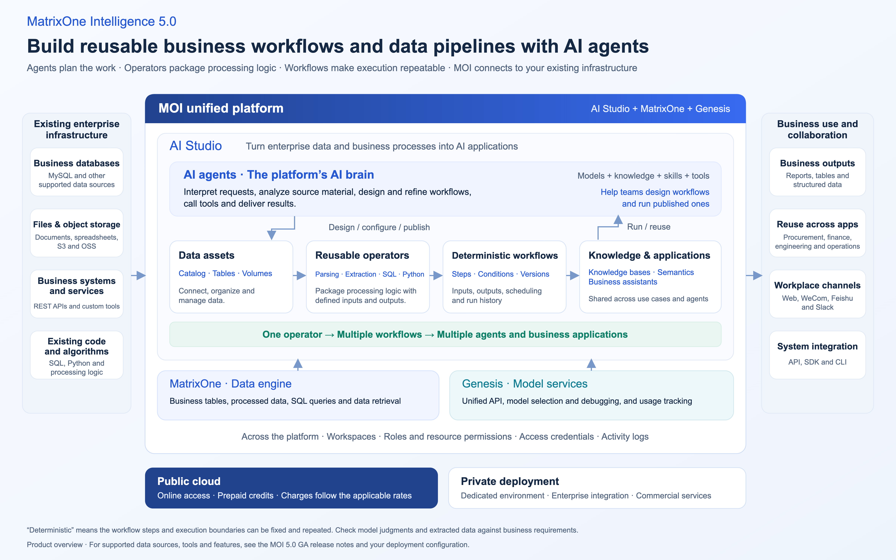
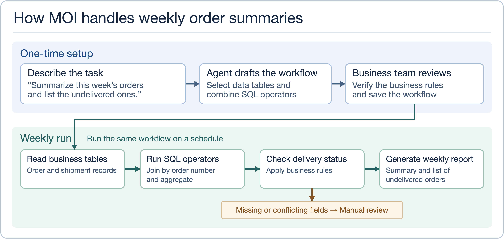
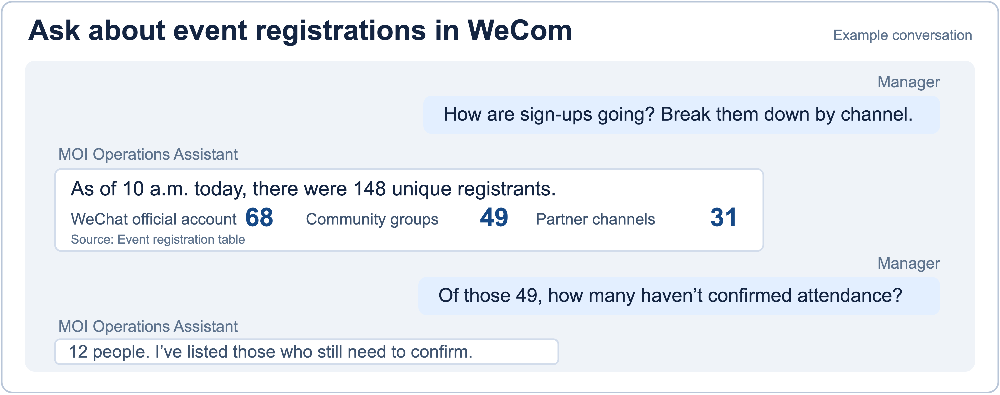
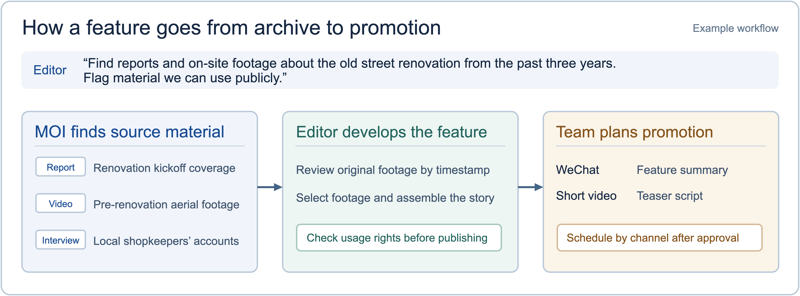

**MatrixOne Intelligence 5.0 is now generally available, bringing AI infrastructure to enterprise teams.**

AI is changing how companies work. More teams are trying it in everyday office work, customer service, data analysis, finance, research and development, and production operations. Large language models can interpret and generate content, and AI agents can use tools, handle tasks, and take part in business processes.

Getting value from AI takes more than connecting a model or setting up a chatbot. Companies generate and collect large volumes of data every day. That data holds business knowledge, operational experience, and performance information, but it lives across databases, business systems, files, and applications. Companies want AI to understand this data and their rules, answer real business questions, and help people get work done.

A capable model may still know little about a company's data. It might answer questions without being able to access the resources it needs to finish a task. And even if it works in a demo, it may lack the access controls, execution environment, and operational oversight needed to keep it running in production.

**Enterprises need infrastructure they can use to build, run, and improve AI applications over time.**

Today, we’re pleased to announce that **MatrixOne Intelligence 5.0 (MOI) is now generally available.**

MatrixOne Intelligence is an enterprise AI infrastructure platform built around data intelligence. It helps teams connect and manage data, build knowledge bases, develop AI applications and agents, and run them in their own business environments. Our goal is to give AI the context it needs to understand how a company works and help its people do their jobs.

## What enterprises need to run AI in production

Companies are moving from using AI to draft documents and answer questions toward using it in business analysis, customer service, financial reviews, and process automation.

That means integrating AI into the data, systems, and workflows a company already uses. Four obstacles come up repeatedly:

- **Data is hard to access.** Business information is spread across databases, PDFs, Excel files, and applications. Teams need a way for AI to reach that information within clear access boundaries.
- **Raw files are hard to interpret.** Files need to be parsed and cleaned, and business terms need to be defined, before AI can use the information reliably.
- **Answers don’t complete the work.** Companies need agents that can query data, call tools, run workflows, and deliver results.
- **Production activity needs oversight.** Teams need control over data access, tool use, task monitoring, and resources, with records they can audit.

MatrixOne Intelligence brings enterprise data, data intelligence, workflows, and agent execution together so teams can build and operate AI applications with those controls in place.

## MatrixOne Intelligence 5.0 architecture and capabilities

**MatrixOne Intelligence** has three components:

**AI Studio** is a shared workspace for data processing and AI agents. Teams can use natural language to connect and process data, build knowledge bases, and combine workflows, knowledge, and tools into business assistants for WeCom or Feishu.

**MatrixOne** is the data engine behind MOI. It stores business data and processed results and provides tools for processing and querying them. Workflows can read and write business tables, and the same data can support SQL analysis and knowledge retrieval.

**Genesis** is MOI’s unified model service. Teams can choose models, test them online, manage API credentials, and monitor usage. Genesis provides the models that power AI Studio workflows and agents. It also offers an API for connecting models to existing applications.

The platform has five core capabilities spanning data access and business operations:

1. **Unified data connections and Catalog.** Teams can start with the data they already have. AI Studio supports local file uploads and can connect directly to MySQL, Doris, S3, OSS, and REST APIs. Structured data goes into tables, while unstructured documents go into data volumes. In the Catalog, teams can browse resources, preview data, and share it with designated workspaces using read-only access.
2. **Reusable operators and deterministic workflows.** Teams can package document parsing, information extraction, vectorization, and existing SQL or Python scripts as standard operators with defined inputs and outputs and independent versions. AI can help design a workflow from natural language instructions or templates. Once the team approves it, they can fix the steps, conditional branches, and schedule or data triggers so it runs consistently and produces a log for each step. Teams can still review model judgments as needed. The same operator can serve multiple workflows, and a workflow can be published as an API for multiple use cases.
3. **Knowledge bases that understand business terms, with SQL analysis.** Knowledge bases organize documents and structured tables alongside field definitions, business rules, and sample queries. When employees ask a question in natural language, answers based on documents include citations. Data queries show both the generated SQL and the results. Analysts can also save frequently used queries in SQL workbooks and use them to create workspace dashboards.
4. **Production agents and runtime management.** Agents use models, knowledge bases, skills, and business APIs to carry out tasks. Teams can publish finished applications as standalone web pages or integrate them into tools they already use, including WeCom, Feishu, and Slack. Isolated execution environments, scheduling, archived results, and workspace and role permissions help teams track who can see which data, which tools they can call, and what each run produces.
5. **Open Genesis model services and developer tools.** Developers can choose and test models in Genesis, connect them to their applications through an API compatible with the OpenAI SDK, and review usage and request logs. MOI also provides APIs, an SDK, and a CLI for teams that want to integrate data processing and agent capabilities into their existing systems.

## Bring AI into core workflows in three steps

For enterprise AI, model capability is only part of the equation. AI needs to understand your data, follow your business rules, and work inside your systems. MOI gives teams a way to build toward that in stages.

**Step 1. Connect scattered data.** Building a separate system for every use case means copying documents for customer support and exporting data again for reporting. The MatrixOne data engine and Catalog let teams connect databases, object storage, and everyday documents without changing their existing systems. Workflows, knowledge bases, and agents can then draw on the same data.

**Step 2. Turn raw material into usable knowledge.** Connecting data is just the beginning. PDF contracts and inconsistent business tables still need work before an AI system can interpret them. Teams can use operators and workflows to standardize document parsing, field extraction, cleanup in SQL or Python, and vectorization. Unstructured files become a knowledge base whose answers can be traced to their sources. Semantic models give fields and metrics in structured business tables consistent definitions. Teams can reuse those processing workflows and build up their rules and knowledge as they use the system.

**Step 3. Use workflows and agents to get work done.** Once data and knowledge are ready, the right way to execute a task depends on how predictable it is:

- **Use workflows for tasks with clear rules and fixed steps.** Teams can automate regular data summaries, preliminary invoice compliance checks, and weekly project reports. Each run follows the configured steps, reducing manual work and errors.
- **Use agents for tasks that depend on context and judgment.** A research engineer can look up a technical standard, a manager can ask about business performance in natural language, and a finance team can investigate an unusual expense claim. The agent can bring in relevant knowledge and call business tools to analyze the question and respond.

By connecting data, turning it into usable knowledge, and putting that knowledge to work, MOI helps teams make AI part of their daily operations.

*In this example, the team defines the reporting task once. The published workflow runs weekly and flags missing or conflicting fields for human review.*

## What can teams do with MOI?

We use MOI ourselves. Engineering and testing teams use it to ship releases, operations teams run events with it, and managers use it to look up business data in WeCom.

### How we use MOI at MatrixOrigin

**Engineering and testing work together on MOI releases.** If testing uncovers a data import issue, the team can put sample data, steps to reproduce the issue, and run results in the same workspace. Once engineering fixes the problem, the testing team reruns the same data. For checks that apply to every release, they save the samples and steps in a workflow.

**Operations schedules recurring event tasks.** Promoting an event is only the start. Teams also need to compile registrations, track channels, and review what worked. We turn recurring steps into workflows and schedule them. For the next event, we can reuse the same workflow with new materials and dates.

**Managers ask about business data in WeCom.** Before reviewing an event, managers can ask an MOI assistant in WeCom which channels brought in the most registrations. They can follow up in the same conversation to find out who in the community hasn’t confirmed attendance. The operations team can then use that list to follow up.

*The assistant first breaks down registrations by channel, then identifies the 12 community members who have yet to confirm attendance.*

### How customers use MOI in their industries

**Construction and engineering drawings.** When engineers start a project, they often look for past projects with similar ground conditions. One engineering survey firm uses MOI to parse historical reports, scans, and drawings. It extracts parameters such as bearing capacity from tables that span multiple pages and keeps each value tied to the original soil layer and source location. Engineers can return to the source page to check a value.

**Medical case records.** Before a specialist consultation, a hospital needs to understand the patient’s symptoms and how the condition has developed. Its team uses MOI to process de-identified records and organize primary complaints and medical histories into structured records for case review and consultation preparation. Doctors can then verify the information and make their own assessments.

**Production quality and yield.** A smelting company brings equipment sensor data, camera images, and historical operating records into one data platform to help assess furnace conditions. On a discrete manufacturing line, quality teams can align process parameters and inspection results by work order and batch to investigate changes in yield. Once enough historical examples are available, the team can train a model to flag which batches to inspect first.

**Procurement sourcing and price comparison.** When a company buys equipment, technical specifications, past purchase prices, and supplier quotes may be spread across several systems. MOI can extract specifications and quantities for the buying team to verify, then compare them with internal purchasing records, supplier material, and external market information. The comparison report cites its sources so reviewers can check the evidence behind each key conclusion.

**Training data for models.** One intelligent cockpit team receives voice data from its fleet daily. They use MOI to standardize raw audio, transcripts, and labels and build a vector index. When the model team needs examples of a certain voice command or driving situation, they can filter the dataset for those samples and avoid another round of manual searching and sorting.

### Media and publishing teams can start with a content library

One publisher has included textbooks, teaching resources, and other publishing materials in a project to manage its content in one place. It also plans to develop assistants for content creation, editing, and proofreading. A newsroom preparing a feature on the redevelopment of a historic street can start with a similar library. An editor can search in their own words for previous stories, interviews, and raw footage, verify the sources, and check which material they have permission to use. The operations team can turn the approved story into a WeChat summary and a short video teaser, then schedule both for promotion.

*The team checks usage rights before publishing and schedules promotional material after the feature is approved.*

## Try MOI in the public cloud or deploy it privately

MatrixOne Intelligence is available in the **public cloud** and through **private deployment**. Teams can choose an option that fits their infrastructure, budget, and security requirements, starting with one use case and expanding as needed.

**Public cloud: start online for free.** Register and sign in to use data connections, workflow orchestration, and agent creation without setting up servers or a hosting environment. Teams prepay in credits and are charged for the compute and model services they use. The cloud option is suited to individual developers, innovation teams, and organizations that want to try AI at low initial cost. During the current promotion, new users can sign up and get started for free.

**Private deployment: a dedicated environment with enterprise integration.** Organizations with sensitive data, isolated networks, or strict audit requirements can deploy MOI in their own cloud or on premises. It can integrate with existing identity systems and single sign-on (SSO), business databases, and internal approval workflows. Dedicated architecture consulting, custom development, and ongoing implementation support are also available.

If you run into a problem or have suggestions while trying MOI, use the **Feedback** option in the product. **We’ll award credits for feedback that qualifies so you can keep exploring.**

[Try MOI 5.0 online](https://moi.matrixorigin.cn/)
