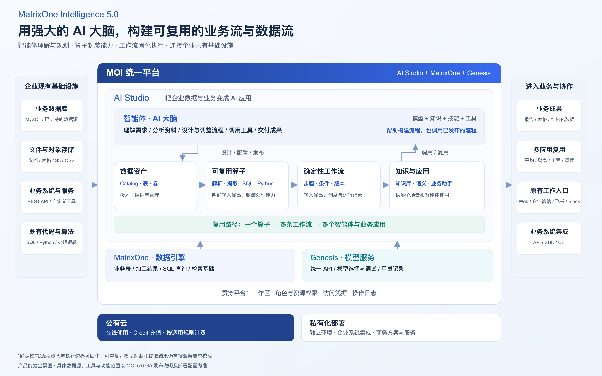
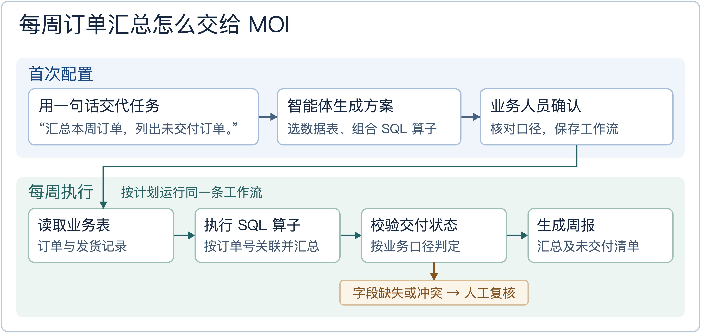
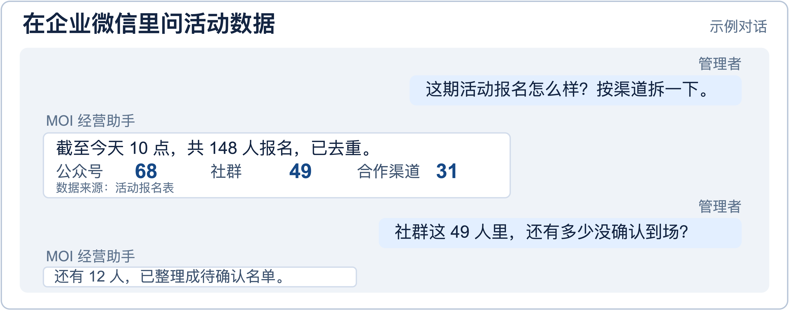
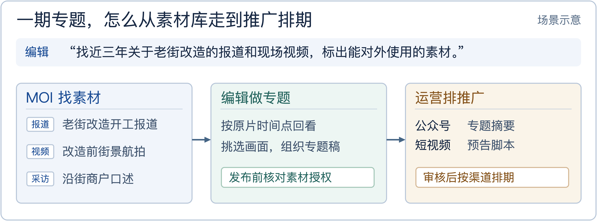

**MatrixOne Intelligence 5.0正式进入 GA 阶段，构建面向企业的 AI 基础设施**

人工智能正在改变企业开展业务的方式。从日常办公、客户服务，到数据分析、财务管理、研发和生产运营，越来越多的企业开始尝试将 AI 引入实际工作。大语言模型让 AI 能够理解和生成内容，智能体则让 AI 开始具备使用工具、处理任务和参与业务流程的能力。

但对于企业来说，让 AI 真正发挥价值，远不只是接入一个模型，或者创建一个能够聊天的机器人。企业每天产生和积累着大量数据。这些数据分散在数据库、业务系统、文件和各种应用中，承载着企业的业务知识、运营经验和经营信息。企业希望 AI 能够理解这些数据，熟悉自己的业务规则，回答真实的业务问题，甚至帮助员工完成实际工作。

然而，这并不容易。AI 可能很聪明，却不了解企业自己的数据；能够回答问题，却无法访问完成任务所需要的业务资源；能够完成一个简单的演示，却缺少在企业环境中持续运行所需要的权限管理、执行环境和运行管理能力。

**企业真正需要的，不只是一个 AI 应用，而是一套能够支撑 AI 应用构建、运行和持续发展的基础设施。**

今天，我们很高兴地宣布，**MatrixOne Intelligence 5.0（简称MOI）正式进入 GA（正式商用）阶段。**

MatrixOne Intelligence 是面向企业的 AI 基础设施平台，以数据智能为核心能力，帮助企业连接和管理数据、构建企业知识、开发 AI 应用与智能体，并让这些能力在企业的实际业务环境中运行。我们希望帮助企业解决一个更根本的问题：**让 AI 了解企业，形成真正的生产力，并成为企业业务的一部分。**

## 企业需要的，不只是AI模型，而是能够支撑 AI 的基础设施

企业使用 AI 的方式正在从“辅助聊天”转向“业务深水区”。如今，企业不仅需要 AI 写材料、答问题，更希望它深度参与经营分析、客户服务、财务审核与业务自动化。

这意味着 AI 必须融入企业现有的数据、系统与工作流。但在落地过程中，企业往往面临四个核心卡点：

- **数据连不上**：业务信息分散在数据库、PDF、Excel 和各类系统中，AI 既难获取，也缺乏权限边界。
- **知识读不懂**：原始文件并非可用知识，需要经过解析、清洗与业务语义定义，AI 才能真正理解。
- **行动落不了地**：企业需要的不是“问答机器”，而是能查数据、调工具、跑通工作流并交付结果的智能体。
- **生产管不住**：进入生产环境后，数据权限、工具调用边界、任务执行监控与资源管理都必须可控、可审计。

**MatrixOne Intelligence** 正是为此而生。它将企业数据、数据智能、工作流与智能体运行能力融为一体，帮助企业稳步构建安全可控的生产级 AI 应用体系。

## MatrixOne Intelligence 5.0的产品架构及能力

**MatrixOne Intelligence** 由三部分构成：

**AI Studio** 是数据处理和智能体的统一工作台。用户可以用自然语言接入和加工数据、建立知识库，再把工作流、知识和工具组合成企业微信或飞书里的业务助手。

**MatrixOne** 是 MOI 的底层数据引擎，负责存储业务数据和加工结果，并提供数据处理与查询能力。工作流可以读写业务表，SQL 分析和知识检索也可以使用这些数据。

**Genesis** 是 MOI 的统一模型服务。用户可以选模型、在线调试、管理调用凭据和查看用量。它为 AI Studio 的工作流和智能体提供模型能力，企业也可以通过 API 将模型接入已有应用。

围绕从数据接入到业务落地的全过程，平台提供五项核心能力：

1. **统一的数据连接与目录（Catalog）** 企业不用为了用 AI 而大动干戈迁移数据。AI Studio 支持本地文件上传，也能直接连通现有的 MySQL、Doris、S3、OSS 及各类 REST API。接入后，结构化数据入表，非结构化文档进“数据卷”。团队可以在统一的 Catalog 里直接浏览资源、预览数据，并按只读权限安全地共享给指定工作区。
2. **可复用的算子与确定性工作流** 文档解析、信息提取、向量化，以及企业原有的 SQL 和 Python 脚本，都可以封装成标准算子——明确输入输出，独立管理版本。在搭建工作流时，你可以用自然语言或模板让 AI 辅助设计，一旦确认，就能把步骤、条件分支、定时或数据触发规则“固化”下来，做到可重复执行、节点日志全可查（涉及大模型判断的环节仍可按需人工核对）。 这套机制的核心在于**复用**：一个算子能被多条工作流调用，一条工作流也能直接发布为 API，服务多个业务场景。
3. **懂业务语义的知识库与 SQL 分析** 知识库把文档和结构化表组织在一起，不仅存内容，还维护字段说明、业务规则和查询示例，帮 AI 真正听懂企业的“行话”。员工用自然语言提问时，文档问答会直接给出引用溯源，数据查询则会同时展示生成的 SQL 和结果，不玩“黑盒”。数据分析师也可以用 SQL 工作簿沉淀常用查询，直接生成工作区看板。
4. **面向生产的智能体与运行管理** 智能体不再只是陪聊，而是能带着模型、知识库、技能和业务 API 去实际干活。做好的应用可以发布为独立 Web 页面，也可以直接嵌进企业微信、飞书、Slack 等现有协作工具里。在后台，平台通过隔离运行环境、定时调度、成果归档，以及工作区与角色权限体系，把“谁能看什么数据、能调什么工具、跑出了什么结果”管得清清楚楚。
5. **开放的 Genesis 模型服务与开发集成** 开发者可以在 Genesis 里自由选型、在线调试模型，并通过兼容 OpenAI SDK 的接口快速接入自家应用，同时透明查看用量与请求记录。对于希望深度定制的研发团队，MOI 同样开放了完整的 API、SDK 和 CLI，方便把平台的数据处理与智能体能力无缝集成到现有业务系统中。

## 从数据到业务：把 AI 一步步接进核心流程

有了底层平台和工具模块，企业究竟该如何把 AI 真正用起来呢？

我们始终认为，决定企业 AI 成败的不是大模型有多聪明，而是它**懂不懂你的数据、认不认你的业务规则、能不能在你的系统里干活**。因此，MatrixOne Intelligence 提供了一条循序渐进的落地路径：

**第一步：把分散的数据“连起来”，形成统一底座** 企业上 AI 最怕“每个场景建一套烟囱”——为了做客服搬一次文档，为了做分析导一次数据。 依托 MatrixOne 的数据底座与统一目录（Catalog），企业无需改动现有信息系统，就能把数据库、对象存储和日常文档直接连通。从此，数据不再是散落在各处的孤岛，而是所有后续流程、知识库和智能体随取随用的公共资产，彻底告别跨工具反复搬运资料的折腾。

**第二步：把原始资料“炼成知识”，让 AI 听懂业务行话** 接通数据只是开始，原始的 PDF 合同、杂乱的业务表，AI 依然看不明白。 通过前文提到的算子与工作流，企业可以把“文档解析—字段提取—SQL/Python 清洗—向量化”串成标准流水线：非结构化文件沉淀为可溯源的知识库，结构化业务表则通过语义模型明确字段含义和指标口径。更重要的是，**这些加工流程都能保存复用**——业务越跑，沉淀下来的规则和知识资产就越厚实，AI 对企业的理解也就越精准。

**第三步：工作流与智能体“双轮驱动”，让 AI 真正接手工作** 当数据和知识准备就绪，AI 就可以从“聊天框”走进具体岗位了。在 MOI 中，企业可以根据任务的确定性程度，灵活组合两种执行方式：

- **规则明确、步骤固定的事，交给工作流**：像定期数据汇总、发票合规初审、项目周报生成，直接按配置自动化跑通，省人力且不出错。
- **需要理解上下文、动态判断的事，交给智能体**：比如研发人员查技术规范、管理者用自然语言问经营数据、财务排查报销异常，智能体会自动调用知识库和业务工具分析作答。

从“连数据”到“炼知识”，再到“跑业务”，MatrixOne Intelligence 让 AI 不再是一个孤立在业务之外的问答工具，而是真正融入企业毛细血管、能扛起日常工作的数字生产力。

## 企业可以用 MOI 做什么？

做 MOI 的过程里，我们也是它的用户。研发和测试用它一起做版本，运营用它跑活动，管理团队想看经营数据时，就在企业微信里问。

### 我们自己怎么用 MOI

**研发和测试用 MOI 一起做 MOI**　拿数据导入来说，测试发现问题后，可以把样例数据、复现步骤和运行结果放进同一个 MOI 工作区。研发修完，测试再用同一批数据跑一遍。每个版本都要做的检查，就把样例和步骤一并留在工作流里。

**运营把活动和推广做成定时任务**　办一场活动，宣传只是开头。报名信息要汇总，推广渠道要跟进，活动结束还要做复盘。我们把其中重复的步骤做成工作流，再用定时任务触发。下一期换一批素材、改一下日期，流程就可以接着用。

**管理团队在企业微信里问数**　活动复盘前，想知道哪个渠道带来的报名多，管理团队可以直接在企业微信里问 MOI 助手。如果还想知道社群里哪些人没确认到场，就在同一段对话里接着问。问完报名情况，运营就可以拿待确认名单继续跟进。

### 客户怎么把 MOI 用到专业业务里

**建筑与工业图纸**　做新项目时，工程师常要找相似地质条件下做过的项目。一家工程勘察机构用 MOI 解析历年报告、扫描件和图纸，把跨页表格里的承载力等参数整理出来，保留它们和原始土层、原文位置的对应关系。参数有疑问，还能回到原页核对。

**医疗病例**　一家医院在做专科问诊时，需要先从历史病历里理清患者的症状和病程。团队用 MOI 处理脱敏后的病历资料，把主诉、病史等内容整理成结构化记录，用于病例分析和问诊准备。医生可以在这份资料上继续核对和判断。

**生产质量与良率**　一家冶炼企业把设备传感器数据、摄像头图像和历史作业记录放到同一套数据底座里，为炉况判断提供依据。换到离散制造的产线，质量团队也可以按工单和批次把工艺参数、检测结果对齐，追查良率波动。积累足够历史样本后，再用这些数据训练模型，提示哪些批次值得优先检查。

**采购寻源与比价**　一家企业做设备采购时，技术规范、历史成交价和供应商报价散在几套系统里。用 MOI 先把规格和数量提出来，由采购人员确认，再对照内部采购记录、供应商资料和外部市场信息。比价报告里的关键结论都带来源，审价时可以查回对应依据。

**模型训练数据准备**　一家智能座舱团队每天都收到来自车队的语音数据。他们在 MOI 里按统一格式整理原始音频、转写和标签，并建立向量索引。下次模型团队要补某类口令或特定驾驶情境下的样本，就能按条件从语料里筛选，少做一轮人工翻找和整理。

### 传媒与出版也可以从素材库做起

一家出版机构已经把教材语料、教学资源和出版素材的统一管理纳入项目，并计划开发内容创作与编辑校对助手。换到传媒编辑部，做一期老街改造专题也可以从类似的素材库开始。编辑用一句话找出往年报道、采访和原片，查看出处，确认哪些素材可以使用。运营接着用审定的专题稿准备公众号摘要、短视频预告，再放进推广排期。

## 如何体验MOI：从公有云免费起步，到企业级私有化落地

为了适配不同规模团队的技术架构、预算节奏与安全合规要求，MatrixOne Intelligence 提供**公有云**与**私有化部署**两种灵活的交付方式，支持企业从单点场景验证平滑演进至全业务规模化应用：

**公有云在线版：即开即用，支持免费开始** 无需购置服务器或部署运维环境，注册登录即可直接使用完整的数据接入、工作流编排与智能体构建能力。平台采用透明的 Credit 充值与按量计费模式，算力与模型消耗清晰可控，非常适合个人开发者、业务创新小组以及希望低成本试水 AI 的企业团队。**目前平台正值限时推广活动期，新用户注册即可免费开始体验**，快速跑通你的第一个生产级智能体。

**企业级私有化部署：独立环境，深度集成** 面向对数据敏感、内网隔离及合规审计有严格要求的中大型企业与政企机构，MOI 支持在企业自有云环境或本地机房进行独立部署。方案可与企业现有的身份权限体系（SSO）、核心业务数据库及内部审批流深度打通，并提供专属的架构咨询、定制开发与全生命周期交付服务，确保 AI 能力在安全可控的边界内长期演进。

试用时遇到问题，或有哪里希望我们改进，可以通过产品里的「反馈」入口告诉我们。**提交有效反馈，我们会赠送 Credit，供你继续体验。**

[在线试用 MOI 5.0](https://moi.matrixorigin.cn/)
