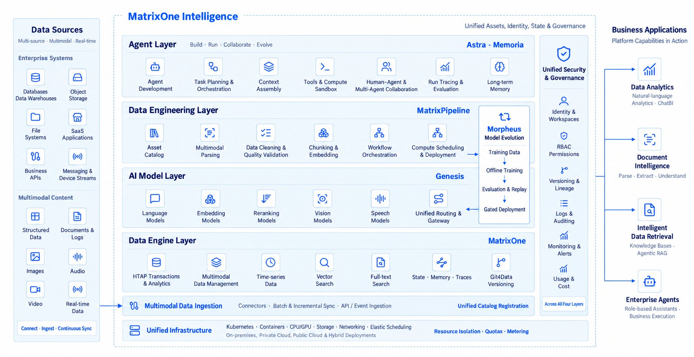

## Second-Round Public Beta Opens Today

We are pleased to announce that MatrixOne Intelligence (“MOI”) 5.0 officially launches its second-round public beta today, available exclusively to Waitlist users and invited users. From enterprise data preparation and model invocation to agent building, we invite you to bring your real business needs and experience the newly added capability of direct document and email ingestion.

Let us be specific about eligibility for this round:

**First-round registrants:** users who registered during the first round of beta but have not yet received an invitation will receive their invitations in this round.

**Existing activated users:** users already activated in the first round can continue with their original accounts — no need to re-register.

**New users:** users who haven't registered yet are welcome to join the Waitlist (https://uc.moi.matrixorigin.cn/register?lang=en-US). When the next round of beta opens, you'll receive the invitation first and lock in your experience slot ahead of time.

## Unlock More Beta Benefits

**Newly activated accounts:** invited customers who complete registration and activate their accounts will receive 1,000 Credits (worth approximately RMB 100) of trial quota. Credits already claimed during the first round of beta will stay in your original account and will not be cleared.

**All existing customers:** to go with this second round, we'll send 500 Credits to every account — issued directly, with no additional action needed.

All platform billing items are priced in Credits. For specific rates, please see "Product Pricing" in the Billing Center.

## What Is MOI

If you're new to MOI, here it is in three sentences: MOI is an integrated, enterprise-grade AI infrastructure platform that provides three areas of capability — data ingestion and processing, model invocation, and agent building. Organized data and knowledge can be queried by agents; configured operators and workflows can be reused as tools and skills in later tasks. In this way, the data, knowledge and processing methods an enterprise accumulates can be reused across different application scenarios.

You can use these capabilities based on your own needs:

**Organize data and build knowledge bases.** ingest documents, images, audio/video and business tables; complete parsing, extraction and processing; and organize scattered materials into queryable, maintainable data and knowledge.

**Invoke models via Genesis.** use the model Token service provided by Genesis to access large models through a unified interface, and centrally manage invocation keys, usage and cost.

**Build agents with knowledge and tools.** configure agents with the enterprise knowledge base, tools and skills for business queries, data analysis and automated task handling.

MOI platform architecture

## Go Beyond the Experience — Tell Us the Difference

We still want to know whether this update helped you get your hands-on tasks done.

If data isn't read in, parsing results are wrong, model invocation is bumpy, or an agent doesn't produce the expected result, please tell us through the "Feedback" entry on the right side of the page. Confusion about operations, feature suggestions, and unmet business needs are just as welcome.

When you submit, please describe what you wanted to accomplish, the steps you took, and the difference between the expected and actual results. Screenshots are welcome too — this information helps us locate the issue faster.

Every valid piece of feedback is a help to MOI. The 200 Credits are our way of saying thanks, and we hope they support you in continuing to explore.

## One More Thing: MatrixNEXT 2026 Is Now Open for Registration

If you're taking agents from demo to real business, this event deserves a place on your calendar. [Click](https://matrixorigin.io/matrixnext) to view the event details.
