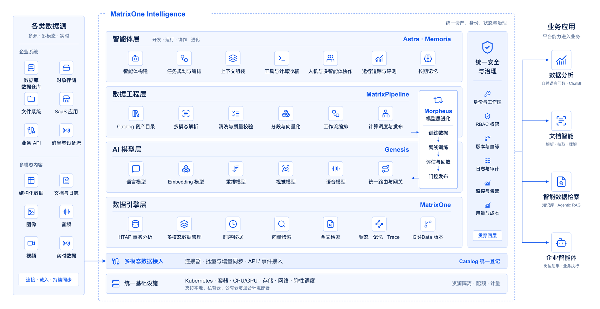

## 第二批公测，今日开放

我们很高兴地宣布，MatrixOne Intelligence（以下简称 MOI）5.0 今日正式开启**第二批公测**，仅面向 Waitlist 名单用户及受邀用户。从企业数据准备、模型调用到智能体构建，我们邀请您带着真实的业务需求，体验这次新增的文档与邮件直接读入能力。

关于本轮的资格，这里说明得具体一些：

**首批公测期间已经完成登记、尚未收到邀请的用户**，将在本轮收到邀请。

**首批已经激活的用户**，使用原账户即可进入，无需重新注册。

**尚未登记的用户**，欢迎加入 Waitlist 名单https://uc.moi.matrixorigin.cn/register完成登记。下一轮公测开放时，您会第一时间收到邀请，提前锁定体验资格。

## 解锁更多公测福利

**新激活的账户**：受邀客户完成注册并激活账户，即可获得价值相当于 100 元人民币的 1,000 Credit 体验额度。首批公测中已经领取的额度，继续留在原账户中，不会清零。

**所有已有客户**：配合本次第二批开放，我们将向每位账户送出 500 Credit，直接发放，无需额外操作。

平台各计费项以 Credit 计价，具体价格可在计费中心「产品定价」查看。

## MOI 是什么

如果您是第一次接触 MOI，这里用三句话说明：MOI 是一体化企业级 AI 基础设施平台，提供数据接入与处理、模型调用和智能体构建三部分能力。整理好的数据与知识，可以供智能体查询；已经配置好的算子和工作流，可以作为工具与技能继续用于后续任务。企业积累的数据、知识和处理方法，由此能够在不同应用场景里复用。

您可以从自己的需求出发，使用其中的能力：

**▸ 整理数据、构建知识库。** 接入文档、图片、音视频和业务表，完成解析、提取与加工，将分散的资料组织成可查询、可维护的数据与知识。

**▸ 通过 Genesis 调用模型。** 使用 Genesis 提供的模型 Token 服务，通过统一接口接入大模型，并集中管理调用密钥、用量与费用。

**▸ 结合知识和工具构建智能体。** 为智能体配置企业知识库、工具与技能，用于业务查询、数据分析和自动化任务处理。

## 比体验更进一步，把差异告诉我们

我们仍然希望知道，这次更新有没有帮您完成手头的任务。

数据没有读入、解析结果不对、模型调用不顺，或者智能体没有做出预期结果，都请从页面右侧的**「反馈」**入口告诉我们。操作上的困惑、功能上的建议，以及尚未被满足的业务需求，同样值得留下。

提交时请写明**您想完成什么、做了哪些操作，以及预期结果和实际结果的差异**。有截图也可以一并附上——这些信息能帮助我们更快定位问题。

每一条有效反馈，都是对 MOI 的一次帮助。200 Credit 是我们的感谢，也希望支持您继续体验。

## 顺便说一件事：MatrixNEXT 2026 正在报名

如果您正在把智能体从 Demo 推向真实业务，这场活动值得放进日程。[点击查看活动详情。](https://matrixorigin.cn/matrixnext)
