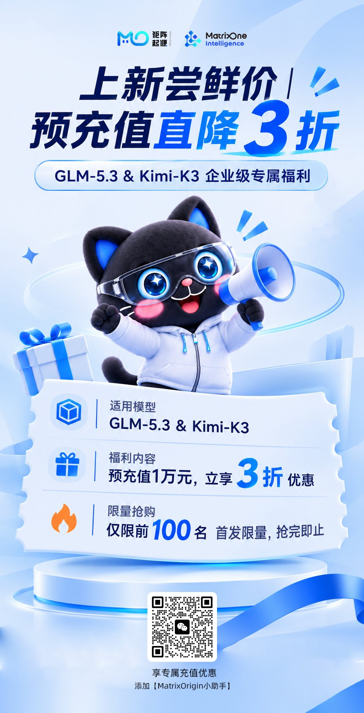

# 免费体验继续｜本周六 GLM 5.3、Kimi K3 再开放 6 小时

**上周没赶上，或还有任务没跑完？本周六，继续来。**

MOI 5.0 已正式开放公测，所有用户均可注册体验，无需等待邀请。

延续上周的免费体验活动，**本周六，MOI 中的 Genesis 将再次免费开放 GLM 5.3 和 Kimi K3 六小时，活动期间不设 token 用量上限。**

新朋友可以从第一个任务开始，老朋友也欢迎带着新的需求继续探索。

同期还有一项上新福利：**GLM-5.3 与 Kimi-K3 预充值 1 万元，立享 3 折**，首发限前 100 名，详情见第 03 部分。

## 01 本周六，免费六小时继续

**活动时间**  
本周六 10:24—16:24，北京时间

**参与对象**  
所有平台用户，无需邀请

**免费模型**  
GLM 5.3、Kimi K3

**活动权益**  
活动期间，上述两款模型 API 调用免费，不设 token 用量上限。

上周还没来得及体验的任务，这周可以接着做；已经完成初步测试，也可以换一份资料、增加一些步骤，看看模型在更完整的任务中表现如何。

*本次免费活动仅限 GLM 5.3 和 Kimi K3。高级模型、MiniMax 和 Seedance 不在免费范围内。*

## 02 这个周六，给搁置的想法一次运行机会

收藏的项目还没启动，想做的小工具一直没动手，开发环境配好了却只跑过一句“你好”——这个周六，可以选一个开始。

**做一个自己会用的小工具**

把零散的支出记录整理成报表，把常用资料做成问答助手，或给重复的工作写一个处理脚本。先缩小范围，争取在六小时内跑出第一个可用版本。

**让已有的应用多一种能力**

为现有产品加一个自然语言入口，让用户用一句话查询信息、生成内容或发起操作。从一个具体功能开始，试着把模型调用接进应用。

**把上次的尝试接着做完**

上周只完成了接口调用，这周可以补上业务逻辑；上次拿到了初步结果，这次可以加入更多输入，看看程序能否稳定运行。

**不用一次做完所有事。让一个想法跑起来，就是这个周六值得留下的成果。**

## 03 五项体验福利，继续保留

除了本周六的限时免费活动，MOI 的五项体验福利也继续开放。

**注册激活：即得 1,000 Credit**

首次注册并激活账户，即可获得 **1,000 Credit**，价值相当于人民币 **100 元**。

**提交有效反馈：获得 200 Credit**

通过页面右侧「反馈」入口提交问题，经判定有效后，获得 **200 Credit**。

**完成平台任务：累计可得 1,500 Credit**

完成平台指定任务，累计可获得 **1,500 Credit**。

**邀请好友：双方各得 500 Credit**

好友通过你的邀请链接注册并激活后，**你与好友各得 500 Credit，最多邀请 10 人**。

平台各计费项以 Credit 计价，具体价格可在计费中心「产品定价」查看。

**上新尝鲜价：预充值直降 3 折**

面向 GLM-5.3 与 Kimi-K3 的企业级专属福利。**预充值 1 万元，立享 3 折优惠**；首发限量**前 100 名**，抢完即止。

如需咨询或参与预充值活动，请添加 **MatrixOrigin 小助手** 进行沟通。

## 04 体验继续，也欢迎把结果告诉我们

模型调用是否顺畅？输出有没有满足任务要求？接入自己的应用和工作流时，遇到了哪些问题？

欢迎通过页面右侧的 **「反馈」** 入口，留下你的实际使用经历。提交时，请说明想完成的任务、操作步骤，以及预期结果与实际结果的差异；如有截图，也可以一并附上。

无论是一次成功的尝试，还是一个卡住的步骤，都能帮助我们了解 MOI 在真实场景中的表现。

---

**本周六 10:24—16:24，带上你的想法，继续体验 GLM 5.3 和 Kimi K3。**

**[立即进入 MOI](https://uc.moi.matrixorigin.cn/register)**
