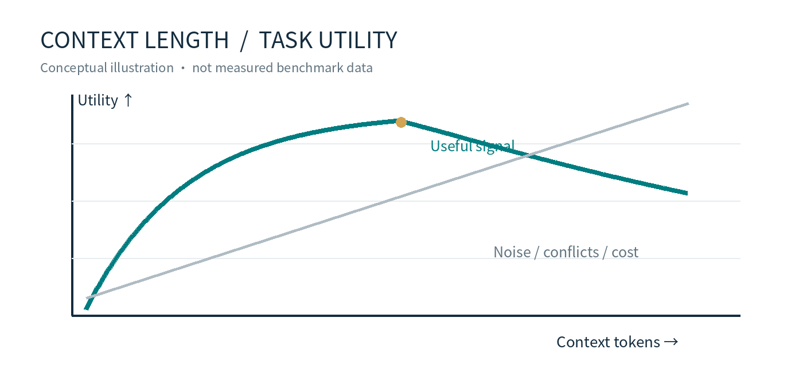
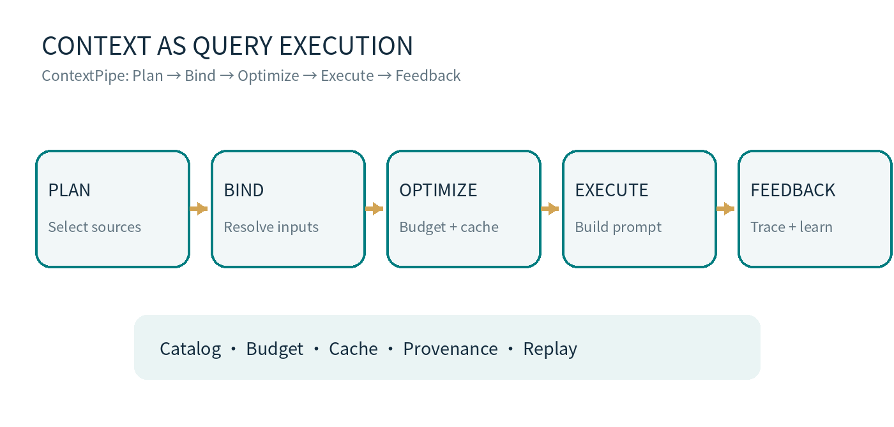
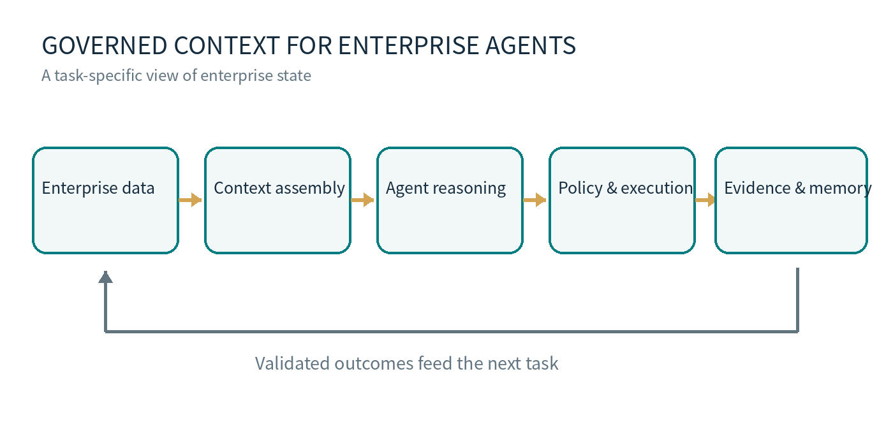

*The hidden systems problem behind long-context AI*

Imagine an enterprise procurement agent reviewing a supplier order. It has the contract, inventory reports, payment history, internal emails, and a risk register. The model supports a large context window. Nothing important appears to be missing.

The recommendation can still be wrong. The contract may have been superseded, the inventory figure may belong to yesterday’s snapshot, and the supplier’s risk status may have changed minutes ago. The model is reasoning over the information it was given. The harder question is whether the system assembled the right information in the first place.

## Context is the working set of an AI agent

Model weights carry learned capabilities. Context supplies the instructions, facts, state, and observations available for the task at hand. That distinction is a useful engineering shorthand, not a claim that models cannot use parametric knowledge or external tools.

For a long-running agent, context may include the current objective, permissions, tool schemas, retrieved documents, database results, prior decisions, and the latest tool outputs. Missing a critical piece can invalidate an otherwise coherent chain of reasoning.

But every additional token has a systems cost. And the ability to fit information into a context window says little about whether the model will use it reliably.

## The physics and failure modes of long context

### Compute and memory

In a standard Transformer with full self-attention, the attention component of prefill has O(n²) compute complexity in sequence length n. Conventional key-value cache storage grows approximately linearly with cached sequence length. These are component-level scaling relationships, not a prediction that the entire cost of an LLM request must grow quadratically. FlashAttention, grouped-query attention, sliding windows, prefix caching, hardware, and serving policies change the practical profile.

For agents, repeated processing matters as much as the size of any single prompt. A runtime that keeps appending tool outputs and resending history can pay repeatedly for information that has little value to the next decision.

### Position and attention

The widely cited Lost in the Middle study examined multi-document question answering and key-value retrieval. In the tested settings, models often performed better when relevant information appeared near the beginning or end of the input, with weaker results when it appeared in the middle. This is a measured tendency in specific tasks, not a universal law across every modern model.

Attention weights are computed from the input, but their effective behavior is shaped by training, position, architecture, and task structure. Document ordering and the distance between related facts can therefore affect results. The runtime cannot assume that dumping every retrieved passage into a prompt gives each passage an equal chance of being used correctly.

### Capacity versus usable context

Chroma’s 2025 Context Rot report evaluated 18 models and documented unstable performance as input length increased across several controlled tasks. A model that retrieves a single fact from a very long sequence may still struggle when it must reconcile conflicting evidence or carry constraints across many steps.

The advertised context window measures capacity. Effective context is a task-level property, best assessed through accuracy, consistency, latency, and cost on representative workloads.

Figure 1. Conceptual illustration, not a measured performance curve. More tokens can add useful evidence as well as noise and cost.

## Context assembly is becoming a systems discipline

An agent runtime has to decide what enters the next request, in which order, and at what level of detail. It must decide which observations can be summarized, which constraints must remain exact, when a source needs refreshing, and how to stay within a token and latency budget.

A retrieval score alone cannot make these decisions. Enterprise sources differ in authority, freshness, permissions, and consistency. A highly similar document can be outdated; a short database result can be decisive. This is why context assembly needs policies, statistics, and observable execution rather than an ever-growing prompt template.

## What database query processing can teach agent runtimes

MatrixOrigin’s ContextPipe research makes a concrete architectural proposal: treat context assembly as a process structurally similar to relational query execution. Its pipeline has five phases—Plan, Bind, Optimize, Execute, and Feedback—supported by a structured source catalog, a deterministic cache-aware optimizer, and an EXPLAIN ANALYZE-style trace.

Figure 2. ContextPipe’s five-phase assembly pipeline, redrawn from the research architecture.

This matters because prompt construction is usually difficult to inspect. The decision to include a tool result, compact a history segment, or preserve a cache-friendly prefix may be scattered across application code. A planned execution pipeline makes those decisions visible and, in principle, auditable and replayable.

In a preliminary evaluation on the Qutebrowser subset of SWE-bench Pro, ContextPipe reported 31% fewer total tokens, 23% fewer model calls, and 9% lower response time compared with an append-only context policy. Its KV-cache hit ratio was lower. These figures describe a particular baseline and workload; they are not general production performance guarantees.

The deeper point is methodological. Query optimizers have spent decades reasoning about source selection, execution order, caching, cost, and observability. Agent context assembly now faces recognizable versions of those problems.

## Enterprise context needs a consistent view of reality

Return to the procurement agent. If it approved an order at 10:00 a.m., an auditor needs to reconstruct the business state it saw: which contract version, which inventory snapshot, which supplier status, which permissions, and which tool responses. Saving the final prompt is useful, but insufficient on its own.

Snapshot consistency, provenance, temporal validity, versioning, and authorization are data-system concerns. MatrixOrigin’s Version Control System for Data with MatrixOne describes Git-like operations—clone, branch, diff, merge, and revert—built on immutable storage and MVCC. Such mechanisms can help manage and compare data states. They do not, by themselves, constitute a complete agent audit or reverse actions taken in external systems.

A practical definition follows: enterprise context is a governed, task-specific view of enterprise state. Similarity search helps locate information; business validity depends on more than similarity.

## Memory turns local errors into persistent risks

Context is assembled for a current task. Memory preserves information or experience that may be useful in future tasks. Memory can feed context, but the two should not be conflated.

An incorrect statement in one prompt may damage one decision. The same statement written into shared long-term memory can influence many agents and workflows. A successful tool execution does not automatically validate every generalization derived from it. Durable memory needs provenance, revision history, access controls, and ways to correct or retire information.

This is the problem space addressed by agent memory infrastructure such as Memoria. The technical questions are concrete: What gets retained? Who can read it? How is it verified? How are conflicting updates handled? Can a later decision be traced to the memory version that informed it?

Figure 3. Governed context connects enterprise data, reasoning, authorized execution, and verified feedback.

## The metric that matters is the cost of successful work

Token prices are visible. The cost of an enterprise agent is distributed across retrieval, context processing, model inference, tool calls, approvals, failed executions, and remediation. A cheap model call that creates an incorrect purchase order can be expensive in business terms.

Teams should measure task completion, factual and policy errors, human intervention, end-to-end latency, and cost per successful workflow—not token consumption in isolation. Context quality becomes economically meaningful when it improves those outcomes.

## A durable layer beneath changing models

Longer windows are valuable. They widen the range of evidence a model can inspect. They also increase the responsibility of the systems that select, version, authorize, and assemble that evidence.

MatrixOrigin’s research connects these layers: MatrixOne explores versioned data state; ContextPipe applies database-style planning to context assembly; Memoria addresses durable agent memory; and Astra addresses runtime execution. Their value ultimately has to be demonstrated on real enterprise tasks, with reproducible evidence and clear operating costs.

The most useful question is not how much an agent can read. It is whether the agent can act on the right facts, at the right time, under the right controls—and explain what happened afterward.

*Turning Enterprise Data into Enterprise Intelligence.*
