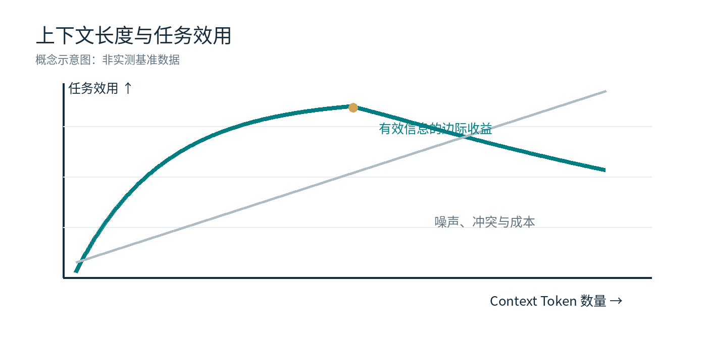
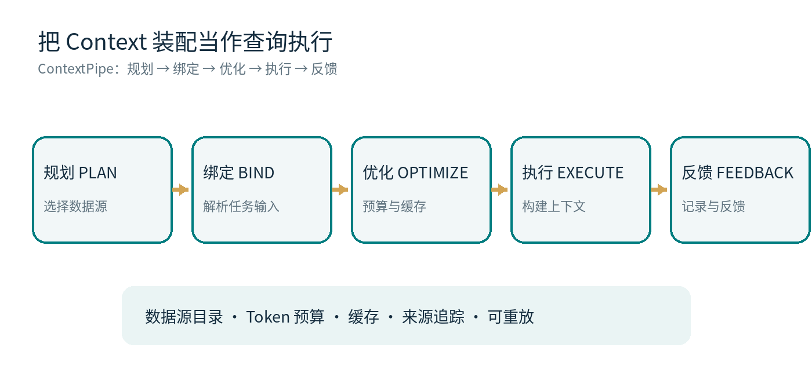
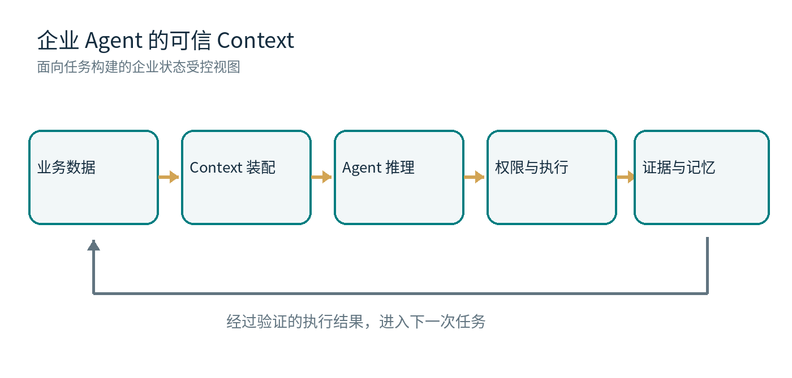

*长上下文的计算代价、注意力偏差与企业级 Context Engineering*

一个采购 Agent 正在审核一笔订单。它拿到了供应商合同、库存报表、历史邮件、付款记录和风险名单。资料齐全，模型也有足够长的 Context Window。它仍然可能给出错误建议：合同是旧版，库存来自昨天的快照，而供应商的风险状态在十分钟前刚刚改变。

这类错误不一定出在模型不会推理。模型处理的是被送入当前请求的信息。信息的版本、位置、相关性与可信度，都会影响最后的判断。给 Agent 更多材料很容易；让它在正确的时刻拿到正确材料，困难得多。

## 01｜Context 为什么重要

语言模型在预训练中形成语言、知识和推理能力；一次具体任务中的指令、事实、检索结果与工具输出，则通过 Context 进入推理过程。模型参数决定它具备哪些能力，Context 决定它在当前任务中能够利用哪些信息。这是工程上的简化表达：模型也可能依靠参数知识，Agent 也可能继续调用外部工具。

因此，Context 对 Agent 的作用接近运行时的工作集。用户要它处理的对象、当前系统状态、允许调用的工具以及最近一次操作的结果，都可能成为下一步决策的必要条件。缺少关键事实，推理再流畅也难以得到可靠结论。

但 Context 是有成本的。信息进入窗口，需要被编码、计算、缓存和反复读取；它占据预算，也会改变其他信息被模型利用的条件。

## 02｜长 Context 的代价，来自模型机制

### 计算与缓存：长度增加不是免费的

标准 Transformer 的 Full Self-Attention 会计算序列中 Token 之间的关联。在 Prefill 阶段，注意力部分的计算量随序列长度 n 呈 O(n²) 增长；常规 KV Cache 的存储需求则随缓存 Token 数近似线性增加。实际推理总成本并不严格等于 n²：FlashAttention、分组查询注意力、滑动窗口、前缀缓存和不同硬件实现都会改变瓶颈。

对长任务 Agent 而言，问题还在于重复。每次工具调用都可能追加新的观察结果；如果运行时反复发送大段历史，即使单次请求仍在窗口范围内，累计输入 Token、Prefill 时间和缓存管理成本也会变得可观。

### 位置偏差：重要信息放在哪里也有影响

Liu 等人的《Lost in the Middle》在多文档问答和键值检索任务中发现，相关信息位于上下文开头或结尾时，模型往往表现更好；落在中部时，表现可能明显下降。这个现象不能机械地套用到所有模型和任务，但它足以提醒系统设计者：把材料全部拼在一起，并不等于模型会均匀利用它们。

注意力机制会根据输入计算权重，权重分布却受训练、位置编码、序列结构和任务目标共同影响。关键约束放在一段很长的工具日志之后，可能与放在清晰的任务结构中产生不同效果。Context 的排序、分组和压缩因此是系统设计问题。

### 有效长度：能装下与能用好是两回事

Chroma 在 2025 年的《Context Rot》报告中评估了 18 个模型，观察到若干任务的表现会随输入长度变化而波动。一个模型通过长文本中寻找单个答案的测试，也不能保证它能稳定处理相互依赖、存在冲突的多条业务事实。标称窗口大小衡量输入容量；有效上下文长度要通过具体任务检验。

图 1｜概念示意：Context 增长带来信息，也可能引入噪声与成本；任务效用并非必然单调上升。

## 03｜Context Engineering 需要解决什么

一个企业 Agent 的 Context 可能包含系统指令、任务状态、业务数据库查询结果、检索片段、工具调用记录和跨会话记忆。它们的可信等级并不相同，更新频率也不相同。

系统需要决定哪些信息进入当前请求、以什么顺序呈现、何时重新获取、哪些历史可以压缩、哪些必须保留原文，以及如何在成本预算内维持任务所需的事实。检索召回率只是其中一项指标。

可以用一个概念性的优化目标来描述：在 Token 与延迟预算之内，选择使任务效用最高、同时降低错误和安全风险的 Context 集合。这里的“效用”不能只用语义相似度替代，还需要考虑业务时间、数据来源、权限和状态一致性。

## 04｜把 Context 装配当作数据库查询执行

MatrixOrigin 研究团队在《ContextPipe: Database-Inspired Context Assembly for Long-Horizon Agents》中提出了一个值得关注的方向：将散落在 Prompt Builder、历史压缩、缓存兼容逻辑中的 Context 装配过程，组织成可规划、可优化、可追踪的执行流水线。

ContextPipe 采用 Plan、Bind、Optimize、Execute、Feedback 五个阶段。数据源先被编目；系统再根据任务与运行时状态绑定输入，执行确定性的缓存感知优化，生成实际请求，并保留类似数据库 EXPLAIN ANALYZE 的执行追踪。设计目标包括可审计、可重放和故障隔离。

图 2｜ContextPipe 的五阶段装配流程（根据论文架构重新绘制）。

论文在 SWE-bench Pro 的 Qutebrowser 子集上进行了初步评估。相对简单追加历史的基线，报告的 Token 总量减少 31%，模型调用次数减少 23%，响应时间减少 9%；代价是 KV Cache 命中率下降。这些结果属于指定工作负载的早期实验，不意味着所有企业任务都能获得同样收益。

真正有价值的是方法论：Context 装配从难以观察的字符串操作，变成有输入、策略、代价和执行证据的系统过程。数据库系统几十年来处理的查询规划、缓存利用、资源预算和可解释执行，开始在 Agent Runtime 中找到对应问题。

## 05｜企业 Context 必须回答“当时发生了什么”

回到采购 Agent。它在上午十点建议下单，十分钟后供应商被标记为高风险。事后复盘时，只保存最终 Prompt 文本并不足够。企业还需要知道：模型查询了哪个数据源？读到的是哪个时间点的库存？使用的是哪一版合同？当时具有怎样的访问权限？工具执行后又改变了哪些业务状态？

这涉及数据库系统熟悉的 Snapshot、MVCC、Lineage、Versioning 与审计。MatrixOrigin 的《Version Control System for Data with MatrixOne》展示了利用不可变存储和多版本并发控制支持 Clone、Branch、Diff、Merge、Revert 等数据版本操作的研究路径。它为数据状态的比较、隔离实验与审查提供基础，但不能直接替代 Agent 层面的决策审计。

企业 Context 更适合被看作“在特定任务、时间和权限条件下构建的业务状态视图”。检索相似度决定不了合同是否有效；向量距离也不能证明库存读数与价格来自一致快照。这些问题需要数据系统和业务规则共同处理。

## 06｜Memory 会放大 Context 的好处，也会放大错误

Context 服务当前任务；Memory 保存可能被未来任务复用的信息、状态与经验。两者联系紧密，却不能混为一谈。一次成功操作产生的日志不一定值得长期保存；一次模型生成的总结也不应未经验证就升级为组织知识。

如果错误事实只进入一次 Context，影响可能局限于单次任务。如果它进入共享 Memory，之后被多个 Agent 重复调用，问题就可能跨任务扩散。来源、版本、有效期、纠错和撤销机制，因而是长期记忆系统的基本要求。

Memoria 可以从这里切入：让长期记忆具有可追踪、可更新和可治理的结构。是否能够自动验证某类记忆、如何处理并发冲突、哪些内容可以跨 Agent 共享，都需要具体实现与测试来回答。

图 3｜业务数据、Context 装配、推理、受控执行与记忆反馈的关系（概念架构）。

## 07｜企业最终衡量的是完成任务的成本

Token 单价容易计算，Agent 的真实成本却分布在整个工作流：检索与数据处理、长上下文推理、工具调用、人工审批、错误修复以及失败后的业务补救。一个 Token 用量很低、却频繁生成错误采购单的 Agent，并不经济。

因此，Context 的优化目标应当与业务任务绑定。除了 Token、延迟和缓存命中率，还需要观察任务成功率、人工接管率、错误率、数据时效性以及每次成功执行的端到端成本。模型可以更换，企业积累的业务数据、经过验证的经验和执行证据需要持续保留。

## 结语｜Context 的质量，最终由数据系统托底

长 Context 扩大了模型可以接触的信息范围，也把信息组织的责任推给了 Agent 系统。它必须知道何时读取、读取哪个版本、如何控制预算、如何解释一次决策，以及怎样把可靠的结果带到下一次任务。

MatrixOrigin 正在沿着这条路径推进：MatrixOne 研究数据版本与状态管理，ContextPipe 将数据库优化思想用于 Agent 的上下文装配，Memoria 关注长期记忆，Astra 关注执行运行时。这些能力仍需在真实企业负载中接受持续检验。

衡量一个企业 Agent 是否聪明，最终要看它能否在真实业务条件下，持续作出可靠、可解释且成本合理的行动。

*Turning Enterprise Data into Enterprise Intelligence.*
