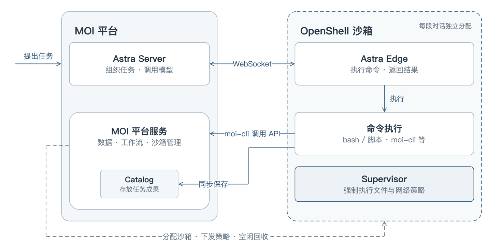
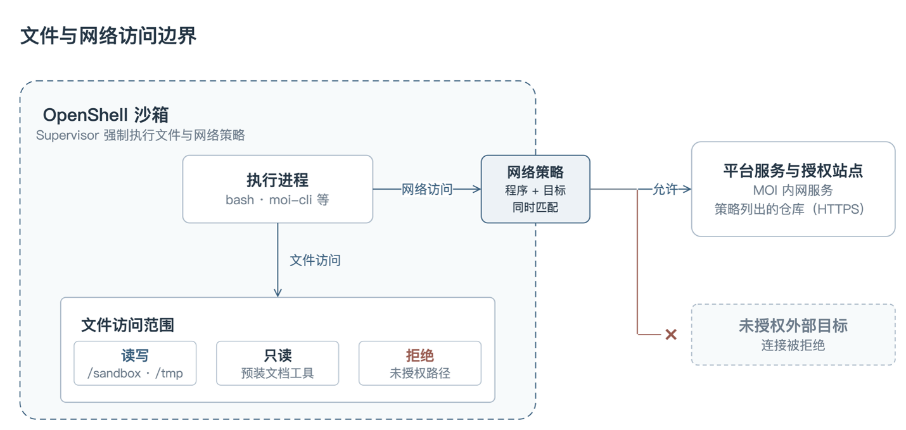

转自：https://blogs.nvidia.cn/blog/matrixorigin-openshell/

当 AI Agent 进入企业工作流执行更多的任务，智能体 AI 安全成为企业落地的关键。矩阵起源 (MatrixOrigin) 将 OpenShell 集成到其对话驱动的数据分析流程中，为每段对话分配独立沙箱，以最小必要权限约束 Agent 的文件读写与网络连接，在保留检索、分析和自动化能力的同时，降低数据越权访问与误操作的风险，构建更安全的企业数据 Agent 执行环境。

当 AI Agent 开始为企业查询数据、运行分析脚本、生成业务文档，它所需要的已不只是理解问题的能力，还有访问文件、执行代码和连接服务的权限。这些能力让 Agent 能够完成更多实际工作，也带来了新的挑战：如何在赋予 Agent 行动能力的同时，保护企业数据，并控制错误操作带来的风险和影响。

NVIDIA 近期发布的开放智能体安全平台为企业 AI Agent 提供从测试到部署全流程的安全保障。作为一个开放软件平台与参考系统设计，该平台旨在从智能体测试到部署的各个环节强化 AI 安全，并针对运行智能体的软件、硬件、计算和机器人系统，实施全栈治理与管控。

[NVIDIA 开放智能体安全平台](https://www.nvidia.cn/solutions/ai/agent-safety/) (NVIDIA Open Agent Safety Platform) 由 [NVIDIA OpenShell](https://www.nvidia.cn/ai/openshell/) 开源软件和 [NVIDIA Sentry](https://www.nvidia.cn/networking/products/software/sentry/) 参考系统设计组成。NVIDIA OpenShell 是面向 AI Agent 的开源、安全运行时，为需要执行代码、读写文件和访问网络的 Agent 提供受策略约束的沙箱环境。它通过文件系统隔离、网络访问控制等机制，在运行时落实权限边界，让安全约束独立于模型的任务决策生效。对于企业应用，这意味着可以在保留 Agent 必要执行能力的同时，限制其可访问的资源和可连接的目标，降低错误操作或越权访问带来的风险。

在 MatrixOne Intelligence (以下简称 MOI) 平台的实践中，矩阵起源团队将 NVIDIA OpenShell 引入 Agent 执行环境，通过独立沙箱、文件访问控制和网络访问策略，为对话驱动的数据任务建立运行时安全边界。这让企业能够在明确的权限约束下使用 Agent 开展检索、分析和自动化工作，降低数据被越界访问、意外修改或发送至未授权目标的风险。

## 企业数据 Agent 面临的落地挑战

MatrixOne Intelligence (MOI) 是一体化企业级 AI 基础设施平台，将企业数据、AI 服务、业务上下文、智能体运行、长期记忆与持续学习统一在一个平台中，为企业构建可信、可控、可审计并持续演进的生产级智能体。

以数据分析类任务为例，Agent 可能需要查询数据库、运行脚本处理结果，再生成可下载的报告。随着任务从“回答问题”延伸到“执行操作”，平台需要同时解决三个问题：

- 如何保护任务之外的数据和环境。Agent 需要必要的工作空间，但不应因此获得对其他文件和系统工具的任意读写权限。
- 如何控制数据流向。安装依赖、获取代码和调用内部服务都可能需要网络连接，但完成任务所需的连接，不应演变为不受限制的对外访问。
- 如何兼顾隔离与使用体验。不同对话需要独立的执行环境，同时，用户也不应为每次任务手动创建、维护和清理沙箱。

这些问题需要执行环境提供强制约束。即使 Agent 生成了超出授权范围的命令，平台也需要在实际操作发生时阻止它。

## 将 OpenShell 接入 Agent 执行链路

NVIDIA OpenShell 为 Agent 提供受策略约束的沙箱执行环境。在 MOI 中，平台负责管理沙箱生命周期并下发访问策略，Agent 运行时 Astra 负责组织任务和调用模型，命令则在沙箱内执行。

Astra 由决策与执行两部分组成。Astra Server 组装上下文、调用模型，并根据任务进展选择检索知识库、调用平台工具或执行命令；沙箱内的 Astra Edge 进程通过 WebSocket 接收命令，并返回执行结果。沙箱还预装了 MOI 命令行工具 moi-cli，用于调用数据库查询、SQL 执行和工作流等平台能力。

在这条执行链路中，OpenShell Supervisor 在沙箱内启动受限的 Agent 进程并协调策略执行。文件访问限制由 Landlock 等内核机制落实，网络出口则由沙箱内的代理和策略引擎根据调用程序、目标地址及相关规则进行判断。Agent 可以在授权范围内决定如何完成任务，但具体操作能否执行，最终由运行时策略决定。

_图 1：MOI 与 OpenShell 协作架构 (任务成果同步保存回平台)_

## 用最小必要权限降低数据与环境风险

_图 2：OpenShell 沙箱中的文件与网络访问边界_

## 限定文件读写范围，保护工作空间之外的资源

在 OpenShell 默认策略的基础上，MOI 为业务任务配置了明确的文件访问范围：Agent 在/sandbox/.moi 中处理任务，业务工作文件的写入限定在/sandbox 和临时目录/tmp；预装的文档处理工具设为只读，策略未授权的路径不可访问。文件系统策略在沙箱创建时确定，任务执行期间保持固定。

这些约束使 Agent 能够生成脚本、处理中间文件和输出报告，同时降低误读任务范围之外的资料、修改受保护工具的风险。即使生成的命令试图访问未授权路径，也会受到执行环境的限制，帮助控制错误操作的影响范围。

## 按程序与目标地址约束网络，减少非必要的数据出口

MOI 将内部服务访问与外部资源访问分别配置：内部工具经内网访问平台服务；git、pip、npm 等常用工具仅获准通过 HTTPS 连接策略列出的代码托管和软件包仓库等站点，其他未授权外部连接被拒绝。

这样的设计在保留依赖安装、代码获取等任务能力的同时，收紧了沙箱的网络出口。如果命令尝试连接未获授权的外部服务器，OpenShell 会阻止该连接，从而降低任务资料通过这些连接外传的风险。

网络访问策略控制的是连接权限。它需要与平台的数据授权机制配合，共同保护企业数据；对已获准访问的服务，仍需根据业务需要审慎配置权限。

## 以对话为单位隔离任务，让安全机制融入使用流程

MOI 为每段需要执行命令的对话分配独立沙箱，将执行环境绑定到当前对话。对话空闲达到设定时长后，平台销毁该沙箱，减少临时文件和运行时凭证长期驻留的机会，也降低不同对话共享执行环境带来的数据混用风险。

为了减少首次执行命令时的环境准备等待，MOI 预先创建一批空闲沙箱。当对话需要执行命令时，平台从池中分配沙箱，并自动补充空闲资源。沙箱的分配、回收和策略配置均由平台完成，用户可以直接围绕业务任务展开对话。

任务生成的文件会同步保存到 MOI 平台，沙箱回收后仍可下载。这使临时执行环境能够及时清理，同时保留用户需要的任务成果。

在这一设计中，OpenShell 提供沙箱及其策略执行能力，MOI 负责将这些能力组织成按需分配、自动回收的对话任务流程。安全隔离由平台统一落实，也减少了用户管理执行环境的负担。

## 为企业 Agent 建立可复用的安全执行基础

这项实践的价值，在于把文件访问、网络连接和任务隔离等要求，落实到 Agent 实际执行操作的环节：文件策略限制可读写范围，网络策略约束连接去向，独立沙箱与自动回收机制减少跨任务干扰和临时数据驻留。

对企业用户而言，这为 Agent 参与真实业务数据处理提供了更清晰的安全边界；对平台开发团队而言，OpenShell 提供了可集成的执行与策略机制，让团队能够在此基础上构建任务编排、数据工具和用户体验。

随着 Agent 承担更多企业工作，运行时安全将成为应用落地的重要基础。MOI 的实践展示了 NVIDIA OpenShell 在企业数据场景中的一种集成路径：将 Agent 的任务执行能力与明确的权限边界结合，让检索、分析和自动化任务在更安全、更易管理的环境中运行。

**客户引语**

“企业数据 Agent 要走进生产环境，安全是第一道门槛。NVIDIA OpenShell 的多层沙箱让 Agent 始终在最小权限下运行，使我们能够为企业客户构建既强大又可信的数据 Agent 执行环境。”

—— 矩阵起源 CTO 田丰
