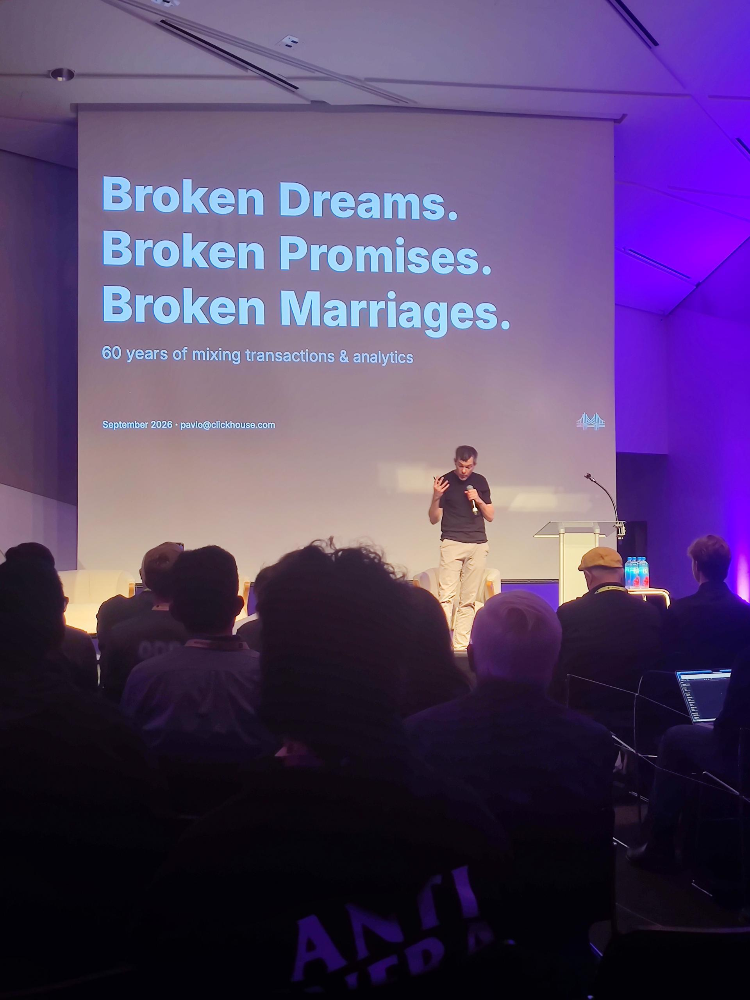
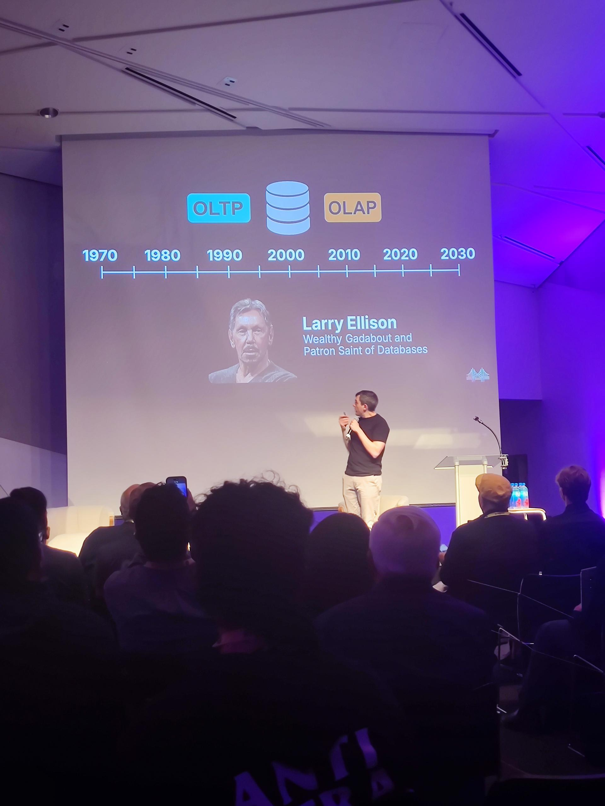
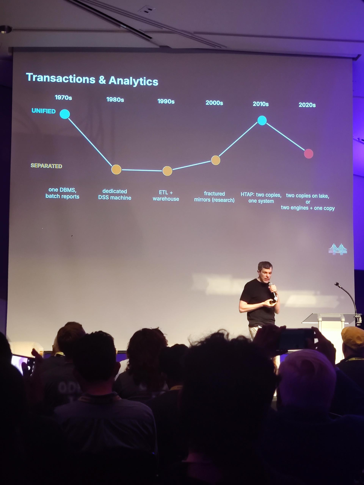
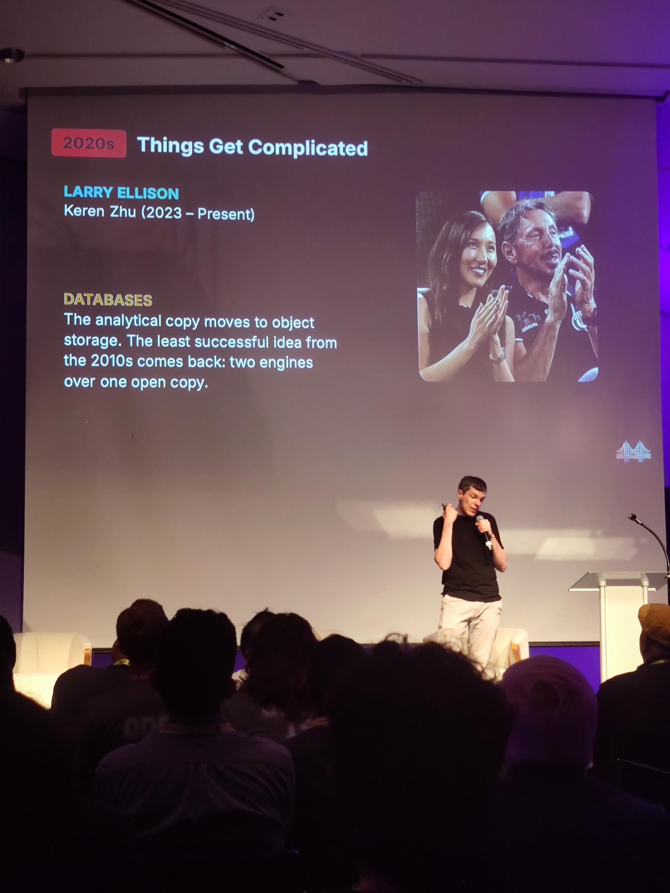
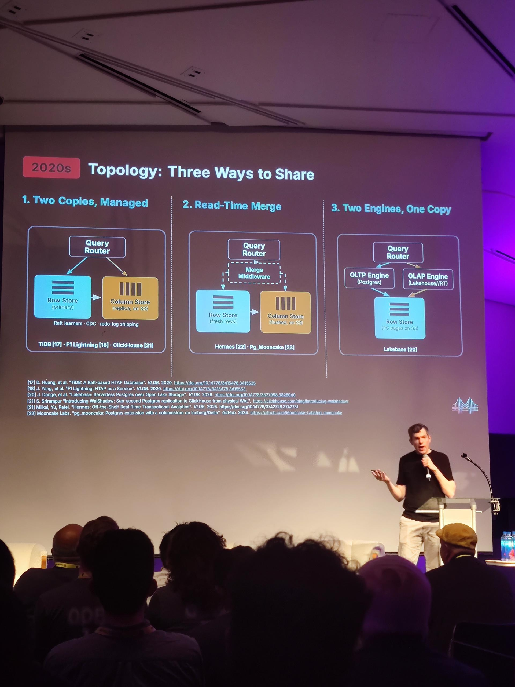
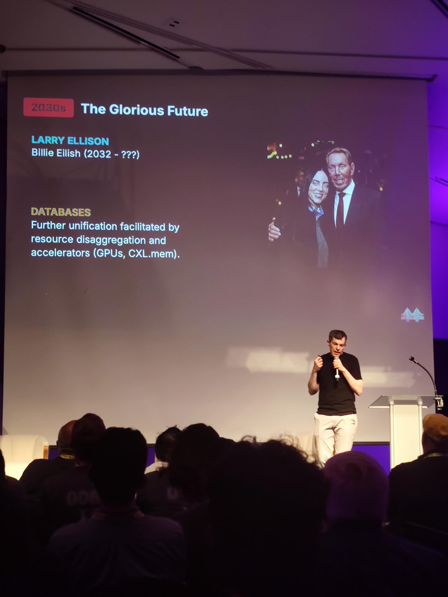

At this year's inaugural Rows & Columns Summit in San Francisco, held at the Contemporary Jewish Museum designed by architect Daniel Libeskind, one question dominated the agenda — a question backed by ClickHouse and organized by an independent community committee, and one that has puzzled the industry for half a century:

**OLTP and OLAP: together or apart?**

The Opening Keynote went to Andy Pavlo, then head of ClickHouse Labs — a CMU database professor and one of the most beloved evangelists in the database world. Sharing the stage were DuckDB founder Hannes Mühleisen and leading systems experts from Google, OpenAI, Snowflake, and Databricks. The agenda ranged from the interoperability-layer debates around Apache Iceberg all the way to OpenAI's governance of a 70,000-dataset corpus. In short, everyone with real authority over HTAP was in the room that day.

Andy Pavlo's talk was as witty as ever. Its title: "Broken Dreams. Broken Promises. Broken Marriages." — with the subtitle delivering the real subject: 60 years of "mixing" transactional and analytical workloads.

Andy Pavlo opening the Rows & Columns Summit

He opened with a running joke about Oracle founder Larry Ellison's several marriages, using him as a lens for a more serious topic: the "breakups and reunions" of database architecture over 60 years.

A 60-year architecture timeline with Larry Ellison as the recurring thread

But behind the jokes, the conclusion was sharp: **across 60 years and six generations of architecture, the industry kept patching things up — yet almost no one went back to first principles to design an HTAP product truly built for the future.**

## 1. Sixty Years: An Architecture History of "Long Divided, Must Unite; Long United, Must Divide"

The database industry follows a fascinating cycle: one system, or two?

Transactional and analytical workloads: the pendulum from "unified" to "separated" and back to "unified" again

**The 1970s**: There was just one database, and "analytics" was little more than batch reporting jobs.

**The 1980s–2000s**: OLTP and OLAP parted ways, each evolving into independent systems — dedicated decision-support machines, ETL plus data warehouses, and researchers' mirror replicas.

**The 2010s**: With the rise of cloud computing, HTAP (Hybrid Transactional/Analytical Processing) became the buzzword. Yet most HTAP systems actually maintained two copies of data internally — a row store for transactions and a column store for analytics — with systems differing markedly in data-consistency lag.

**The Data Lake Era**: As data volumes exploded, analytical replicas moved to object storage, and the model of "two engines sharing one copy of data" came back into favor.

The 2020s: the data lake era — "the least successful idea" makes a comeback

The only clear trend of the past few years has been: data moving to the cloud, and storage-compute separation. But the question of "one system or two" remains unanswered — after 60 years.

## 2. Today's Three Mainstream HTAP Architectures, Each with Its Own Compromise

In his talk, Andy summarized the HTAP topologies on the market today into three forms:

Three HTAP topologies: Two Copies Managed, Read-Time Merge, and Two Engines One Copy

**OLTP-first with OLAP as an add-on, maintaining two copies of data** (Two Copies, Managed): e.g., TiDB, Google F1 Lightning, ClickHouse;

**Transforming OLTP data into OLAP-optimized storage at read time** (Read-Time Merge): e.g., the Postgres extension pg_mooncake;

**Dual-engine designs built on data lakes** (Two Engines, One Copy): e.g., the Databricks Lakehouse.

Each approach has its trade-offs. But from MatrixOrigin's perspective — **whether you look at architectural scalability or ease of use, these designs are outdated for the large-scale Agent workloads that are coming, and they need to be reinvented.**

## 3. Why the Age of Agent Workloads Demands a New Architecture

The rise of AI Agents is reshaping the database workload profile: high-frequency, massive, heterogeneous, and machine-initiated. Database architectures designed for "humans" are visibly struggling under such workloads.

MatrixOne was designed starting in 2021, and it took a different path from day one:

**One Engine + One Copy**: a single engine with a single copy of data, handling transactions and analytics within one architecture — eliminating the two-copy consistency problem at its root;

**Natively built for Agent workloads**: designed for this new class of workloads in terms of data consistency, scalability, and heterogeneous computing (GPU acceleration);

**Data Branching**: built on its existing architecture to support git4data-style data branching operations — making data branchable and version-controlled, just like code.

## 4. Beyond the Database

Looking ahead, MatrixOne will continue to expand its capabilities, delivering high-performance, reliable, stable, and secure data services for enterprise customers.

At the end of his talk, Andy offered a prediction: in the 2030s, databases will move toward further unification, driven by resource disaggregation and accelerators (GPUs, CXL memory).

The 2030s, "The Glorious Future": further unification driven by resource disaggregation and GPU acceleration

This aligns strikingly with MatrixOne's roadmap — heterogeneous computing and GPU acceleration are native capabilities of the MatrixOne architecture.

**One more thing**: on top of the MatrixOne data foundation, MatrixOrigin's MatrixOne Intelligence platform fully supports Agent workflows, helping enterprises accelerate their AI transformation and boost productivity.

**Sixty years of breakups and reunions — and the next convergence may well begin with One Engine.**
