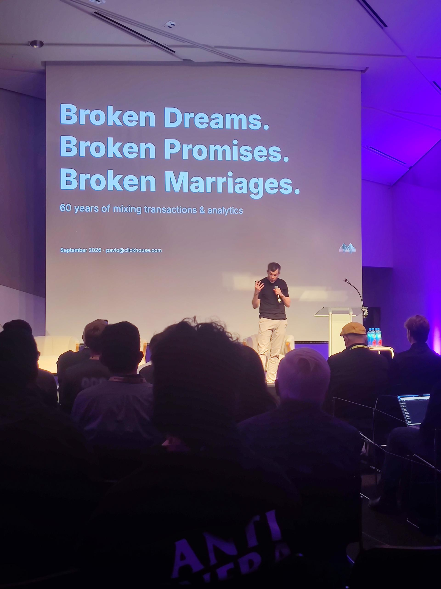
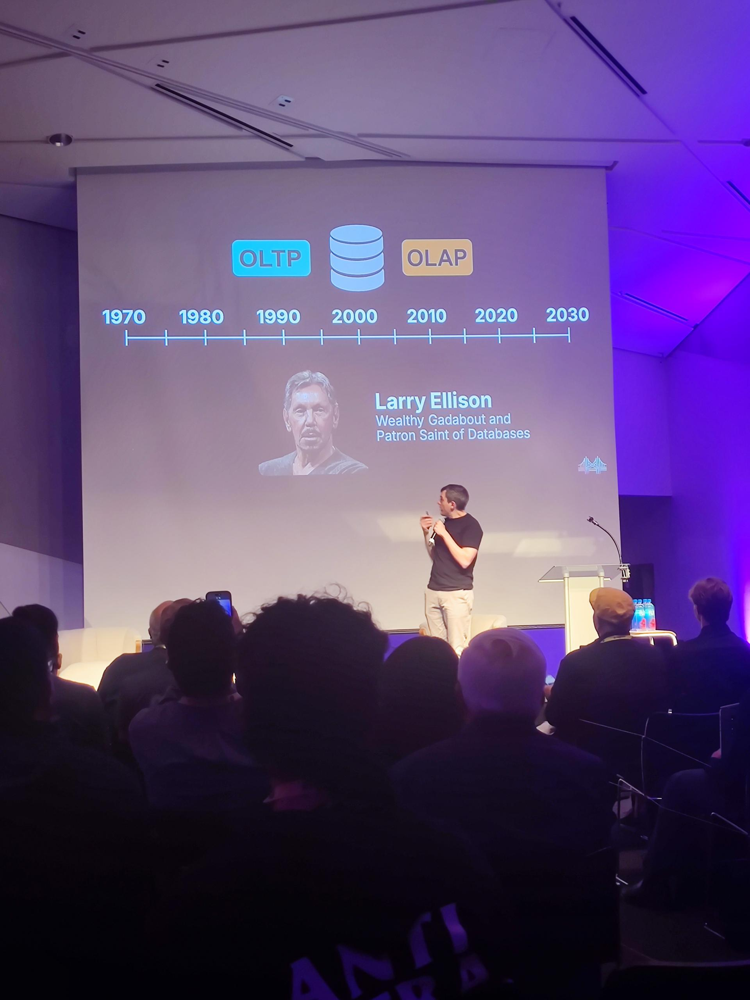
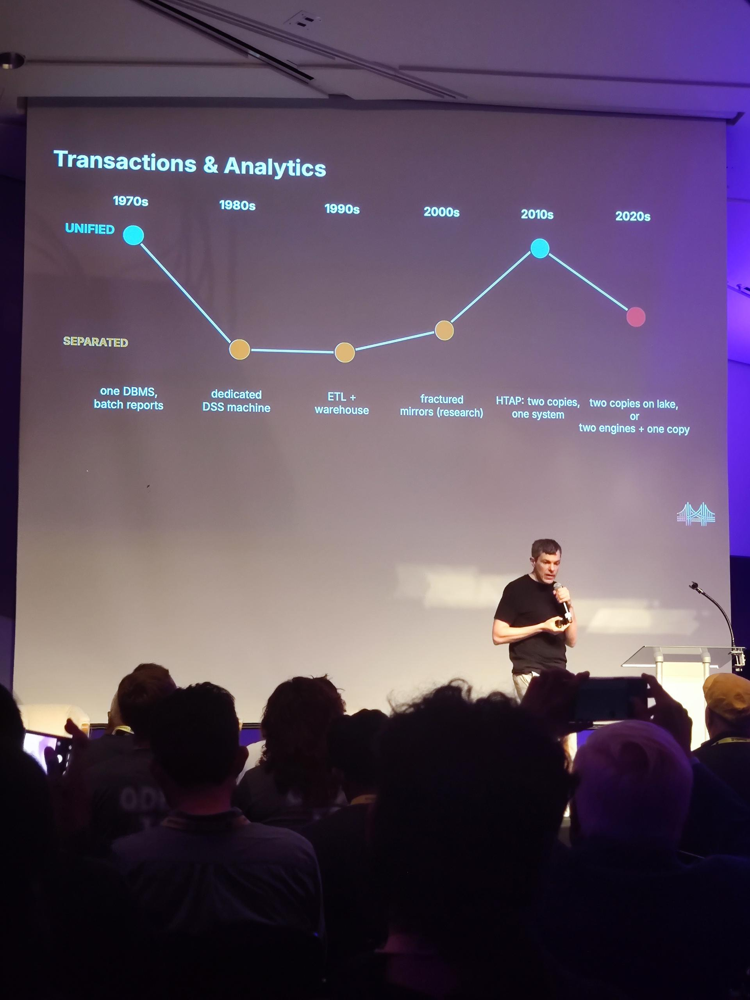
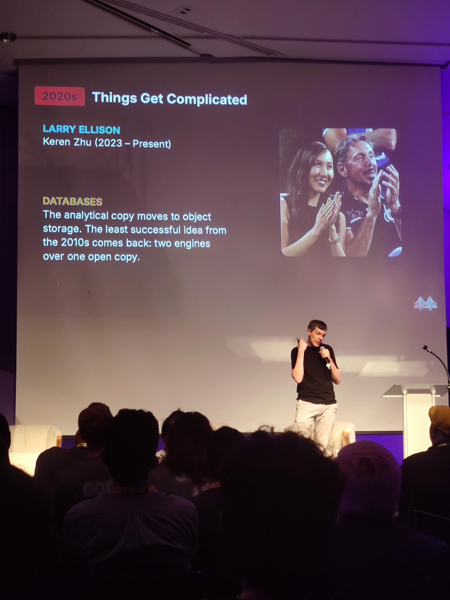
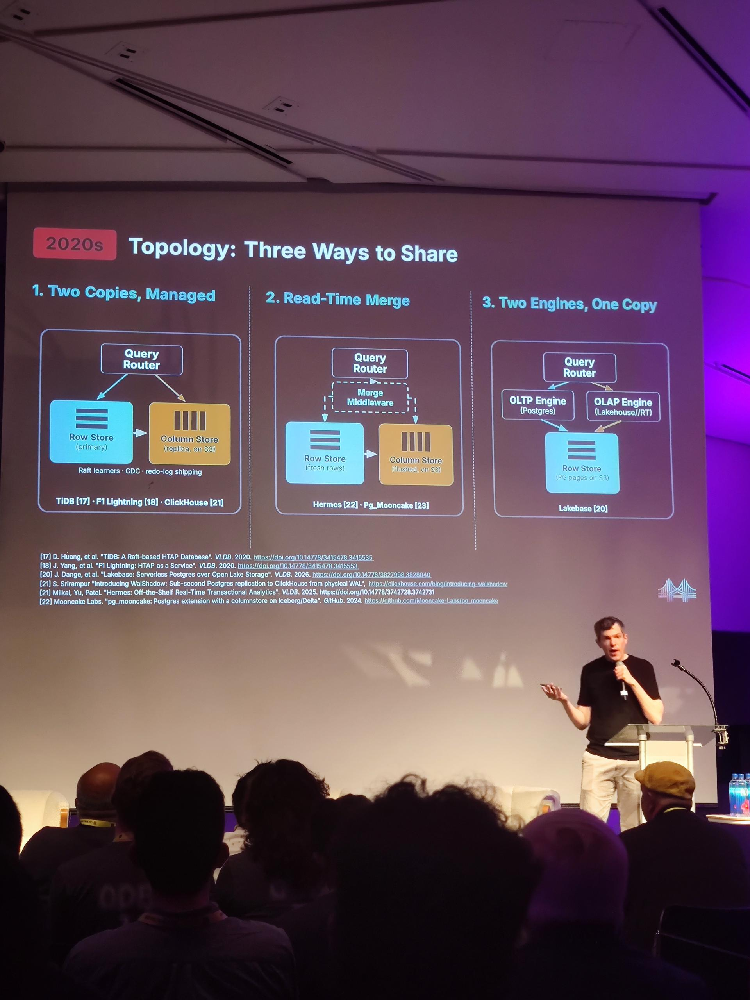
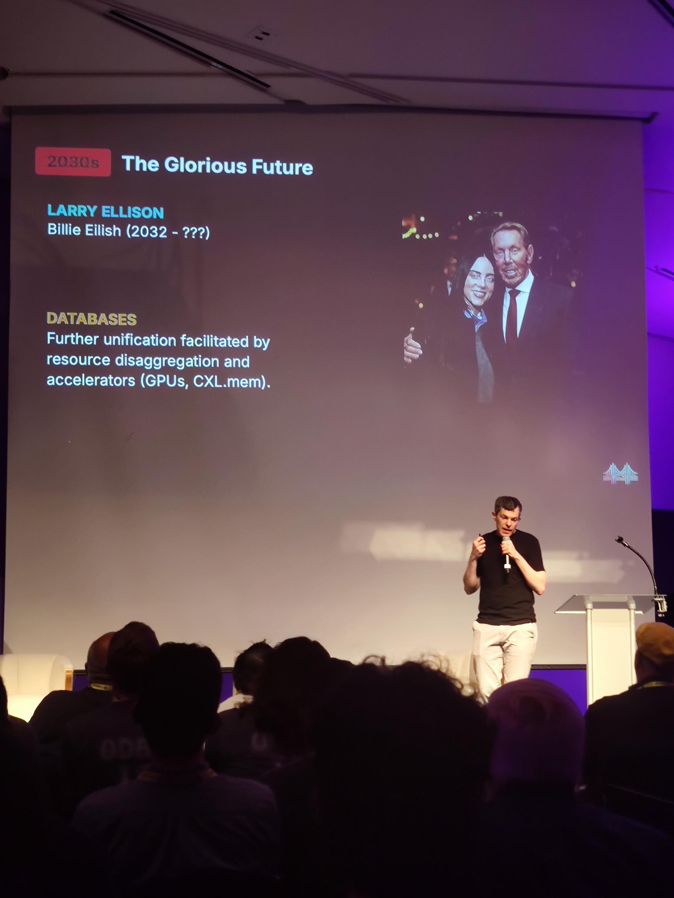

今年在旧金山举行的首届 Rows & Columns Summit，落址于建筑大师 Daniel Libeskind 设计的 Contemporary Jewish Museum，这场由 ClickHouse 支持、独立社区委员会组织的峰会，主题只有一个困扰行业半个世纪的问题：

**OLTP 与 OLAP，到底合还是分？**

Opening Keynote 交给时任 ClickHouse Labs 负责人 Andy Pavlo——CMU 数据库教授、数据库行业最受欢迎的布道者之一。同台的还有 DuckDB 创始人 Hannes Mühleisen、Google、OpenAI、Snowflake、Databricks 的一线系统专家，议程从 Apache Iceberg 的互操作层之争一直聊到 OpenAI 的 7 万数据集治理。可以说，HTAP 领域最有发言权的人，那一天都在现场。

Andy Pavlo 的演讲依旧风趣幽默，其标题是「Broken Dreams. Broken Promises. Broken Marriages.（破碎的梦想、破碎的承诺、破碎的婚姻）」，副标题则是正题：60 年事务与分析负载的「混搭」史。

Andy Pavlo 在 Rows & Columns Summit 现场开场

他以 Oracle 创始人 Larry Ellison 的数段婚姻为引子，讲了一个更有意思的话题：数据库架构 60 年来的「分分合合」。

以 Larry Ellison 为「线索人物」的 60 年架构时间轴

玩笑归玩笑，结论却相当犀利：**60 年 6 代架构，大家一直在修修补补，却很少有人从第一性原理出发，重新设计一款面向未来的 HTAP 产品。**

## 一、60 年，一部「合久必分、分久必合」的架构史

数据库行业有一个有趣的周期律：一套系统，还是两套系统？

事务与分析负载：从「一体化」到「分离」再到「回归一体化」的钟摆曲线

**70 年代**：只有一个数据库，所谓「分析」不过是批量的汇报任务。

**80–00 年代**：事务（OLTP）与分析（OLAP）分道扬镳，各自演化成独立的系统——专用决策支持机、ETL + 数据仓库、研究界的镜像副本。

**2010 年代**：云计算兴起，HTAP（混合事务分析处理）成为热词。但大多数 HTAP 系统内部其实维护着两份数据——面向事务的行存 + 面向分析的列存，不同系统在数据一致性延迟上差异明显。

**数据湖时代**：随着数据规模暴涨，分析副本迁往对象存储，「两套引擎共享一份数据」的模式又回来了。

2020s：数据湖时代，「最少成功的想法」卷土重来

过去几年唯一明确的趋势是：数据上云，存算分离。但采用「一套还是两套」系统的问题，60 年了，依然悬而未决。

## 二、当下三种主流 HTAP 架构，各有各的将就

Andy 在演讲中把目前市场上的 HTAP 拓扑归纳为三种形态：

三种 HTAP 拓扑：托管双副本、读取时合并、双引擎共享一份数据

**OLTP 为主、OLAP 为辅，维护两份数据**（Two Copies, Managed）：如 TiDB、Google F1 Lightning、ClickHouse；

**读取时将 OLTP 数据转化为 OLAP 优化存储**（Read-Time Merge）：如 Postgres 插件 pg_mooncake；

**基于数据湖的双引擎方案**（Two Engines, One Copy）：如 Databricks Lakehouse。

这些方案各有优劣，但在矩阵起源看来——**无论从架构扩展性还是易用性看，面对即将到来的大规模 Agent 负载，它们都是过时的设计，需要被重新发明（reinvent）。**

## 三、Agent 负载时代，为什么需要新的架构？

AI Agent 的崛起正在改变数据库的负载画像：高频、海量、异构、机器发起。传统为「人」设计的数据库架构，在这样的负载面前正在显出疲态。

MatrixOne 于 2021 年开始设计研发，从第一天起就选择了不同的路线：

**One Engine + One Copy**：一个引擎、一份数据，事务与分析在同一架构内完成，从根上消除双份数据的一致性难题；

**天然适配 Agent 负载**：在数据一致性、扩展性、异构计算（GPU 加速）等方面为新型负载而生；

**Data Branching 能力**：基于现有架构支持 git4data 等数据分支操作，让数据像代码一样可分支、可版本管理。

## 四、不止于数据库

展望未来，MatrixOne 将持续扩展新功能，为企业客户提供高性能、可靠、稳定、安全的数据服务。

Andy 在演讲结尾也给了一个预言：2030 年代，数据库将进一步走向统一，而推动力正是资源解耦与加速器（GPU、CXL 内存）。

2030s「The Glorious Future」：资源解耦与 GPU 加速驱动的进一步统一

这与 MatrixOne 的路线不谋而合——异构计算与 GPU 加速，正是 MatrixOne 架构的原生能力。

**One more thing**：依托 MatrixOne 数据底座，矩阵起源的 MatrixOne Intelligence 平台全面支持 Agent 工作流，为企业 AI 转型与生产力提升提供助力。

**60 年分分合合，下一次合流，也许正是从 One Engine 重新开始。**
