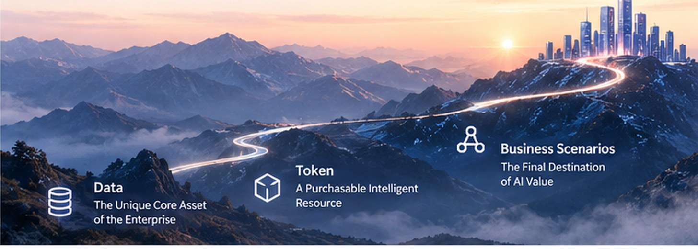
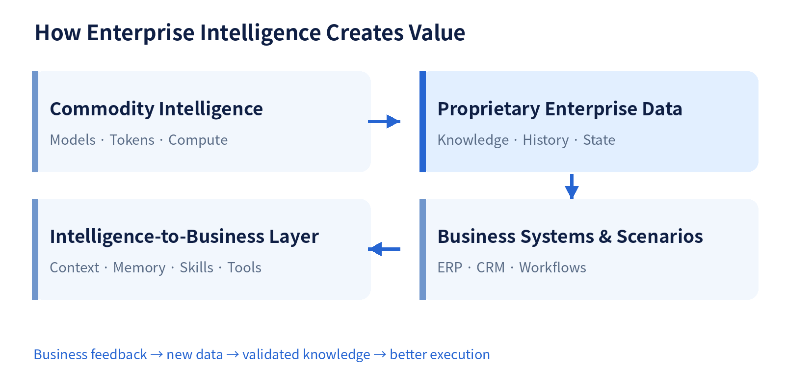

*From Data and Tokens to Business-System Reinvention: Rethinking the Long-Term Value of Enterprise AI*

**Control Your Data, Trust Your AI.  →  Turning Enterprise Data into Enterprise Intelligence.**

The enterprise AI conversation has moved rapidly—from chatbots and copilots to agents and digital workers that participate in real business processes.

As models, compute, and tokens become easier to acquire, what can enterprises truly own and compound? The answer begins with proprietary data—and how it is connected to real business execution.

## 01  AI Is Reshaping How Enterprises Produce Value

For decades, databases, ERP, CRM, and enterprise applications have digitized business processes. Software executes predefined rules; people interpret information, make judgments, and move work forward.

AI agents are beginning to change that division of labor. Procurement agents can analyze demand and inventory; finance agents can investigate anomalies; industrial operations agents can interpret logs and historical incidents. Tasks once dependent on human cognition can increasingly involve intelligent systems.

This is a shift in how work is organized. Enterprises must reconsider task allocation, resource investment, risk controls, and how to measure the business value of intelligence.

## 02  Tokens Can Be Bought. Proprietary Enterprise Data Cannot Be Easily Replicated.

Enterprises can access increasingly capable general-purpose intelligence through cloud services, commercial APIs, and open models. Tokens are a unit of model processing and a common metric for AI consumption. Competition and inference efficiency are pushing general-purpose capabilities toward commoditization.

Yet the same model and similar token spend do not produce the same business outcomes. Manufacturing process data, equipment histories, risk policies, and institutional decisions reflect years of actual operations. They cannot simply be recreated by buying more tokens.

Data alone is not automatically a moat. The durable advantage is an enterprise’s ability to continuously produce, govern, organize, and apply proprietary data.

**Enterprises buy tokens to run intelligence. They build lasting intelligence through data.**

## 03  From Information Asset to Intelligence Asset

In the information era, data recorded transactions and supported reporting and decisions. In the intelligence era, it also participates directly in reasoning, planning, and execution—and receives the results of that execution.

Context supplies relevant and timely information for the current task. Memory preserves useful history and validated experience. Skills package repeatable working methods. Tools connect agents to databases, APIs, and business applications.

These concepts are distinct. Skills do not automatically emerge from raw data; they often require expert design, engineering, testing, and governance.

Agent execution generates new records, state changes, and feedback. Once validated, these can improve future context, memory, and skills—creating a compounding cycle between enterprise data and intelligence.

Figure 1. How enterprise data, general intelligence, and execution reinforce one another

## 04  Connecting Probabilistic Intelligence to Deterministic Business Systems

Real enterprise operations rely on mature, largely deterministic systems. ERP, CRM, finance, and production applications enforce schemas, permissions, approvals, transaction boundaries, and business rules. AI agents excel at interpreting ambiguous requests and reasoning over complex information, but their judgments are probabilistic.

Making these two paradigms work together is a central enterprise AI architecture challenge.

Consider procurement. An agent proposes replenishment based on demand, inventory, and supplier performance. Deterministic software validates budget and policy constraints. Humans approve exceptional transactions. The ERP system issues the order under established authorization and transaction controls.

Use deterministic code where rules are clear and execution must be reliable; use model reasoning where ambiguity, unstructured information, and exceptions justify its cost. This division of labor improves both reliability and economics.

## 05  Rethinking Investment and Operations Around Data, Tokens, and Business Scenarios

Data is the basis of differentiation and long-term accumulation. Investment must cover integration, quality, governance, versioning, permissions, and agent-ready context and memory.

Tokens are an intelligence resource to optimize. The right metric is total cost per successful business task—not simply the cheapest token. Retries, tool calls, human review, maintenance, and risk handling all matter.

Business scenarios are where value is realized. Completion rates, cycle times, error rates, human workload, risk, and customer experience tell a more meaningful ROI story than model benchmarks alone.

Enterprises must therefore design the division of labor among models, deterministic software, and people around end-to-end business outcomes.

## 06  Operating Digital Workers Requires Governance

As organizations deploy more digital workers, identity, authorization, cost, task state, and execution quality become ongoing operational concerns.

Governance must answer three questions: What may an agent do? What did it actually do? What did it change? These map to authorization, evidence, and business-state impact.

Database transactions and versions can help manage data changes, but they cannot automatically undo an email already sent, a payment already executed, or every action in an external system. High-impact workflows still need approvals, audit trails, isolation, compensation procedures, and human oversight.

## 07  Where Does the Value of AI Ultimately Accumulate?

If an agent only consumes tokens and completes a one-off task, the enterprise gains immediate productivity. If validated feedback, incident knowledge, and repeatable methods become durable data, memory, and skills, each investment can also improve future performance.

Not every output should be retained. Errors, stale knowledge, and unverified inferences must be filtered, corrected, or retired. Provenance, versions, permissions, validity, and evaluation matter.

Long-term advantage comes from making each useful execution an opportunity to improve the next one.

## 08  From “Control Your Data, Trust Your AI” to Enterprise Intelligence

In 2025, MatrixOrigin articulated a foundational belief: “Control Your Data, Trust Your AI.” Enterprises need control over their data and reliable governance before they can trust AI in real operations.

As agents and digital workers enter production, the scope of data management expands to context, memory, execution records, and business feedback. Requirements extend beyond analytics into runtime execution, tool coordination, and integration with enterprise workflows.

MatrixOne focuses on enterprise data management and versioning. MatrixOne Intelligence connects data and AI applications. Memoria explores long-term agent memory. Astra addresses agent runtime and execution. Together, these directions support a larger ambition: Turning Enterprise Data into Enterprise Intelligence.

The goal is to combine accessible general-purpose intelligence with proprietary enterprise data, knowledge, and business systems—and make the resulting capability durable.

## 09  Invest in the Ability to Produce Intelligence Continuously

Models will improve, token efficiency will rise, and agent frameworks will evolve. Enterprises need not anchor their long-term advantage to a single generation of models.

The enduring investments are proprietary data, business knowledge, validated working methods, and infrastructure that connects probabilistic intelligence to deterministic operations safely and efficiently.

As intelligence becomes easier to acquire, the defining question is what an enterprise can create with it—and whether that value compounds into capabilities it truly owns.

**Turn enterprise data into enterprise intelligence.**

MatrixOrigin  |  Enterprise AI Infrastructure
