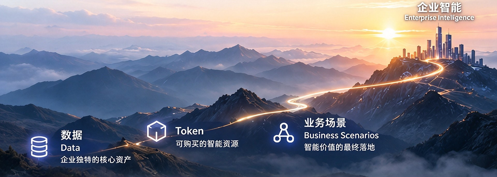
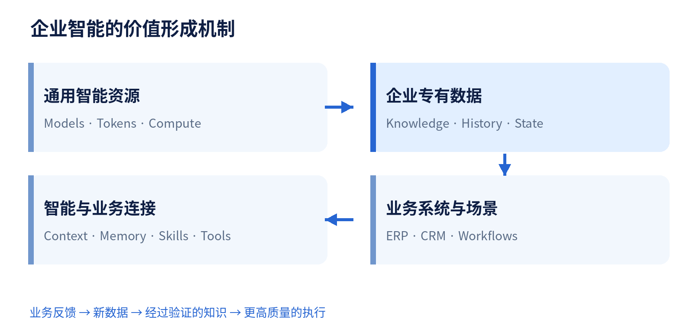

*从数据、Token 到业务系统重构，重新理解企业 AI 的长期价值*

**Control Your Data, Trust Your AI.  →  Turning Enterprise Data into Enterprise Intelligence.**

过去两年，企业对人工智能的讨论发生了明显变化。从大模型问答、AI Copilot 到 AI Agent 和数字员工，智能系统正逐步进入真实业务流程。

当模型、算力和 Token 越来越容易获得，企业真正能够长期积累的竞争优势是什么？答案首先要回到企业自己的数据，以及数据如何与业务系统协同创造价值。

## 01  AI 带来的是生产方式的革命

过去几十年，企业通过数据库、ERP、CRM 和各类业务软件，将经营流程逐步数字化。软件按照预先设计的规则执行，人负责理解信息、作出判断并推动流程。

AI Agent 正在改变这种分工。采购 Agent 可以分析需求与库存，财务 Agent 可以核对异常交易，工业运维 Agent 可以结合日志和历史案例提出处置建议。越来越多过去依赖人工认知的任务，开始能够由智能系统参与完成。

这是一种生产方式的变化。企业需要重新考虑工作如何分配、资源如何投入、风险如何控制，以及每项智能投入究竟创造了什么业务价值。

## 02  Token 可以购买，企业独有的数据无法简单复制

企业今天可以通过云服务、商业 API 和开放模型获取越来越强的通用智能。Token 成为模型处理信息的重要计量单位，也是许多 AI 服务的成本指标。随着模型竞争与推理效率提升，通用智能正在呈现商品化趋势。

但是，相同模型与相近 Token 消耗，并不会带来相同的企业价值。一家制造企业积累的工艺参数、设备记录和故障经验，一家金融机构拥有的风险规则与历史决策，都来自长期的真实经营，无法简单地通过购买 Token 复制。

数据本身也不天然构成壁垒。真正重要的是企业持续产生、治理、组织并利用专有数据的能力。

**企业购买 Token 来运行智能，通过 Data 来积累智能。**

## 03  数据正在从信息资产，变成智能生产的核心资产

信息时代，数据主要用于记录业务、查询分析和支持决策。智能时代，数据开始直接参与推理、规划与执行，并承接执行产生的新知识。

Context 为当前任务提供相关、准确和及时的信息；Memory 让 Agent 能够利用长期历史和经过验证的经验；Skills 将可复用的工作方法工程化；Tools 则连接数据库、API 和企业系统，执行具体动作。

这些能力不能混为一谈，也不会自动从原始数据中生成。尤其是 Skills，需要结合专家知识、业务规则和测试验证。

Agent 每次工作都会产生新的执行记录、业务状态和反馈。经过验证的结果，可以进一步改善 Context、Memory 与 Skills，形成数据与智能相互促进的循环。

图 1  企业数据、通用智能与业务执行的价值循环

## 04  让概率性智能进入确定性的业务世界

企业真实业务建立在大量成熟的确定性软件之上。ERP、CRM、财务与生产系统有明确的数据结构、权限、审批、事务与业务约束。AI Agent 则擅长处理模糊意图、复杂信息与开放式推理，其判断存在概率性。

两者如何协同，是企业 AI 进入生产环境的关键架构问题。

以采购为例：Agent 可以根据需求、库存和供应商表现提出补货建议；确定性程序校验预算、资质和采购规则；超额操作交由人工审批；ERP 在授权和事务约束下创建正式订单。

在规则清晰的环节，应发挥确定性软件的可靠性与成本优势；在需要复杂理解和例外处理的环节，才让模型承担更高价值的推理。这样才能避免用昂贵且不稳定的推理替代本已高效的业务逻辑。

## 05  围绕 Data、Token 与 Business Scenarios 重构投资和运营

Data 是差异化与长期积累的基础。企业需要投入数据治理、集成、质量、版本、权限以及面向 Agent 的 Context 和 Memory 能力。

Token 代表需要优化的智能资源消耗。企业应衡量任务的整体完成成本，而非只比较单次调用或单 Token 的价格。失败重试、工具调用、人工复核与运维同样构成成本。

Business Scenarios 是价值实现与检验的场所。任务完成率、业务周期、错误率、人工工作量、风险和客户体验，比孤立的模型指标更能反映 AI 的投资回报。

因此，企业需要重新设计模型、确定性程序与人的分工，优化完整业务流程的投入产出。

## 06  数字员工越多，越需要可信的执行与治理

当企业运行越来越多数字员工，身份、权限、成本、任务状态和执行质量就必须成为持续运营的对象。

治理需要回答三个问题：Agent 被允许做什么？Agent 实际做了什么？Agent 最终改变了什么？这分别对应授权边界、执行证据和业务状态影响。

数据库事务与版本机制可以帮助管理数据变化，但不能自动撤销已经发出的邮件、付款或外部系统操作。高风险任务仍然需要审批、审计、隔离、补偿流程和必要的人工控制。

## 07  AI 的价值最终沉淀在哪里？

如果 Agent 每次执行只消耗 Token、完成一次性任务，企业得到的主要是即时效率提升。若能将经过验证的业务反馈、故障经验和成熟方法持续沉淀为数据、Memory 与 Skills，每次投入就可能为未来的智能生产留下资产。

不是所有输出都值得保存。错误信息、过时知识和未经验证的推断需要被过滤、纠正和淘汰。企业需要管理知识来源、版本、权限、有效性与持续评估。

长期竞争优势，来自让每一次有效的 AI 执行，都有机会成为下一次智能改进的基础。

## 08  从 Control Your Data, Trust Your AI 到 Enterprise Intelligence

2025 年，MatrixOrigin 提出“Control Your Data, Trust Your AI.” 企业掌握自己的数据，建立可靠的治理与控制机制，才能在真实业务中信任 AI。

随着 AI Agent 与数字员工进入生产环境，数据管理的对象正在扩展到 Context、Memory、执行记录和业务反馈；企业的技术需求也从数据分析走向智能体运行、工具协同和真实业务执行。

MatrixOne 面向企业数据管理与版本化；MatrixOne Intelligence 关注数据与 AI 应用的结合；Memoria 探索 Agent 长期记忆；Astra 面向 Agent 运行与执行。它们共同指向一个长期方向：Turning Enterprise Data into Enterprise Intelligence。

从企业数据，到企业智能。企业需要将可购买的通用智能与独有的数据、知识和业务系统连接起来，建立可以持续积累的智能能力。

## 09  企业真正需要投资的，是持续生产智能的能力

模型会进步，Token 的使用效率会提升，Agent 框架也会演进。企业不必将长期竞争力绑定在某一代模型上。

更值得长期建设的是数据资产、业务知识、成熟工作方法，以及让概率性智能与确定性业务系统可靠协同的基础设施。

当通用智能越来越容易获得，真正重要的是企业能够用它创造什么，以及这些创造能否沉淀为自己的长期能力。

**让企业的数据，成为企业自己的智能。**
